# Literature review: LLMs that sense, think and act in realtime

Research date: 10 November 2026.

This is a literature review for a GStar Bootcamp 2026 team project. The project's goal is large language models (LLMs) that can sense, think and act in realtime: models that keep taking in input, reasoning and acting while the world around them keeps moving, instead of having it wait for them. The project plan has three aspects, worked on together rather than in sequence:

- **Environments**: build or collect realtime environments, such as games whose clock keeps running while the model thinks.
- **Benchmarking**: test current models on those environments, to show that they do badly where humans do fine.
- **Post-training**: train models to do better on them.

The review collects published environments, benchmarks and methods that bear on each aspect. It is written for the project team and for anyone new to the topic.

**How to use it.** Read this page first. [Play modes and clocks](#play-modes-and-clocks) defines the labels used everywhere in the review, [Most relevant recent research](#most-relevant-recent-research) lists the work closest to benchmarking and post-training, and [Key takeaways](#key-takeaways) summarises what the literature shows. For more, go to the two indexes below; each links to one file per work with details, sources and, where one exists, a demo.

## Scope

The review has two parts:

- **[environments/](environments/README.md)**: game environments and benchmarks, from platforms built for reinforcement learning (RL) to 2026 benchmarks for LLMs and vision-language models (VLMs), plus near neighbours (trading, negotiation, computer use, full-duplex speech, streaming video, robotics). It has one file per environment; the [index](environments/README.md) has the comparison tables, the environments grouped by play mode, and a shortlist of candidates for the project's first environments.
- **[solutions/](solutions/README.md)**: agent scaffolds (code wrapped around an existing model), realtime model architectures, reinforcement-learning and decision models, and post-training methods. It has one file per work; the [index](solutions/README.md) has a summary table per category, notes on what the project could reuse, and a list of gaps in the literature.

Out of scope: code execution as the way of solving a task, image and sound generation, pre-training or new architectures from scratch.

## Play modes and clocks

Every environment and evaluation in the review is classified by how the agent actually plays:

- **Realtime-live**: the model chooses actions itself during play and the environment clock keeps running while it thinks (wall clock, or a token or compute budget that advances the game). Slow thinking costs the agent. This is the mode the project targets.
- **Paused-live**: the model chooses each action itself but the environment waits for it (one turn per frame, emulator paused during inference, scored in frames or steps).
- **Scripted**: the model writes a program, policy, macro or offline action trace that then plays; the model is not in the loop during play.

Many benchmarks have more than one mode; each is recorded separately.

The clocks used to make an environment realtime-live:

- **Wall clock**: the environment advances in real elapsed time while the model runs.
- **Token clock**: each block of tokens the model generates advances the environment by a fixed amount of game time.
- **Latency injection** (also "inference time charged to the game clock"): the environment waits during the model call, then the measured latency is applied to the game before the action lands.
- **Paused**: the environment waits for every action; used as the control.

## Most relevant recent research

The works closest to the project's benchmarking and post-training, newest first within each group. Each name links to its file, which gives the source for its play-mode label and the full details. Note that Realtime-Bench and RealtimeBench are two different benchmarks.

**Realtime benchmarks and environments**: the task itself runs in realtime, so the game keeps moving on its own clock (closest to benchmarking: showing that current models do badly)

Visuals are excerpts of each work's published recordings, replays or figures, not live runs; each is credited on its page.

| Work | Date | What it tests | Clock | Headline result | Visual |
|---|---|---|---|---|---|
| [LOLPlay](environments/lolplay.md) | Nov 2026 | 36 League of Legends tasks, screen and mouse | wall clock | best 25% (GPT-6 Astra); humans 36/36 | 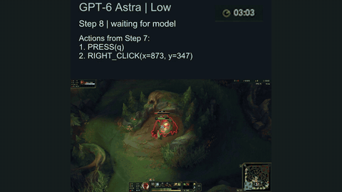 |
| [Realtime-Bench](environments/realtime-bench.md) | Oct 2026 | 50 web and game tasks via computer use | wall, token, paused | Claude Opus 5: 70% paused, 14% wall clock | 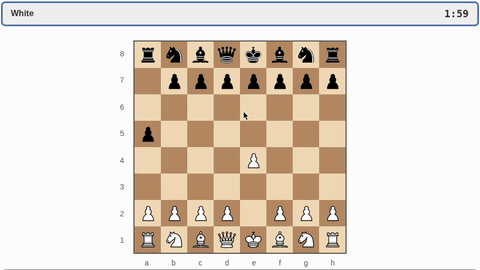 |
| [RealtimeBench](environments/realtimebench.md) (with [TORSI](solutions/torsi.md)) | Oct 2026 | 6 arcade games from text state | paused, live, 1.5x, 2x | GPT-6.1-sol ~44/100 paused, 1.5 live | 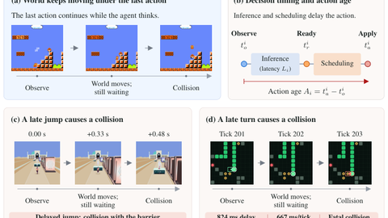 |
| [ROAR](environments/roar.md) | Oct 2026 | 3D arena shooter: pixels, text, audio | 40 and 250 ms ticks | Gemini-3.1 Pro: 0.87 turn-based, 0.34 at 40 ms | 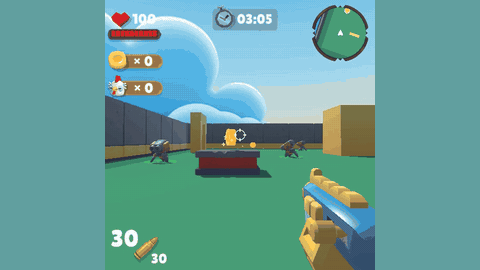 |
| [OmniGameArena](environments/omnigamearena.md) | Jun 2026 | 12 Unreal Engine 5 games | paused, latency charged | GPT-5.5 SharedFloor: 0.368 → 0.048 | 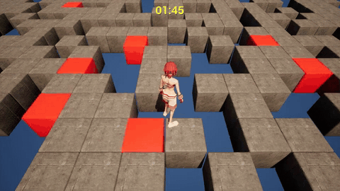 |
| [GameWorld-RT](environments/gameworld.md) | Apr 2026 | 34 browser games, human baselines | paused, wall clock (RT) | humans 55-77% success; RT run on 2 models | 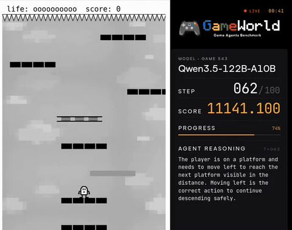 |
| [Real-Time Reasoning Gym](environments/realtime-gym.md) | Nov 2025 | Freeway, Snake, Overcooked | N tokens per step | planner 0.92 → 0.05 under pressure | 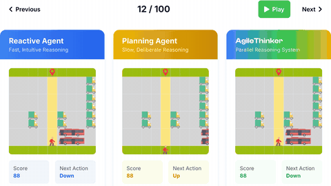 |
| [PokeAgent speedrun track](environments/pokeagent-speedrun.md) | 2025-26 | Pokemon Emerald to the first gym | wall clock | winner 40:13 (scripted); human 18 min | 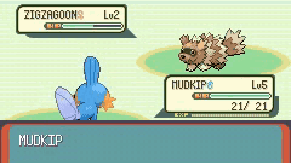 |
| [OpenAI Universe](environments/openai-universe.md) | 2016 | games over remote desktop: pixels in, keys out | wall clock, 60 fps | no LLM results; archived 2018 | 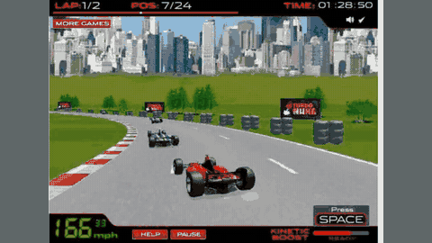 |

**Related benchmarks with designs to avoid or copy**

| Work | Notes | Visual |
|---|---|---|
| [SpeedrunBench](environments/speedrunbench.md) (Oct 2026) | frames to goal vs world records; scripted traces get within 3-7%, live play 4-12x slower | 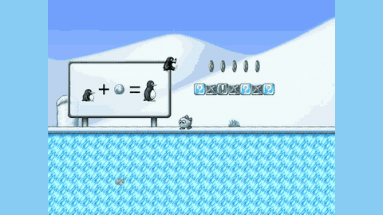 |
| [Orak](environments/orak.md) (2025) | pauses every game; without the pause, StarCraft II scores fall from 75-100 to 0 | 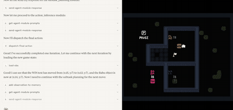 |

**Methods for thinking while acting** (closest to post-training: training models to do better)

Eval mode: RE = realtime-live, PL = paused-live (see [Play modes and clocks](#play-modes-and-clocks)).

| Work | Date | Idea | Evaluated on | Eval mode | Headline result | Visual |
|---|---|---|---|---|---|---|
| [AgileThinker](solutions/agile-thinker.md) | ICLR 2026 | fast model acts on a slow planner's partial reasoning | [RealtimeGym](environments/realtime-gym.md) | RE, token clock | 0.90 → 0.58 under pressure (planner alone 0.05) | 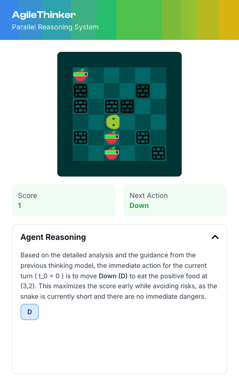 |
| [TORSI](solutions/torsi.md) | Oct 2026 | slow teacher writes guidance; fast student plays | [RealtimeBench](environments/realtimebench.md) | RE, wall clock | student 13.5 → 24.2 out of 100 | 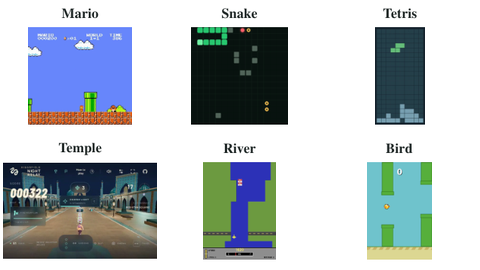 |
| [Thinking Machines interaction models](solutions/tml-interaction-small.md) | 2026 | full-duplex model, 200 ms micro-turns | speech timing only | RE (speech) | TimeSpeak 64.7, CueSpeak 81.7 | 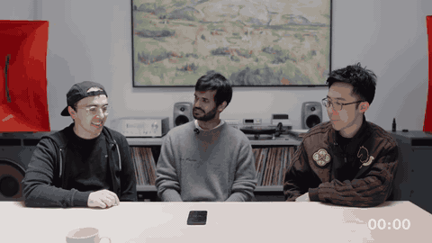 |
| [Lumine](solutions/lumine.md) | 2025 | imitation-trained agent, 5 Hz see, 30 Hz act | Genshin Impact | RE missions; PL benchmark | Act I in 56 min vs 53 for experts | 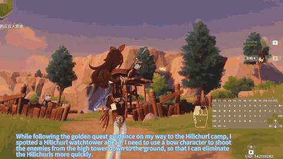 |
| [Timely-RL](solutions/timely-rl.md) | 2026 | RL with zero reward past a deadline | math, GPQA, text games | static, deadline | on-time 53.3% vs 30.0% (AIME) | 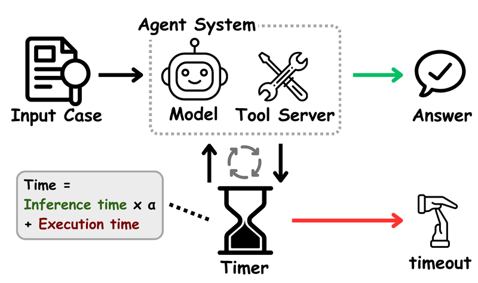 |
| [Kyutai interactivity alignment](solutions/kyutai-interactivity-alignment.md) | 2026 | RL with timing rewards for speech | Full-Duplex-Bench | RE (speech) | interruption latency 1.38 → 0.46 s | 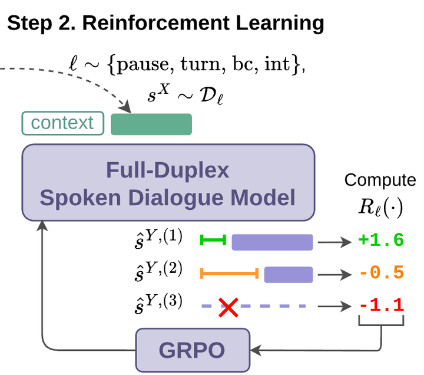 |
| [Real-Time Chunking](solutions/real-time-chunking.md) | 2025 | compute the next action chunk while acting | robots, Kinetix sim | RE (robots) | no loss with 200 ms added delay | 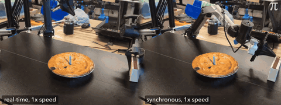 |

Timely-RL and Kyutai's work are the nearest existing post-training recipes; nobody has yet trained a model against a live game clock.

## Key takeaways

1. **Benchmarking current models under a clock is partly published already.** Between November 2025 and November 2026 a cluster of benchmarks appeared that run the same tasks paused and under a clock: Real-Time Reasoning Gym, GameWorld-RT, OmniGameArena, Realtime-Bench, RealtimeBench, ROAR and LOLPlay. The pattern is consistent: frontier reasoning models lose most of their score when the clock runs (for example 70% paused to 14% wall clock for one model in Realtime-Bench, and about 44 to 1.5 out of 100 in RealtimeBench); more reasoning effort helps when paused and hurts or does nothing live; and fast small models or realtime-API models respond quickly but are too weak.
2. **Pausing is the norm and is often stated only in an appendix.** [Orak](environments/orak.md), [Cradle](environments/cradle.md), [V-MAGE](environments/v-mage.md), [NitroGen](environments/nitrogen.md), [CombatVLA](environments/combatvla.md), [Game-TARS](environments/game-tars.md) (web games), [GameWorld](environments/gameworld.md) (main mode), [OmniGameArena](environments/omnigamearena.md) (main mode) and [VideoGameBench-Lite](environments/videogamebench.md) all pause the game during inference. Several "human-level" game results hold only under pause.
3. **Scripted routes win when allowed.** Offline trace editing gets within 3-7% of speedrun world records where live play takes 4-12 times as long, and the PokeAgent speedrun winner used LLM-written scripts. A realtime benchmark must rule these out to measure what the model can do while in the loop.
4. **What is still missing on the environment side**: human baselines under the same clock and interface, and short tasks that are easy for humans and use pixel input and low-level actions (keys, mouse, buttons). Good open starting points exist: [MiniWoB++](environments/miniwob-plusplus.md) (natively wall-clock, with a reward that decays over time), [ViZDoom](environments/vizdoom.md) in async mode, Atari and small arcade games behind a wall-clock wrapper, GameWorld-RT, and the Realtime-Bench harness with its wall, token and paused clocks.
5. **Four clock designs are in use**: wall clock, token clock, latency injection, and paused as the control (see [Play modes and clocks](#play-modes-and-clocks)). Token clocks and latency injection are reproducible and hardware independent, which matters for training.
6. **The recurring scaffold is a fast reactive loop plus a slow asynchronous thinker** ([HLA](solutions/hla.md), [DPT-Agent](solutions/dpt-agent.md), AgileThinker, [Latent Bridge](solutions/latent-bridge.md), the Thinking Machines background model). When the game runs at human reaction speeds, the fast loop is always a hand-written executor or a second model.
7. **Post-training for realtime play is open.** No paper was found that post-trains a reasoning LLM against a live game clock and reports better realtime scores. The nearest pieces are game models trained by imitation (Lumine), deadline-aware reinforcement learning on static tasks (Timely-RL), teaching through the prompt (TORSI), and reinforcement learning on timing rewards for speech models (Kyutai).
8. **No interaction or full-duplex model has been evaluated as a game player**, and none has an output channel for actions. Robotics has mature methods for acting while inference runs (action chunking, real-time chunking, delay-conditioned training) that have not been ported to LLM game agents.
