# Environments for realtime LLM agents

Research date: 10 November 2026. Part 1 of the review; see the [home page](../README.md) for the project this review supports and its scope, and [solutions](../solutions/README.md) for Part 2.

The review supports a GStar Bootcamp 2026 team project on LLMs that sense, think and act in realtime. The project plans to build or collect realtime environments, benchmark current models on them, and post-train models to do better. This part covers the environments: games, benchmarks and near neighbours where the world can keep moving while the model thinks.

This folder has one file per environment. This index holds the definitions, the comparison tables, a list of all environment files by play mode, the general conversion notes, the framing papers, the shortlist and the items that could not be reviewed.

## How to read these files

**Play mode** (how the agent actually plays, checked in the paper or repo where possible):

- **Realtime-live (RE)**: the model picks actions during play and the environment clock runs while it thinks. This is the mode the project targets.
- **Paused-live (PL)**: the model picks each action but the environment waits for it.
- **Scripted (S)**: the model writes a program, policy, macro or input trace that then plays.

In the tables, realtime-live is abbreviated RE; RL always means reinforcement learning, as in "RL-era platforms".

**Clock model** vocabulary used in these files:

- **WALL**: environment advances on real wall-clock time during inference.
- **TOKEN**: generated tokens are converted to environment time (reproducible, hardware independent).
- **INJECT**: environment is frozen during the call, then the measured latency is replayed into the simulation before the action lands (reproducible, charges model time but not network jitter).
- **BUDGET**: a fixed compute budget per tick, enforced by rule.
- **STEP**: environment advances only when the agent calls step (paused).

**Basis.** Every play-mode and clock label rests on a primary source that was opened and read: the repo's step loop ("code: <file>") or the paper's full text including appendices ("paper: <section>"). The Basis column of each table, and the Basis row of each environment file, gives the file or section and a short quoted phrase. Where a paper is silent and no code exists, the label is the one that follows from what the source does say, and the entry states what is missing. Items with nothing readable are listed under ["Not reviewable"](#not-reviewable) at the end of this index. Numbers were extracted from arXiv HTML pages by a summarising fetch tool, not read off PDF tables; re-check any figure before quoting it in a paper. Model names from 2026 papers (for example GPT-6 Astra, Claude Opus 5, Jev) are reproduced as printed in those papers. Where an entry says "code read", the step loop was checked in a clone of the public repo on 10 November 2026 and the file path is given.

**Fit** is scored against the five properties the project team wants in its first environments: realtime, verifiable (success can be checked automatically), single player, easy for humans, and short horizon.

**Environment files.** Each file has a field table (year, authors, links, play mode per mode, clock, observation, action, players, horizon, human reference, open source, convertibility, basis), then the details, the fit line where there is one, and links to related environments and to the [solutions](../solutions/README.md) files. In the files, play modes are spelled out.

**Demos.** Every environment file whose work has a public demo has a Demo row in its field table (after Links) and a `## Demo` section after the details, recorded from headless-browser visits on 10 November 2026. Each bullet says what was done, what the demo shows and what it shows about play mode, and whether it was seen in a recording or run live. Where a demo conflicts with a file's play-mode label, the Demo section has a "Note:" bullet and the label is unchanged. The demos fall into these groups:

- Human-playable demos: [ARC-AGI-3](arc-agi-3.md), [MiniWoB++](miniwob-plusplus.md), [Overcooked-AI](overcooked-ai.md) (with a small RL partner), [Realtime-Bench](realtime-bench.md) (some game tasks, e.g. Gomoku), [SpeedrunBench](speedrunbench.md) (race a recorded agent run in SuperTux), [TALES](tales.md) (Zork I), [V-MAGE](v-mage.md) (Hugging Face Space, once woken) and [VideoGameBench](videogamebench.md) (practice games); [ROAR](roar.md) offers downloadable builds to play locally.
- Demos of an LLM or vision-language model (VLM) agent playing live against a running clock: [LLM Colosseum](llm-colosseum.md) (run live in the browser; the round timer ran from 83 to 59 while model calls were pending), and in recordings [Realtime-Bench](realtime-bench.md) (wall-clock trajectories with tick numbers and timestamps), [LOLPlay](lolplay.md), [StreetFighter (Win Fast or Lose Slow)](streetfighter-win-fast-or-lose-slow.md), [GPTNT](gptnt.md), [OmniGameArena](omnigamearena.md), [DPT-Agent Overcooked](dpt-agent-overcooked.md), [HLA Overcooked](hla-overcooked.md), [GameVerse](gameverse.md), [VideoGameBench](videogamebench.md), [ROAR](roar.md), [MINDcraft](mindcraft.md), [Lumine](lumine.md), [LMGame-Bench](lmgame-bench.md) (early Mario clips only) and [Alpha Arena](alpha-arena.md) (archived trading logs); [RealtimeGym](realtime-gym.md) replays runs under its token clock.
- Speech and video timing demos with a running clock: [Game-Time](game-time.md), [Full-Duplex-Bench](full-duplex-bench.md) and [Towards Streaming Perception](towards-streaming-perception.md).
- Non-LLM agents on a running clock: [Overcooked-AI](overcooked-ai.md), [OpenAI Universe](openai-universe.md), [stable-retro](stable-retro.md), [tmrl / rtgym](tmrl-rtgym.md), [Gran Turismo Sophy](gran-turismo-sophy.md) and [Real-Time Chunking (Kinetix)](real-time-chunking-kinetix.md) (real-robot video).

## Environment files by primary play mode

### Realtime-live

- [Realtime-Bench](realtime-bench.md) (also realtime computer use)
- [RealtimeBench (TORSI)](realtimebench.md)
- [Real-Time Reasoning Gym (RealtimeGym)](realtime-gym.md)
- [ROAR](roar.md)
- [LOLPlay](lolplay.md)
- [GameWorld / GameWorld-RT](gameworld.md) (main mode paused-live; GameWorld-RT realtime-live)
- [OmniGameArena](omnigamearena.md) (main mode paused-live; LCRT realtime-live)
- [VideoGameBench / Lite](videogamebench.md)
- [PokeAgent Challenge, speedrunning track](pokeagent-speedrun.md)
- [Win Fast or Lose Slow: StreetFighter](streetfighter-win-fast-or-lose-slow.md)
- [LLM Colosseum](llm-colosseum.md)
- [HLA Overcooked](hla-overcooked.md)
- [DPT-Agent Overcooked](dpt-agent-overcooked.md)
- [HAZARD with the Time Conversion Mechanism](hazard.md)
- [GameVerse](gameverse.md)
- [GPTNT](gptnt.md) (also live negotiation)
- [STAR](star.md)
- [LM Fight Arena](lm-fight-arena.md)
- [SIMA evaluation environments](sima.md)
- [Lumine evaluation settings](lumine.md)
- [ViZDoom](vizdoom.md)
- [MiniWoB++](miniwob-plusplus.md) (also realtime computer use)
- [FightingICE / DareFightingICE](fightingice.md)
- [PySC2 / python-sc2](pysc2-python-sc2.md)
- [OpenAI Universe](openai-universe.md)
- [libmelee / Slippi](libmelee-slippi.md)
- [tmrl / rtgym (TrackMania)](tmrl-rtgym.md)
- [Physical Atari](physical-atari.md)
- [microRTS](microrts.md) (paused-live with a hard thinking budget)
- [CARLA](carla.md)
- [Gran Turismo Sophy interface](gran-turismo-sophy.md)
- [Mineflayer](mineflayer.md)
- [Chrome Dino (gym-chrome-dino)](chrome-dino.md) (browser game is realtime-live)

### Paused-live

**Benchmarks and platforms**

- [Orak](orak.md) (StarCraft II ablation realtime-live)
- [ALE / Atari](ale-atari.md)
- [Atari-GPT](atari-gpt.md)
- [stable-retro / Gym Retro](stable-retro.md)
- [gym-super-mario-bros](gym-super-mario-bros.md)
- [LMGame-Bench](lmgame-bench.md)
- [V-MAGE](v-mage.md)
- [TextStarCraft II](textstarcraft-ii.md)
- [LLM-PySC2](llm-pysc2.md)
- [AVA / AVACraft](ava-avacraft.md)
- [SMAC / SMACv2](smac.md)
- [RTSGameBench](rtsgamebench.md)
- [DSGBench](dsgbench.md)
- [Cradle](cradle.md)
- [CombatVLA](combatvla.md)
- [VARP](varp.md)
- [NitroGen universal simulator](nitrogen.md)
- [Game-TARS game suite](game-tars.md)
- [UI-TARS-2 game suite](ui-tars-2.md)
- [Overcooked-AI](overcooked-ai.md)
- [Collab-Overcooked](collab-overcooked.md)
- [Robotouille](robotouille.md)
- [TimeArena](timearena.md)
- [Procgen](procgen.md)
- [Google Research Football](google-research-football.md)
- [Crafter / Craftax](crafter-craftax.md)
- [DeepMind Lab](deepmind-lab.md)
- [MineRL](minerl.md)
- [MineDojo](minedojo.md)
- [Malmo](malmo.md)
- [MCU / MineStudio](mcu-minestudio.md)
- [DIAMBRA Arena](diambra-arena.md)
- [Flappy Bird (flappy-bird-gymnasium)](flappy-bird.md)
- [PLE](ple.md)
- [MinAtar](minatar.md)
- [PyBoy](pyboy.md)
- [Unity ML-Agents](unity-ml-agents.md)
- [TowerMind](towermind.md)
- [Will GPT-4 Run DOOM](will-gpt-4-run-doom.md)

**Turn-based or untimed (contrast set)**

- [BALROG](balrog.md)
- [SmartPlay](smartplay.md)
- [FlashAdventure](flashadventure.md)
- [ARC-AGI-3](arc-agi-3.md)
- [Kaggle Game Arena](kaggle-game-arena.md)
- [CivRealm](civrealm.md)
- [CivBench](civbench.md)
- [TALES](tales.md)
- [NetHack LE](nethack-le.md)
- [TextWorld](textworld.md)
- [Jericho](jericho.md)
- [SnakeBench](snakebench.md)
- [StarBench](starbench.md)
- [AgentBench game tasks](agentbench-games.md)
- [GameBench](gamebench.md)
- [GTBench](gtbench.md)
- [BattleAgentBench](battleagentbench.md)
- [GameArena](gamearena.md)
- [Think in Games (Honor of Kings replays)](think-in-games.md)
- [Pokemon stream harnesses](pokemon-stream-harnesses.md)

### Scripted

- [SpeedrunBench](speedrunbench.md) (offline scripted; online paused-live)
- [Factorio Learning Environment](factorio-learning-environment.md)
- [Polytopia Bench](polytopia-bench.md) (model writes a Rust bot in 40 minutes; games turn-based)
- [Voyager](voyager.md)
- [Odyssey](odyssey.md)
- [MINDcraft](mindcraft.md) (realtime-live; listed with the Minecraft code agents)
- [CodeClash](codeclash.md)
- [PORTAL](portal.md)
- [Dota 2 bot API / dotaservice](dota-2-bot-api.md)

### Near neighbours

**Latency-sensitive trading**

- [HFTBench](hftbench.md)
- [Alpha Arena (Nof1)](alpha-arena.md)
- [LiveTradeBench](livetradebench.md)
- [Agent Market Arena](agent-market-arena.md)
- [Prophet Arena](prophet-arena.md)
- [ForecastBench](forecastbench.md)
- [ABIDES](abides.md)

**Live negotiation and realtime multi-agent interaction**

- [Real-Time Deadlines (UPenn negotiation)](real-time-deadlines-negotiation.md)
- [NegotiationArena](negotiationarena.md)
- [AucArena](aucarena.md)
- [Deal or No Deal](deal-or-no-deal.md)
- [AmongAgents (Among Us)](amongagents.md)

**Realtime computer use**

- [OSWorld 2.0](osworld-2.md)
- [OSWorld-Human](osworld-human.md)
- [STT-Arena](stt-arena.md)

**Full-duplex speech**

- [Full-Duplex-Bench (v1, v1.5, v2, v3)](full-duplex-bench.md)
- [Game-Time](game-time.md)
- [Thinking Machines TimeSpeak / CueSpeak](thinking-machines-timespeak-cuespeak.md)
- [DuplexWorld](duplexworld.md)
- [Joi-Bench-Task](joi-bench-task.md)

**Streaming video understanding**

- [StreamingBench](streamingbench.md)
- [OVO-Bench](ovo-bench.md)
- [OmniMMI](omnimmi.md)
- [ProactiveVideoQA (PAUC)](proactivevideoqa.md)
- [Proact-VL Live Gaming Benchmark](proact-vl-live-gaming.md)

**Robotics with inference delay**

- [Real-Time Chunking Kinetix benchmark](real-time-chunking-kinetix.md)
- [LIBERO-LQ](libero-lq.md)
- [When Delay Meets Distribution Shift](when-delay-meets-distribution-shift.md)
- [Bench2Drive](bench2drive.md)
- [Towards Streaming Perception](towards-streaming-perception.md)

## Comparison table

Play mode: RE = realtime-live, PL = paused-live, S = scripted. "Human ref." = human reference score. "Conv." = convertible to realtime-live (n/a if already realtime).

### Benchmarks built for LLM/VLM agents

| Name | Visual | Year | Play mode | Clock | Observation | Action | Players | Horizon | Human ref. | Open source | Conv. | Link | Basis |
|---|---|---|---|---|---|---|---|---|---|---|---|---|---|
| [Realtime-Bench](realtime-bench.md) | 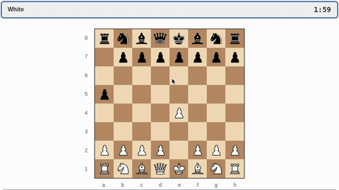 | 2026 | RE + RE + PL | WALL, TOKEN (64 tok = 1 s), paused | screenshots 1 FPS + SoM | GUI mouse/keyboard | 1 | up to 5 min | none reported | MIT, 20 of 50 tasks public | n/a | [arXiv 2610.22155](https://arxiv.org/abs/2610.22155) | code: `realtime_framework/clock.py` (`FrameClock`: under token and pause clocks "the world stands still while a model generates"), `docs/evaluation.md:154-155`; paper §3 "Wall Clock advances the environment according to the actual time spent on inference" |
| [RealtimeBench (TORSI)](realtimebench.md) | 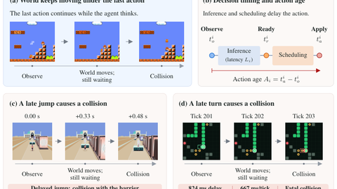 | 2026 | RE + PL | WALL at 1x, 1.5x, 2x; paused | structured text | legal actions, some short plans | 1 | short arcade episodes | none | no code yet | n/a | [arXiv 2610.20665](https://arxiv.org/abs/2610.20665) | paper §1: "While a response is pending, the game keeps running with the previous control still active"; §4 Paused "freezes the game during inference"; no code released |
| [Real-Time Reasoning Gym](realtime-gym.md) | 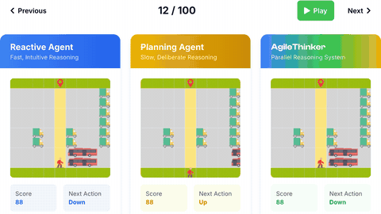 | 2025 | RE | TOKEN (4k-32k tok/step) or WALL seconds | text | 1 discrete move/step | 1 (scripted partner) | 100 steps | none | MIT | n/a | [arXiv 2511.04898](https://arxiv.org/abs/2511.04898) | paper §2: "the environment steps forward at a fixed rate, even when the agent has not finished thinking"; README `--time_unit token` / `seconds`, `agent.act() or DEFAULT_ACTION` |
| [ROAR](roar.md) | 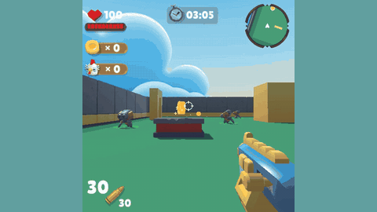 | 2026 | RE + PL | WALL: env thread steps every 40 ms or 250 ms of wall-clock time and never waits (code read); turn-based control | RGB, depth, JSON text, audio | 7-dim move/aim/fire | 1 or 4 | 5 min | none (rule bot) | MIT, Unity builds | n/a | [arXiv 2610.24282](https://arxiv.org/abs/2610.24282) | code: `roar_evaluation/async_env_runner.py` (env thread sleeps to `perf_counter` deadline, consumes action buffer, `env.step`); turn-based: `roar_benchmark.py` `start_run_turn_based` |
| [LOLPlay](lolplay.md) | 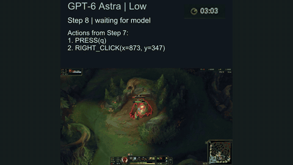 | 2026 | RE | WALL | screenshots 1080p | mouse/keyboard | 1 (+bots) | 5-20 min | 2 players, 36/36 | repo open (licence file not present) | n/a | [arXiv 2611.03685](https://arxiv.org/abs/2611.03685) | paper §3: "The environment keeps running while the agent generates its response and executes the actions"; repo README: "Gameplay continues during model reasoning and action execution" |
| [GameWorld / GameWorld-RT](gameworld.md) | 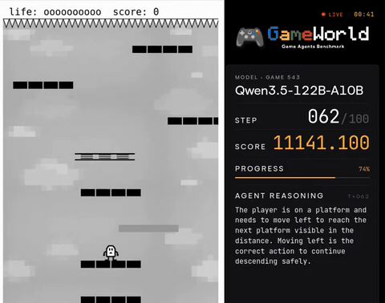 | 2026 | PL (main) + RE (RT) | sandbox pause / WALL | screenshots | raw mouse/keyboard or semantic | 1 | short tasks | novice 55.3, expert 77.1 SR | repo open (gameworld-project/gameworld) | has RT switch | [arXiv 2604.07429](https://arxiv.org/abs/2604.07429) | code: `runtime/runtime_config.py:20` `pause_during_inference: bool = True` (RT = False); paper §1 "A browser-based sandbox pauses game execution during model inference" |
| [OmniGameArena](omnigamearena.md) | 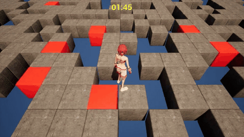 | 2026 | PL (PDQ) + RE (LCRT) | paused / INJECT | RGB + timestamp | chunked keyboard-mouse | 1, PvP, co-op | short | none | repo open (LICENSE file) | has LCRT | [arXiv 2606.09826](https://arxiv.org/abs/2606.09826) | code: README "LFM pauses the game during inference; LCM charges model inference time to the game clock", `omni_game_arena/clock.py` `decision_latency`; paper: PDQ "freezes the environment", LCRT "idles for the server-reported inference time" |
| [VideoGameBench / Lite](videogamebench.md) | 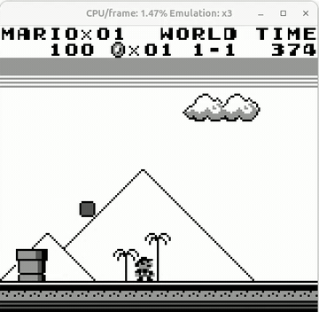 | 2025 | RE (full) + PL (Lite) | WALL / emulator pause | screenshots | key presses, clicks | 1 | hours | no numeric | MIT, bring own ROMs | n/a | [arXiv 2505.18134](https://arxiv.org/abs/2505.18134) | code: README `--lite` "pause enabled while model is thinking" (full mode has no pause); paper §2.5 |
| [PokeAgent speedrun track](pokeagent-speedrun.md) | 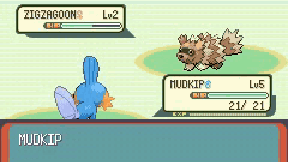 | 2025-26 | RE (winners used S) | WALL incl. inference | frames + state | button presses | 1 | 20 min to hours | top 18 min, average 1:22:05 | paper CC BY-NC-SA 4.0; starter repo open | n/a | [arXiv 2603.15563](https://arxiv.org/abs/2603.15563) | paper Fig. 7: "our environment runs in real time—the game world continues while the agent reasons" |
| [Win Fast or Lose Slow: StreetFighter](streetfighter-win-fast-or-lose-slow.md) | 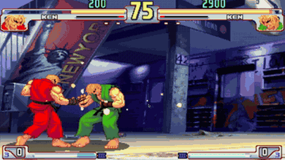 | 2025 | RE | env loop steps continuously with no-move default (code read) | text state | named moves | 2 (model vs model) | 1 round | none | repo, no licence | n/a | [arXiv 2505.19481](https://arxiv.org/abs/2505.19481) | code: `StreetFighter/GameEngine/Engine/game.py` (main loop `env.step` with action 0 for any player without a pending action) |
| [LLM Colosseum](llm-colosseum.md) | 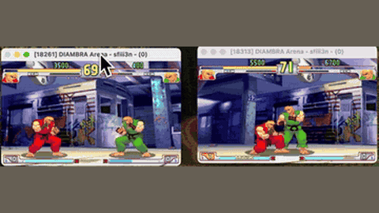 | 2024 | RE | env loop steps continuously with no-move default; LLM calls in threads (code read) | text or screenshot | named-move macros | 2 | about 1 min | none | MIT + ROM | n/a | [GitHub](https://github.com/OpenGenerativeAI/llm-colosseum) | code: `eval/game.py` (`env.step` loop; LLM calls in `PlanAndAct` threads; empty slot = action 0) |
| [DPT-Agent Overcooked](dpt-agent-overcooked.md) | 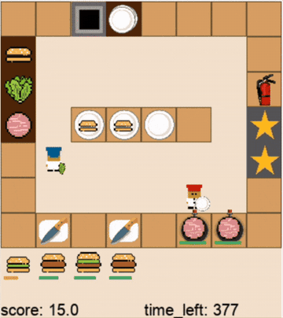 | 2025 | RE (part S) | WALL, 0.25 s/step | text state | macro actions via FSM | 2 (human or bot partner) | 125 s | humans as partners | MIT | n/a | [arXiv 2502.11882](https://arxiv.org/abs/2502.11882) | code: `llm_agent_run_dpt_exp1.py:248` `env.step(decision)` in a loop paced by `await asyncio.sleep(0.25)` (line 298), LLM reflection in separate async tasks |
| [HLA Overcooked](hla-overcooked.md) | 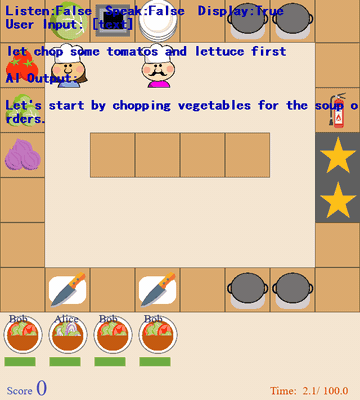 | 2023 | RE | WALL, about 3 Hz | text + chat | macro + scripted executor | 2 (human) | 100 s | humans as partners | no code found | n/a | [arXiv 2312.15224](https://arxiv.org/abs/2312.15224) | paper §1: Overcooked where "players collaborate at a rate of approximately 3Hz"; executor acts while the LLMs run (§4); no pause described; no code released |
| [HAZARD + Time Conversion](hazard.md) | 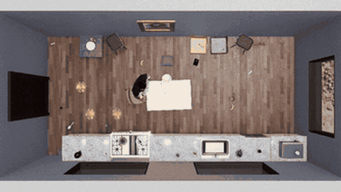 | 2024 / 2025 | PL (original HAZARD) / RE with TCM | INJECT at 30 FPS | 3D scene, text | navigation/pick actions | 1 | minutes | none | HAZARD open; TCM no code | TCM is the conversion | [arXiv 2506.07223](https://arxiv.org/abs/2506.07223) | original: code `src/HAZARD/challenge.py` (agent chooses, then env steps, `while frame_count < max_steps`); TCM: paper 2506.07223 §3 "After each decision, we advance the simulator by frames" |
| [GameVerse](gameverse.md) | 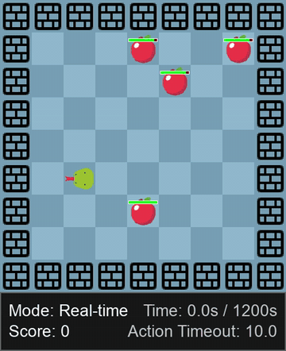 | 2026 | PL + RE (Snake, PvZ) | Stop / Slow / Normal | screenshots | semantic or GUI | 1 | mixed | rookie and expert tiers | repo open (LICENSE.txt) | partial | [arXiv 2603.06656](https://arxiv.org/abs/2603.06656) | paper App.: Stop "the environment is fully paused during inference", Slow "a 5-second pause", Normal "without any artificial delays"; code `snake/config.yaml` `game_mode: discrete` / `realtime` |
| [GPTNT](gptnt.md) | 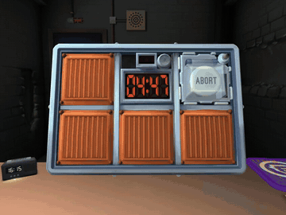 | 2026 | RE | live countdown | game UI + chat | UI + messages | 2 | minutes | humans succeed | repo open (LICENSE) | n/a | [arXiv 2606.28514](https://arxiv.org/abs/2606.28514) | paper Fig.: "In asynchronous mode ... generation time per request counts against the bomb clock"; §1 "act asynchronously and communicate in real time" |
| [STAR](star.md) | 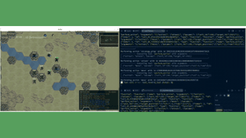 | 2026 | PL (turn_based) + RE (real_time) | turn-based and real-time modes | text hex map | unit orders | 2 | long | none | open repo | n/a | [arXiv 2603.09337](https://arxiv.org/abs/2603.09337) | code: README "Real-time keeps the world ticking while the model thinks"; `starbench.py --mode turn_based` or `--mode real_time`; paper §4.2-4.3 |
| [Orak](orak.md) | 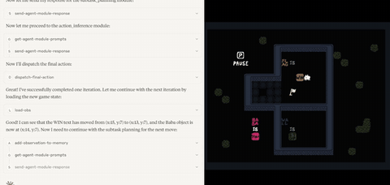 | 2025 | PL (main) + RE (SC2 ablation, paper only) | game paused during inference; ablation enables real-time play | mostly text state | macro actions | mostly 1 | mixed | none | MIT; 6 paid games | yes for SF3, Mario, SC2 | [arXiv 2506.03610](https://arxiv.org/abs/2506.03610) | code: `src/mcp_game_servers/star_craft/game/utils/bots.py` `realtime=False`; paper App. K.4 "During LLM inference, we pause the StarCraft II game environment"; §5.7 "enabling real-time gameplay" (ablation code not in release branch, tag v0.1.0, PRs or 5 forks) |
| [LMGame-Bench](lmgame-bench.md) | 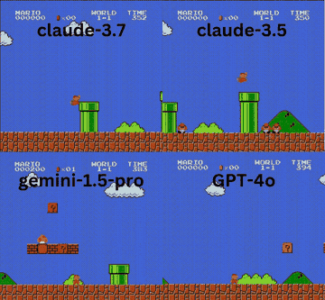 | 2025 | PL | STEP (code read) | screenshots (+ text harness) | game inputs | 1 | short to medium | none | MIT | yes for Mario, Tetris | [arXiv 2505.15146](https://arxiv.org/abs/2505.15146) | code: `lmgame-bench/single_agent_runner.py` (`agent.get_action` then `game_env.step`); `superMarioBrosEnv.py` repeats the action for its frame count |
| [V-MAGE](v-mage.md) | 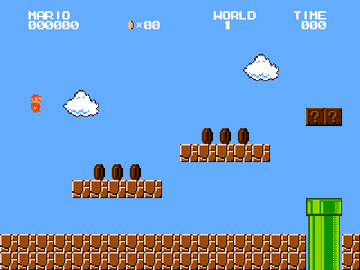 | 2025 | PL | explicit frame pausing | pixels (3 frames) | discrete keys | 1 | short levels | 5 players | open repo, no licence stated | high | [arXiv 2504.06148](https://arxiv.org/abs/2504.06148) | code: `game/pygame_base.py` (game stepped only when `new_action_event` is set); paper §3 "the game is paused while the model processes the visual inputs" |
| [Atari-GPT](atari-gpt.md) | 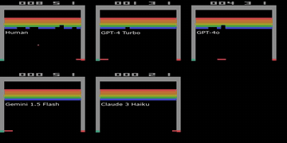 | 2024 | PL | STEP, frame skip 8 | pixels | joystick actions | 1 | 1,000 steps | standard human scores | MIT (repo nwayt001/atari-gpt) | high | [arXiv 2408.15950](https://arxiv.org/abs/2408.15950) | code: `run_experiments.py` `model_rollout` (blocking LLM call, then `env.step`, 1,000 steps) |
| [Cradle](cradle.md) | 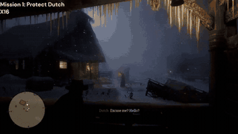 | 2024 | PL in every environment (code); actions are generated code skills | game paused during calls | video clips at 2 fps | keyboard/mouse via code | 1 | long | anecdotal | code open; commercial games | poor | [arXiv 2403.03186](https://arxiv.org/abs/2403.03186) | code: `cradle/provider/execute/skill_execute.py` (`unpause_game` -> execute -> `pause_game` around every skill); paper §4 "we must pause those game environments while waiting for backbone model responses" |
| [BALROG](balrog.md) | 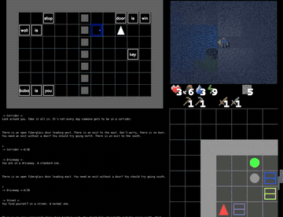 | 2024 | PL | STEP | text or text+image | language actions | 1 | long | none numeric | open | weak (no native clock) | [arXiv 2411.13543](https://arxiv.org/abs/2411.13543) | code: `balrog/evaluator.py` (`agent.act` then `env.step` per step) |
| [SmartPlay](smartplay.md) | 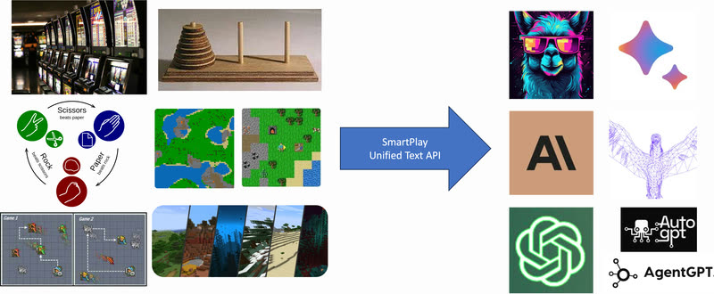 | 2023 | PL | STEP | text | categorical | 1 | mixed | yes | open | not meaningful | [arXiv 2310.01557](https://arxiv.org/abs/2310.01557) | code: `examples/experiment.py` (`query_model` then `env.step`) |
| [Will GPT-4 Run DOOM](will-gpt-4-run-doom.md) | 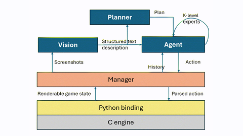 | 2024 | PL | model call runs inside the engine frame callback, so the engine cannot tick | screenshot to text | key holds | 1 | 1 level | one human | open | use ViZDoom | [arXiv 2403.05468](https://arxiv.org/abs/2403.05468) | code: `WillItRunDoom.ipynb` `draw_frame()` calls the model synchronously in the cydoomgeneric callback; paper §5.1 "not ready for real-time play" |
| [TextStarCraft II](textstarcraft-ii.md) | 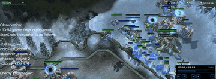 | 2023 | PL (built-in AI experiments) + RE (human matches) | python-sc2 `realtime=False` default; human script sets True | text | macro action queue | 1 vs AI | 20+ min | none | original code at sc2musa/Large-Language-Models-play-StarCraftII | python-sc2 `realtime=True` | [arXiv 2312.11865](https://arxiv.org/abs/2312.11865) | code: `test_the_env.py:163` `--real_time` default False -> `env/bot/Protoss_bot.py:2154` `run_game(realtime=...)`; `on_step` busy-waits for the LLM action (`Protoss_bot.py:2001`); human matches `Human_LLM_agent_test.py:93` default True |
| [LLM-PySC2](llm-pysc2.md) | 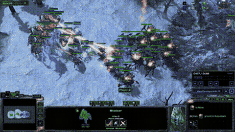 | 2024 | PL | bounded wait per step | text + image | full pysc2 actions | 1 vs AI | 2 min micro to full game | none | open | pysc2 `realtime=True` | [arXiv 2411.05348](https://arxiv.org/abs/2411.05348) | code: `llm_pysc2/agents/llm_pysc2_agent_main.py` (step waits up to `MAX_LLM_WAITING_TIME = 15` s; no_op on timeout); pysc2 `SC2Env` realtime=False |
| [AVA / AVACraft](ava-avacraft.md) | 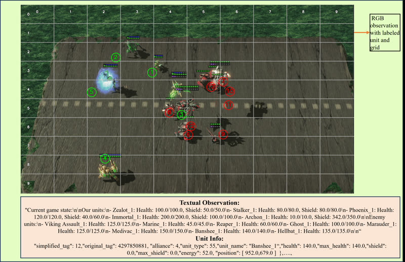 | 2025 | PL | pysc2 `step_mul=8`, decide-then-step | RGB + text | attack/move/ability | 1 vs AI | under 2 min | none | open | yes | [arXiv 2503.05383](https://arxiv.org/abs/2503.05383) | code: `vlm_attention/run_env/multiprocess_run_env_with_ability.py` (`get_action` then `env.step`); `env/env_core.py` `SC2Env` without realtime |
| [RTSGameBench](rtsgamebench.md) | 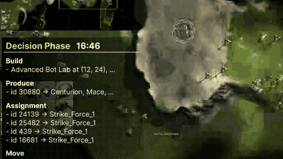 | 2026 | PL | fixed 15-60 s of game time per call | minimap + views + text | unit orders | 1 vs AI | 10-30 min; mini-games shorter | yes (mini-games) | no public code (repo not found) | plausible | [arXiv 2606.18950](https://arxiv.org/abs/2606.18950) | paper §3: "The game runs for a fixed interval between decisions and pauses during inference"; App. F.3 Algorithm 1 "Pause the game and read the engine state" |
| [TowerMind](towermind.md) | 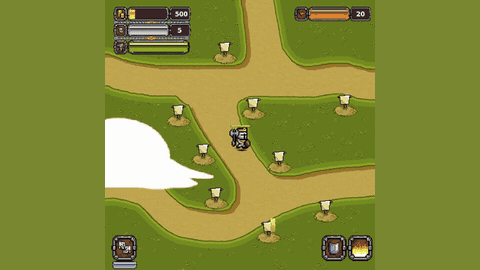 | 2026 | PL | STEP, 16 game steps/action | pixels, JSON, vector | grid + action type | 1 | level | expert-normalised | MIT, Unity binary | yes | [arXiv 2601.05899](https://arxiv.org/abs/2601.05899) | code: `llm_example/llm_run.py` (`agent.act` then `env.step`, `time_scale=20`); ML-Agents step API is synchronous (see Unity ML-Agents row) |
| [Collab-Overcooked](collab-overcooked.md) | 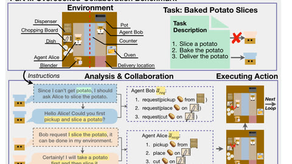 | 2025 | PL | STEP | text | atomic + chat | 2 LLMs | under 100 steps | humans 90-100% with 10 s/step limit | open | harness change | [arXiv 2502.20073](https://arxiv.org/abs/2502.20073) | code: `src/main.py` (`team.joint_action` then `env.step` per timestep) |
| [Robotouille](robotouille.md) | 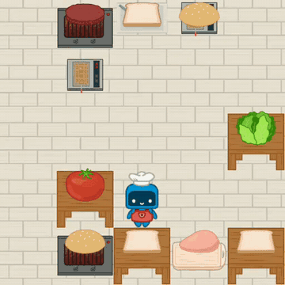 | 2025 | PL | STEP with in-game delays | text (pygame render) | discrete | 1 | short | none | open | plausible | [arXiv 2502.05227](https://arxiv.org/abs/2502.05227) | code: `robotouille/robotouille_simulator.py` (`propose_actions` then `env.step`); paper §2: delays count environment steps |
| [TimeArena](timearena.md) | 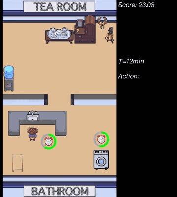 | 2024 | PL | simulated action durations | text | text actions | 1 | 40 simulated min | none | site | map sim minutes to seconds | [arXiv 2402.05733](https://arxiv.org/abs/2402.05733) | code: `LLM_test.py` (`Agent.act` then `current_time += 1` simulated minutes) |
| [FlashAdventure](flashadventure.md) | 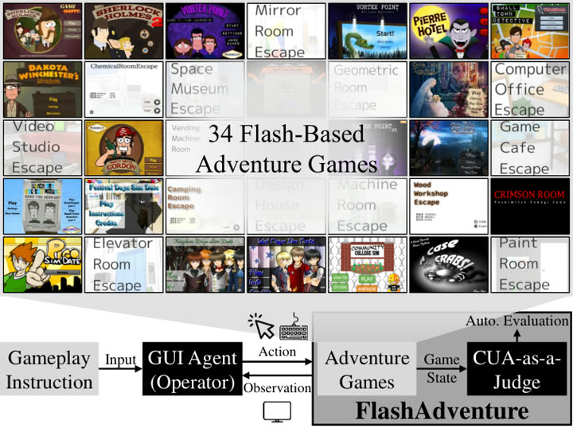 | 2025 | PL (untimed by design) | STEP | screenshots | mouse/keyboard | 1 | about 26 min human | 97% humans | project page | not relevant | [arXiv 2509.01052](https://arxiv.org/abs/2509.01052) | paper §3.1: games chosen by "avoiding strict time limits and rapid-action requirements"; code agents count actions, no timer |
| [ARC-AGI-3](arc-agi-3.md) | 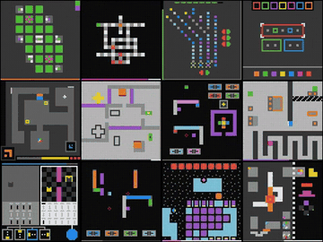 | 2026 | PL, turn-based | none; scored on action count | grid frames | few discrete actions | 1 | minutes | human action baselines | toolkit open | needs imposed deadline | [docs](https://docs.arcprize.org/methodology) | docs `game-schema`: "ARC-AGI-3 games are turn-based environments"; code `agents/agent.py` choose_action -> take_action |
| [Pokemon stream harnesses](pokemon-stream-harnesses.md) | 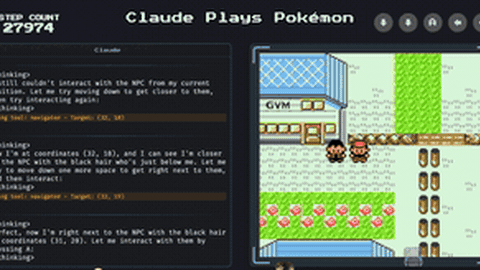 | 2025-26 | PL | emulator ticked only inside tool calls (starter); input-driven RPG (FireRed harness) | screenshot + RAM | button tool calls | 1 | 100s of hours | none | starter and FireRed harness open; Gemini harness not public | low value | [starter repo](https://github.com/davidhershey/ClaudePlaysPokemonStarter) | code: ClaudePlaysPokemonStarter `agent/emulator.py` (`pyboy.tick()` only in button handlers); Clad3815/gpt-play-pokemon-firered `server/src/core/gameLoop.js` (state -> LLM -> keys; mGBA unpaused but game waits for input); PokeAgent paper: "X Plays Pokémon systems all freeze the emulator between actions" |
| [Game-TARS](game-tars.md) | 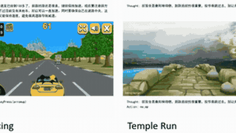 | 2025 | PL | Game-TARS web games time-paused; UI-TARS-2 synchronous browser sandbox | screenshots | keyboard/mouse | 1 | short | human-normalised | not released | un-pause the sandbox | [arXiv 2510.23691](https://arxiv.org/abs/2510.23691) | paper 2510.23691 §5 footnote: "used time-pause to ensure causal interaction" |
| [UI-TARS-2](ui-tars-2.md) | 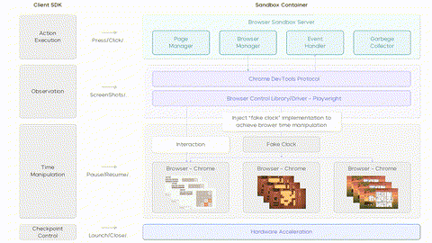 | 2025 | PL | Game-TARS web games time-paused; UI-TARS-2 synchronous browser sandbox | screenshots | keyboard/mouse | 1 | short | human-normalised | not released | un-pause the sandbox | [arXiv 2509.02544](https://arxiv.org/abs/2509.02544) | paper 2509.02544 §2.2: clients "receive synchronous observations", "re-implemented Window timing APIs allow time acceleration and pause" |
| [NitroGen universal simulator](nitrogen.md) | 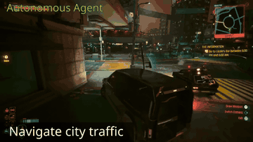 | 2026 | PL | intercepts engine clock, freezes game | 256x256 frame | gamepad chunks of 16 | 1 | short tasks | human-judged | weights + simulator released | promising | [arXiv 2601.02427](https://arxiv.org/abs/2601.02427) | code: `nitrogen/game_env.py` `async_mode=True` "Whether to pause/unpause the game during each step" (env pauses after each step); paper "freezes the game while the model predicts" |
| [CombatVLA](combatvla.md) | 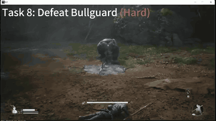 | 2024-25 | PL | game paused during inference | screenshots | key/mouse | 1 | one fight | 10 humans | released; paid game | poor | [arXiv 2503.09527](https://arxiv.org/abs/2503.09527) | paper 2503.09527 §4: "the agent pauses the game during model inference"; code `framework/runner/bmwk_runner.py` `pause_game()` |
| [VARP](varp.md) | 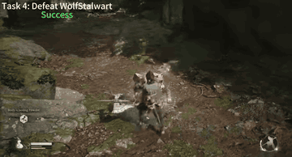 | 2024-25 | PL | game paused during inference | screenshots | key/mouse | 1 | one fight | 10 humans | released; paid game | poor |  | VARP paper §4: "During the inference of VLMs, we pause the game using the photo mode" |
| [DSGBench](dsgbench.md) | 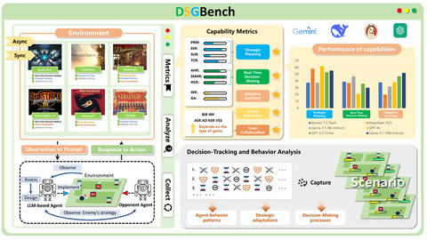 | 2025 | PL (`asynch_mode` false) + RE (`asynch_mode` true) | SC2: python-sc2 `realtime=asynch_mode`; SF3: async starts LLM threads while the game steps | text state | macro actions / named moves | 1-2 | game-length | none | open repo | native flag | [arXiv 2503.06047](https://arxiv.org/abs/2503.06047) | code: `games/starcraft2/agent_vs_computer_starcraft_env.py:244` `realtime=asy_mode`; `agent_manager/agents/streetfight3_agent/streetfight3_agent.py:103-127` (`PlanAndAct` threads when `asy_running`) |
| [LM Fight Arena](lm-fight-arena.md) | 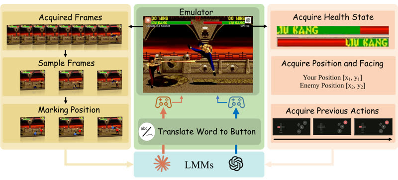 | 2025 | RE (paper's description; no code) | emulator streams frames; model sees 10 frames at 4-frame intervals | pixels | button combinations | 2 (model vs model) | 1 match | none | no code found | n/a | [arXiv 2510.08928](https://arxiv.org/abs/2510.08928) | paper Fig. 2: "the emulator streams raw frames, we subsample every fourth frame"; abstract frames it as "real-time, adversarial environments"; no pause is described and no code is linked |
| [Kaggle Game Arena](kaggle-game-arena.md) | 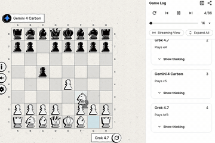 | 2024-26 | PL, turn-based | none or generous per-move limits | text / board | moves | 1-2+ | long | varies | varies | not meaningful | [arXiv 2609.31473](https://arxiv.org/abs/2609.31473) | Game Arena code `harness/model_generation_demo.py` (per-call API timeout, no game clock) |
| [CivRealm](civrealm.md) | 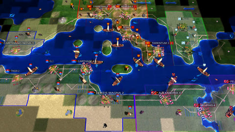 | 2024-26 | PL, turn-based | none or generous per-move limits | text / board | moves | 1-2+ | long | varies | varies | not meaningful | [repo](https://github.com/bigai-ai/civrealm) | CivRealm README step/turn loop |
| [CivBench](civbench.md) | 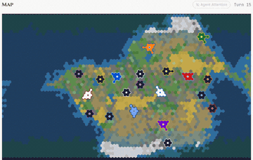 | 2024-26 | PL, turn-based | none or generous per-move limits | text / board | moves | 1-2+ | long | varies | varies | not meaningful | [arXiv 2609.02459](https://arxiv.org/abs/2609.02459) | CivBench paper "over 300 turns" |
| [TALES](tales.md) | 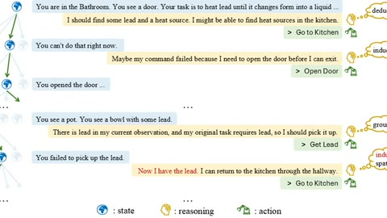 | 2024-26 | PL, turn-based | none or generous per-move limits | text / board | moves | 1-2+ | long | varies | varies | not meaningful | [arXiv 2504.14128](https://arxiv.org/abs/2504.14128) | TALES paper (text games per step) |
| [SnakeBench](snakebench.md) | 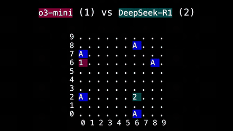 | 2024-26 | PL, turn-based | none or generous per-move limits | text / board | moves | 1-2+ | long | varies | varies | not meaningful | [repo](https://github.com/gkamradt/SnakeBench) | SnakeBench README "proceeds round-by-round" |
| [StarBench](starbench.md) | 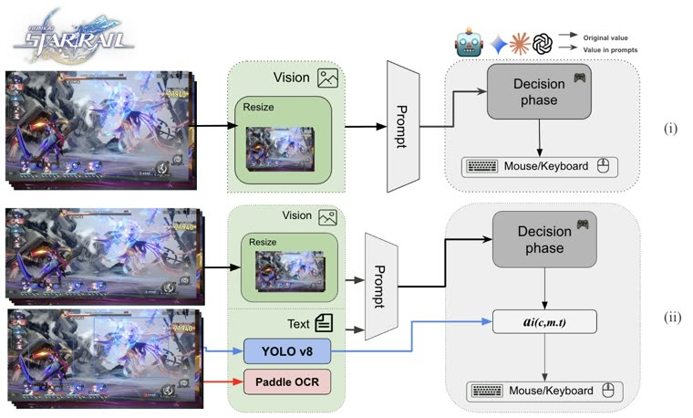 | 2024-26 | PL, turn-based | none or generous per-move limits | text / board | moves | 1-2+ | long | varies | varies | not meaningful | [arXiv 2510.18483](https://arxiv.org/abs/2510.18483) | StarBench title "A Turn-Based RPG Benchmark" |
| [SpeedrunBench](speedrunbench.md) | 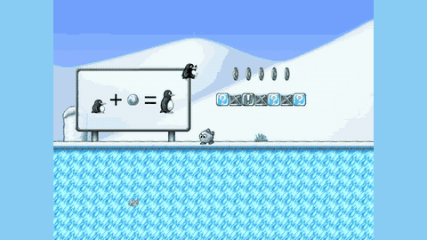 | 2026 | S (offline) + PL (online; from the paper's definition, online harness not public) | deterministic, one frame per action; score = frames to goal | frames | input trace / actions | 1 | 1 level to hours | world records | offline harness and patched games open | yes for SuperTux, SuperTuxKart | [arXiv 2610.08076](https://arxiv.org/abs/2610.08076), [site](https://speedrunbench.com) | offline: README "The agent never runs the game"; online: paper §3.2 "each action advances the game by one frame" + frame-tape seed `seeds/supertux/welcome_seed_9498f.json` + tuxemon-speedrun `tools/tux_env.py` (fixed ticks per `step()`); online runner not published |
| [Factorio Learning Environment](factorio-learning-environment.md) |  | 2025 | S (server paused between programs) | program execution | text stdout | Python programs | 1 | long | none | open | out of scope | [arXiv 2503.09617](https://arxiv.org/abs/2503.09617) | code: `fle/env/gym_env/environment.py:436` unpause before the program, `:519-521` pause after (`pause_after_action=True`) |
| [Polytopia Bench](polytopia-bench.md) |  | 2026 | S (model writes a Rust bot; games turn-based) | 40 active min to write, API latency counted; bot 2 s per decision (timeout = forfeit) | rules + practice traces; bot gets JSON with fog of war | Rust program; bot picks 1 legal action per call | 2 (bot vs fixed reference bots) | 40 min + games up to 200 rounds | none | Apache 2.0 | not meaningful | [write-up](https://thekevinz.com/blog/polytopia-bench), [repo](https://github.com/kevinz917/superhuman-polytopia-bot/tree/main/benchmark) | code: `benchmark/runner/src/polytopia_bot/skirmish/game.py:80-85` (referee calls the bot's `select`, `BotFault` = forfeit), `configs/skirmish/continuous-v1.json` `coding_seconds: 2400`, `move_seconds: 2.0`; write-up "a Rust program that reads a JSON observation on stdin and writes back the id of one legal action" |
| [Voyager](voyager.md) |  | 2023-25 | S (Voyager, Odyssey: server paused during LLM calls) / RE (MINDcraft) | server 20 TPS | structured state | JS skills / commands | 1+ | long | none | open | restrict to low-level controls | [arXiv 2305.16291](https://arxiv.org/abs/2305.16291) | code: Voyager `voyager/env/bridge.py:113-124` (unpause -> run skill -> pause) |
| [Odyssey](odyssey.md) |  | 2023-25 | S (Voyager, Odyssey: server paused during LLM calls) / RE (MINDcraft) | server 20 TPS | structured state | JS skills / commands | 1+ | long | none | open | restrict to low-level controls |  | Odyssey `odyssey/env/bridge.py:148,182` |
| [MINDcraft](mindcraft.md) |  | 2023-25 | S (Voyager, Odyssey: server paused during LLM calls) / RE (MINDcraft) | server 20 TPS | structured state | JS skills / commands | 1+ | long | none | open | restrict to low-level controls | [arXiv 2504.17950](https://arxiv.org/abs/2504.17950) | MINDcraft `src/agent/tasks/tasks.js:378-387` wall-clock timeout, no server pause |
| [CodeClash](codeclash.md) |  | 2025 | S | code competes in arenas | code | code edits | 2 | rounds | humans win | open | out of scope | [arXiv 2511.00839](https://arxiv.org/abs/2511.00839) | paper §2: "LMs do not play the games directly"; code `codeclash/tournaments/pvp.py:99-101` (edit phase then competition phase) |

### RL-era platforms and simulators

| Name | Visual | Year | Play mode | Clock | Observation | Action | Players | Horizon | Human ref. | Open source | Conv. | Link | Basis |
|---|---|---|---|---|---|---|---|---|---|---|---|---|---|
| [ViZDoom](vizdoom.md) |  | 2016 | PL (`PLAYER`) + RE (`ASYNC_PLAYER`) | 35 tics/s wall clock in async, scalable | pixels, depth, labels, audio buffer, game vars | buttons, mouse deltas | 1 or multi | scenarios under 1 min | humans easy | MIT | native flag | [repo](https://github.com/Farama-Foundation/ViZDoom) | code: `src/vizdoom/src/viz_message_queue.cpp` `VIZ_MQTic` (blocking receive unless async); docs `enums.md` ASYNC "without waiting for the agent actions"; late agent: last button state persists |
| [MiniWoB++](miniwob-plusplus.md) |  | 2017-18 | RE natively (usually neutralised to PL) | 10 s wall timer, reward x (1 - t/10 s) | DOM + screenshot | click/type/drag | 1 | 10 s | yes (World of Bits) | MIT | none needed | [docs](https://miniwob.farama.org/content/reward/) | code: `miniwob/html/core/core.js` (`setTimeout(EPISODE_MAX_TIME)`, reward x `max(0, 1 - dt/EPISODE_MAX_TIME)`); `miniwob/reward.py` `get_raw_reward` "without time penalty" |
| [ALE / Atari](ale-atari.md) |  | 2013 | PL | STEP, 60 Hz, frameskip 4 | pixels or RAM | 18 discrete | 1 | minutes | standard human scores | GPL-2.0 | high (wrapper) | [docs](https://ale.farama.org/environments/) | code: `src/ale/python/env.py` `step` "repeats action frameskip # of steps"; docs v5 frameskip=4, sticky 0.25 |
| [Physical Atari](physical-atari.md) |  | 2026 | RE | ALE free-running 60 Hz, agent 30 FPS, 165 ms latency | camera | physical joystick | 1 | minutes | n/a | repo named | n/a | [arXiv 2606.19357](https://arxiv.org/abs/2606.19357) | paper §1: benchmarks where "the environment waits for the agent" contrasted with real-time RL; App.: Devbox "renders Atari 2600 games at 60 FPS, listens to the actions from the CX40+ controller" |
| [OpenAI Universe](openai-universe.md) |  | 2016 | RE | WALL over VNC, 60 fps throttle | pixels | VNC key/mouse events | 1 | short | n/a | MIT, archived 2018 | dead; design reference | [announcement](https://openai.com/index/universe/), [repo](https://github.com/openai/universe) | repo README: "Universe environments run in real-time, rather than stepping synchronously with the agent's actions"; Throttle wrapper 60 fps |
| [stable-retro / Gym Retro](stable-retro.md) |  | 2018 | PL | STEP, 60 Hz | pixels, RAM vars | console buttons | 1 | per level | n/a | MIT + ROMs | high | [repo](https://github.com/Farama-Foundation/stable-retro) | code: `stable_retro/retro_env.py` `step` "Advance one emulator frame" |
| [gym-super-mario-bros](gym-super-mario-bros.md) |  | 2018 | PL | STEP | pixels | NES buttons | 1 | about 1 min/level | easy | MIT + ROM | high | [repo](https://github.com/Kautenja/gym-super-mario-bros) | code: nes-py `nes_env.py` `step` "Run one frame of the NES" |
| [Procgen](procgen.md) |  | 2019 | PL | STEP; human rate 15 Hz | 64x64 pixels | 15 discrete | 1 | 30-60 s | easy | MIT | high | [repo](https://github.com/openai/procgen) | code: `procgen/src/vecgame.cpp` (workers call `game->step()` only on act); README "expected step rate for a human player is 15 Hz" |
| [PySC2 / python-sc2](pysc2-python-sc2.md) |  | 2017 | PL + RE (`realtime=True`) | 22.4 game loops/s, skips missed loops | feature layers, RGB, raw units | function calls / unit commands | 1 vs AI, 1v1 | mini-games about 2 min | easy mini-games | Apache/MIT + Blizzard licence | native flag | [source](https://github.com/google-deepmind/pysc2/blob/master/docs/environment.md) | code: pysc2 `pysc2/env/sc2_env.py` (realtime=False default; realtime "automatically advances (at 22.4 gameloops per second)"); python-sc2 `sc2/main.py` (`if not realtime: await client.step()`; `realtime` is a required argument) |
| [SMAC / SMACv2](smac.md) |  | 2019 | PL | STEP | unit features | per-unit discrete | multi-agent | under 2 min | n/a | MIT | via SC2 realtime | [repo](https://github.com/oxwhirl/smacv2) | code: `smacv2/env/starcraft2/starcraft2.py` (realtime=False, `_controller.step(step_mul)`, step_mul 8) |
| [FightingICE / DareFightingICE](fightingice.md) |  | 2013 / 2022 | RE (default) + PL (`--input-sync`) | 60 fps, 16.67 ms per frame, 15-frame observation delay | frame data, pixels, audio (sound-only track) | fighting moves | 2 (vs bot) | 60 s round | blindfolded humans beat weak AI | repo open, no licence file | n/a | [arXiv 2203.01556](https://arxiv.org/abs/2203.01556) | code: `src/manager/DisplayManager.java` `frameSync.sync(GameSetting.FPS)`, `src/aiinterface/AIController.java` `DELAY = 15`, `ThreadController.java` input-sync wait; rules page: "AILoader will consider the AI's last input as a new input" |
| [DIAMBRA Arena](diambra-arena.md) |  | 2022 | PL | STEP | pixels + RAM | gamepad | 1-2 | round | n/a | DIAMBRA licence + ToU, ROMs | low effort (LLM Colosseum) | [repo](https://github.com/diambra/arena) | code: `diambra/arena/arena_gym.py` `step` RPC; `env_settings.py` `step_ratio: int = 6` |
| [libmelee / Slippi](libmelee-slippi.md) |  | 2017- | RE (default) + PL (`blocking_input=True`) | 60 Hz Dolphin, last input reused | structured game state | controller | 2 (vs CPU) | 1 stock 30-60 s | pros | LGPL + ISO | n/a | [repo](https://github.com/altf4/libmelee) | code: `melee/console.py` `blocking_input=False` "Should dolphin block waiting for bot input"; README: Dolphin "will just use whatever you pressed last frame" |
| [tmrl / rtgym (TrackMania)](tmrl-rtgym.md) |  | 2021 | RE | 20 Hz elastic wall-clock step | screenshots or LIDAR + speed | analog gas/brake/steer | 1 | 30-60 s lap | easy | MIT + game client | n/a | [tmrl](https://github.com/trackmania-rl/tmrl), [rtgym](https://github.com/yannbouteiller/rtgym) | code: rtgym `rtgym/envs/real_time_env.py` `time_step_duration 0.05`; README "Time-steps are being elastically constrained"; tmrl README "runs at 20Hz by default" |
| [microRTS](microrts.md) |  | 2013 | PL with 100 ms per-cycle budget (competition) / PL (gym) | per game cycle | feature planes | per-cell actions | 2 (vs bot) | thousands of cycles | n/a | open; Python binding deprecated | low | [wiki](https://github.com/Farama-Foundation/MicroRTS/wiki) | code: `src/tournaments/Tournament.java` (synchronous `getAction`, timed; overrun beyond budget + tolerance = timeout loss); rules page "computation budget of 100 milliseconds per game cycle"; MicroRTS-Py `vec_env.py` `gameStep` |
| [Google Research Football](google-research-football.md) |  | 2019 | PL | STEP, 100 ms per step | pixels, minimap, vector | 19 discrete | 1 controlled | academy tasks under 40 s | easy | archived | high | [repo](https://github.com/google-research/football) | code: `gfootball/env/football_env_core.py` `step`; README "a single action per 100 ms reported to the environment" |
| [Overcooked-AI](overcooked-ai.md) |  | 2019 | PL (gym) + RE (web demo, 6 ticks/s) | STEP | grid state | 6 actions | 2 | about 60 s | humans | MIT | low effort | [repo](https://github.com/HumanCompatibleAI/overcooked_ai) | code: `overcooked_ai_py/mdp/overcooked_env.py` `step(joint_action)`; `overcooked_demo/server/app.py` `play_game(game, fps=6)` "Asynchronously apply real-time game updates" |
| [Crafter / Craftax](crafter-craftax.md) |  | 2021 / 2024 | PL | STEP | pixels, symbolic, glyph text | 17+ discrete | 1 | long | Crafter human 50.5% | MIT | mechanical only | [Craftax](https://github.com/MichaelTMatthews/Craftax) | code: `crafter/env.py` `step`; Craftax `craftax_symbolic_env.py` `step_env` |
| [DeepMind Lab](deepmind-lab.md) |  | 2016 | PL | STEP, 60 fps config | RGBD | 7-dim | 1 | minutes | n/a | open, Linux, Bazel | medium | [repo](https://github.com/google-deepmind/lab) | docs `python_api.md`: step "Advance the environment a number num_steps frames"; fps is "An advisory metric" |
| [MineRL](minerl.md) |  | 2016-22 | PL (MineRL, MineDojo, MCU/MineStudio) + RE (native Malmo) | STEP at 20 Hz | pixels (+ some state) | mouse/keyboard | 1 | minutes to hours | n/a | MIT; Malmo archived | medium | [MineRL](https://github.com/minerllabs/minerl) | code: MineRL `minerl/env/_multiagent.py` (token "# synchronous", `TICK_LENGTH = 0.05`) |
| [MineDojo](minedojo.md) |  | 2016-22 | PL (MineRL, MineDojo, MCU/MineStudio) + RE (native Malmo) | STEP at 20 Hz | pixels (+ some state) | mouse/keyboard | 1 | minutes to hours | n/a | MIT; Malmo archived | medium |  | MineDojo `bridge_env.py` (sync token) |
| [Malmo](malmo.md) |  | 2016-22 | PL (MineRL, MineDojo, MCU/MineStudio) + RE (native Malmo) | STEP at 20 Hz | pixels (+ some state) | mouse/keyboard | 1 | minutes to hours | n/a | MIT; Malmo archived | medium |  | Malmo `Schemas/Mission.xsd` MsPerTick "default is 50ms per tick (20Hz)", `AgentHost.h` observations "coming in asynchronously" |
| [MCU / MineStudio](mcu-minestudio.md) |  | 2016-22 | PL (MineRL, MineDojo, MCU/MineStudio) + RE (native Malmo) | STEP at 20 Hz | pixels (+ some state) | mouse/keyboard | 1 | minutes to hours | n/a | MIT; Malmo archived | medium |  | MineStudio `minestudio/simulator/minerl/env/_multiagent.py` |
| [Mineflayer](mineflayer.md) |  | 2015- | RE at env level; LLM agents on it mostly S | bot physics on a 50 ms wall-clock interval (20 TPS) | structured state | high-level API | 1+ | any | n/a | MIT | restrict action space | [repo](https://github.com/PrismarineJS/mineflayer) | code: `lib/plugins/physics.js:14` `PHYSICS_INTERVAL_MS = 50`, `:549` `setInterval(doPhysics, ...)` |
| [Flappy Bird](flappy-bird.md) |  | 2016- | PL (Dino browser is RE) | STEP at about 30 fps | numeric state or pixels | 1-few buttons | 1 | seconds | easy | MIT | high | [flappy](https://github.com/markub3327/flappy-bird-gymnasium) | code: flappy-bird-gymnasium `flappy_bird_env.py` `step` (render_fps 30) |
| [PLE](ple.md) |  | 2016- | PL (Dino browser is RE) | STEP at about 30 fps | numeric state or pixels | 1-few buttons | 1 | seconds | easy | MIT | high |  | PLE `ple.py` `force_fps=True` default |
| [Chrome Dino](chrome-dino.md) |  | 2016- | PL (Dino browser is RE) | STEP at about 30 fps | numeric state or pixels | 1-few buttons | 1 | seconds | easy | MIT | high |  | gym-chrome-dino `envs/chrome_dino_env.py` (key presses into a live browser `Runner`) |
| [MinAtar](minatar.md) |  | 2016- | PL (Dino browser is RE) | STEP at about 30 fps | numeric state or pixels | 1-few buttons | 1 | seconds | easy | MIT | high |  | MinAtar README step loop |
| [PyBoy](pyboy.md) |  | 2016- | PL (Dino browser is RE) | STEP at about 30 fps | numeric state or pixels | 1-few buttons | 1 | seconds | easy | MIT | high |  | PyBoy README `tick()` / `set_emulation_speed` |
| [Unity ML-Agents](unity-ml-agents.md) |  | 2017 | PL | DecisionPeriod, time_scale | vector, camera | continuous/discrete | any | custom | n/a | Apache-2.0 | high for own builds | [repo](https://github.com/Unity-Technologies/ml-agents) | code: `com.unity.ml-agents/Runtime/Communicator/RpcCommunicator.cs` `DecideBatch` -> synchronous gRPC `Exchange` (Unity waits for the Python reply) |
| [CARLA](carla.md) |  | 2017 | RE (default async) + PL (sync) | server as fast as possible / client tick | cameras, LIDAR | steer/throttle | 1 | long | easy | open, heavy | n/a | [docs](https://carla.readthedocs.io/en/latest/adv_synchrony_timestep/) | docs `Docs/core_synchrony.md`: "By default, CARLA runs in asynchronous mode. The server runs the simulation as fast as possible, without waiting for the client" |
| [Dota 2 bot API / dotaservice](dota-2-bot-api.md) |  | 2018 | S (bot scripting API) + PL (dotaservice) | 30 fps | state vector | unit orders | 5v5 | 30-45 min | n/a | stale | poor | [dotaservice](https://github.com/TimZaman/dotaservice) | docs: Valve wiki (archived capture) `Think()` "Called every frame"; code: dotaservice `lua/bot_generic.lua:94-99, 205-209` (Think busy-waits for the action file) |
| [Gran Turismo Sophy interface](gran-turismo-sophy.md) |  | 2022 | RE | PS4 real time, 10 Hz control | state | steer/throttle | 1-4 | laps | champions | not public | reference only | [paper page](https://ai.sony/publications/Outracing-champion-Gran-Turismo-drivers-with-deep-reinforcement-learning) | paper (Nature 2022 author PDF): "GT Sophy interacted with the game at 10 Hz"; "communicates asynchronously with the game by means of TCP. Although GT ran only in real time" |
| [NetHack LE](nethack-le.md) |  | 2018-20 | PL, turn-based | none | text | text | 1 | long | n/a | open | not meaningful | [NLE](https://github.com/heiner/nle) | NLE README step loop (turn-based game) |
| [TextWorld](textworld.md) |  | 2018-20 | PL, turn-based | none | text | text | 1 | long | n/a | open | not meaningful |  | code: TextWorld `textworld/core.py:212` `step(command)` |
| [Jericho](jericho.md) |  | 2018-20 | PL, turn-based | none | text | text | 1 | long | n/a | open | not meaningful |  | Jericho `jericho/jericho.py:623` `step(action)` |

---

## Converting paused-live environments

The common conversion is a wrapper that steps the simulator in a timer thread at its native rate and applies the agent's latest action, or a default, when no new one has arrived. [`rtgym`](tmrl-rtgym.md) implements this. What breaks in general:

1. Observation staleness becomes variable; observations need timestamps and the harness should log action age.
2. Scores depend on hardware and API latency. The fixes in the literature are a token clock, latency injection, or a fixed delay in frames.
3. The default action while thinking (no-op versus repeat-last) changes results a lot and must be specified.
4. Human reference scores for these games were collected with the game running in realtime, so realtime model scores are the like-for-like comparison; paused scores are not.

### Turn-based or untimed (contrast set)

All paused-live (turn- or step-based), each from its paper or code: [BALROG](balrog.md), [SmartPlay](smartplay.md), [FlashAdventure](flashadventure.md), [ARC-AGI-3](arc-agi-3.md), [Kaggle Game Arena](kaggle-game-arena.md), [CivRealm](civrealm.md), [CivBench](civbench.md), [TALES](tales.md), [NetHack LE](nethack-le.md), [SnakeBench](snakebench.md), [StarBench](starbench.md), [AgentBench's game tasks](agentbench-games.md), [GameBench](gamebench.md), [GTBench](gtbench.md), [BattleAgentBench](battleagentbench.md), [GameArena](gamearena.md), [Think in Games](think-in-games.md) and the [Pokemon stream harnesses](pokemon-stream-harnesses.md). None has a native clock; a deadline could be imposed but the games do not reward reflexes. They are useful as the "same model, no clock" control and, for ARC-AGI-3, as a scoring template (human time over model time, squared).

### Framing papers from RL on modelling the clock

Each clock model below is taken from the paper's full text (saved and read).

- Ramstedt and Pal, Real-Time RL (2019), [arXiv 1911.04448](https://arxiv.org/abs/1911.04448): the action chosen at t takes effect at t+1; state is augmented with the last action.
- Bouteiller et al., RL with Random Delays (2021), [arXiv 2010.02966](https://arxiv.org/abs/2010.02966): random action and observation delays with an action buffer in the observation.
- Xiao et al., Thinking While Moving (2020), [arXiv 2004.06089](https://arxiv.org/abs/2004.06089): concurrent control, choosing the next action while the previous one executes.
- Firoiu et al., At Human Speed (2018), [arXiv 1810.07286](https://arxiv.org/abs/1810.07286): fixed frame delays on Atari and Melee with a predictive model.
- Riemer et al., Staggered Asynchronous Inference (2024), [arXiv 2412.14355](https://arxiv.org/abs/2412.14355): run overlapping inference processes so an action lands every tick.
- Anokhin et al., Handling Delay in Real-Time RL (2025), [arXiv 2503.23478](https://arxiv.org/abs/2503.23478): per-layer delay; MinAtar and MuJoCo.
- Li, Wang, Ramanan, Towards Streaming Perception (2020), [arXiv 2005.10420](https://arxiv.org/abs/2005.10420): scores the most recent finished output against the current world state, the ancestor of "action age". (Also listed as an environment: [Towards Streaming Perception](towards-streaming-perception.md).)

---

## Near neighbours

### Latency-sensitive trading

| Name | Visual | Year | Play mode | Clock | Does model latency matter? | Basis | Link |
|---|---|---|---|---|---|---|---|
| [HFTBench](hftbench.md) |  | 2025 | RE (in a backtest) | measured inference time moves the fill price | Yes | code: `HFTBench/Environment/TradingEnv.py` `_apply_linear_decay` (price decays toward the daily average over `decay_window` 1.5 s of measured delay), `HFTBench/Agent/agent.py` `decide_trades` times inference with `time.time()` | [arXiv 2505.19481](https://arxiv.org/abs/2505.19481) |
| [Alpha Arena (Nof1)](alpha-arena.md) |  | 2025-26 | PL (live data, slow cadence) | decisions "spaced by minutes to a few hours" | No | docs: Alpha Arena blog "TechPost1" (saved): "decisions are spaced by minutes to a few hours, not microseconds" | [alphaarena.ai](https://www.alphaarena.ai/blog/TechPost1) |
| [LiveTradeBench](livetradebench.md) |  | 2025 | PL (live data, daily) | one decision per trading day | No | paper §4: "For each trading day ... we fix the portfolio position" | [arXiv 2511.03628](https://arxiv.org/abs/2511.03628) |
| [Agent Market Arena](agent-market-arena.md) |  | 2025 | PL (live data, daily) | "trades at a fixed daily time" | No | paper §3 | [arXiv 2510.11695](https://arxiv.org/abs/2510.11695) |
| [Prophet Arena](prophet-arena.md) |  | 2024-26 | PL (forecast before resolution) | questions resolve days to months later | No | papers: Prophet Arena §2 "A Live Benchmark for Predictive Intelligence" with event resolution | [arXiv 2510.17638](https://arxiv.org/abs/2510.17638) |
| [ForecastBench](forecastbench.md) |  | 2024-26 | PL (forecast before resolution) | questions resolve days to months later | No | papers: ForecastBench §3 questions and resolution values | [arXiv 2409.19839](https://arxiv.org/abs/2409.19839) |
| [ABIDES](abides.md) |  | 2019 | simulator (no LLM benchmark) | discrete-event, per-agent latency and computation delay | Could | paper §1: "Variable electronic network latency and agent computation delays"; code `abides-core` latency model | [arXiv 1904.12066](https://arxiv.org/abs/1904.12066) |

The live arenas are slow-cadence, noisy and unrepeatable; they are a poor fit for first environments. Convertible: [ABIDES](abides.md) is the natural base for a rigorous latency-sensitive task (put measured LLM latency in its computation-delay field). [HFTBench details](hftbench.md) are in its file.

### Live negotiation and realtime multi-agent interaction

| Name | Visual | Year | Play mode | Clock | Basis | Link |
|---|---|---|---|---|---|---|
| [Real-Time Deadlines (UPenn negotiation)](real-time-deadlines-negotiation.md) |  | 2026 | RE (weak: output-length clock) | each utterance costs word count at 150 words/min; reasoning free | paper §3: "each utterance incurs a delay proportional to word count, calibrated at 150 words per minute ... deducted from the remaining time budget" | [arXiv 2601.13206](https://arxiv.org/abs/2601.13206) |
| [GPTNT](gptnt.md) |  | 2026 | RE (async) + PL (sync) | bomb countdown | paper §4.1 (see [GPTNT](gptnt.md)) | [arXiv 2606.28514](https://arxiv.org/abs/2606.28514) |
| [NegotiationArena](negotiationarena.md) |  | 2024 | PL, turn-based | max turns | paper §3: games with "Max. # of turns" | [arXiv 2402.05863](https://arxiv.org/abs/2402.05863) |
| [AucArena](aucarena.md) |  | 2023 | PL, round-based auction | rounds | paper §3: bidders act per auction round | [arXiv 2310.05746](https://arxiv.org/abs/2310.05746) |
| [Deal or No Deal](deal-or-no-deal.md) |  | 2017 | PL, turn-based | 10 turns | paper §2: "Agents then sequentially take turns" | [arXiv 1706.05125](https://arxiv.org/abs/1706.05125) |
| [AmongAgents (Among Us)](amongagents.md) |  | 2024 | PL, phase/step-based | task and meeting phases | paper §3: "The gameplay ... repeatedly switches between two phases (Task Phase and Meeting Phase)" | [arXiv 2407.16521](https://arxiv.org/abs/2407.16521) |

No voice negotiation benchmark with deadlines, timed-press Diplomacy LLM benchmark or realtime Among Us benchmark was found. All the turn-based arenas convert trivially by adding a wall-clock deadline per message, as the [UPenn paper](real-time-deadlines-negotiation.md) does.

### Realtime computer use

| Name | Visual | Year | Play mode | Clock | Basis | Link |
|---|---|---|---|---|---|---|
| [Realtime-Bench (web half)](realtime-bench.md) |  | 2026 | RE (wall, token) + PL | see [Realtime-Bench](realtime-bench.md) | see [Realtime-Bench](realtime-bench.md) | [arXiv 2610.22155](https://arxiv.org/abs/2610.22155) |
| [MiniWoB++](miniwob-plusplus.md) |  | 2017-18 | RE | 10 s wall timer | see RL-era table | [docs](https://miniwob.farama.org/content/reward/) |
| [OSWorld 2.0](osworld-2.md) |  | 2026 | PL (step loop) with 6 streaming tasks whose UI keeps animating | screenshot, then action; the page changes in between | paper §3: agents "observe the screen as a discrete sequence of screenshots"; "the environment can change continuously between the moment the agent takes a screenshot and the moment it executes an action"; mid-task emails or TeamChat messages are injected "during execution" | [arXiv 2606.29537](https://arxiv.org/abs/2606.29537) |
| [OSWorld-Human](osworld-human.md) |  | 2025 | PL | the environment waits; latency measured afterwards | paper §3: "The First CUA Latency Study" measures planning/reflection latency per step | [arXiv 2506.16042](https://arxiv.org/abs/2506.16042) |
| [STT-Arena](stt-arena.md) |  | 2026 | PL (state-triggered) | triggers fire on state and spatio-temporal conditions, not wall clock | paper §3: each trigger has "a condition depending on the state and the spatio-temporal context" | [arXiv 2605.18548](https://arxiv.org/abs/2605.18548) |

### Full-duplex speech benchmarks (realtime by construction; output is speech)

| Name | Visual | Year | Play mode | Clock | Basis | Link |
|---|---|---|---|---|---|---|
| [Full-Duplex-Bench v1 / v1.5](full-duplex-bench.md) |  | 2025 | RE (speech), pre-recorded user audio streamed in | audio time | paper v1 Fig. 1: "We feed user audio streams to a full-duplex SDM, which produces time-synchronous output"; v1.5 §1 "simulates a live conversation by streaming pre-recorded user" audio | [arXiv 2503.04721](https://arxiv.org/abs/2503.04721) |
| [Full-Duplex-Bench v2 / v3](full-duplex-bench.md) |  | 2025-26 | RE (speech), live multi-turn | audio time | paper v2 §2.2 "Streaming Interaction Framework"; v3 evaluates Gemini Live, GPT-Realtime and others on tool use during speech | [arXiv 2510.07838](https://arxiv.org/abs/2510.07838), [arXiv 2604.04847](https://arxiv.org/abs/2604.04847) |
| [Game-Time](game-time.md) |  | 2025 | RE (speech) | dual-channel audio time | paper §3.4 "Dual-channel Evaluation"; the SSML-LLM topline is "non-streaming and non-causal" | [arXiv 2509.26388](https://arxiv.org/abs/2509.26388) |
| [Thinking Machines TimeSpeak / CueSpeak](thinking-machines-timespeak-cuespeak.md) |  | 2026 | RE (speech) | 200 ms micro-turns | blog (saved): "continuous input and output streams split into micro-turns"; benchmarks not released | [blog](https://thinkingmachines.ai/blog/interaction-models/) |
| [DuplexWorld](duplexworld.md) |  | 2026 | RE (speech) | world "moves on its own clock" via a tick orchestrator; wall-clock timeout 1,200 s | paper §4: "a tick-based orchestrator"; "the world that moves on its own clock" | [arXiv 2608.10716](https://arxiv.org/abs/2608.10716) |
| [Joi-Bench-Task](joi-bench-task.md) |  | 2026 | RE (speech) | user interventions while the agent speaks or runs tools | paper §1: users "refine requests, redirect ongoing work ... while the agent is speaking" | [arXiv 2611.12118](https://arxiv.org/abs/2611.12118) |

### Streaming video understanding

| Name | Visual | Year | Play mode | Clock | Basis | Link |
|---|---|---|---|---|---|---|
| [StreamingBench](streamingbench.md) |  | 2024 | offline replay | questions carry timestamps on recorded video | paper Table 1: "Timestamp denotes whether to assign timestamps to questions" | [arXiv 2411.03628](https://arxiv.org/abs/2411.03628) |
| [OVO-Bench](ovo-bench.md) |  | 2025 | offline replay | query timestamps | paper §1: "the timestamp when a question is raised"; §8.2 "Query Timestamps" | [arXiv 2501.05510](https://arxiv.org/abs/2501.05510) |
| [OmniMMI](omnimmi.md) |  | 2025 | offline replay | streaming video formalised as frames up to time t | paper §4 formalisation of "an input streaming video" | [arXiv 2503.22952](https://arxiv.org/abs/2503.22952) |
| [ProactiveVideoQA (PAUC)](proactivevideoqa.md) |  | 2025 | offline replay, timing-scored | responses scored by when they occur | paper §1: "Since model responses are generated at varying timestamps, we further propose PAUC" | [arXiv 2507.09313](https://arxiv.org/abs/2507.09313) |
| [Proact-VL Live Gaming Benchmark](proact-vl-live-gaming.md) |  | 2026 | offline replay (commentary, no play) | recorded gameplay | see [Proact-VL](../solutions/proact-vl.md) (solutions, realtime architectures) | [arXiv 2603.03447](https://arxiv.org/abs/2603.03447) |

None of these has actions; slow inference is not punished unless the metric is timing-aware (PAUC). The PAUC idea is reusable for "respond at the right time".

### Robotics with inference delay

| Name | Visual | Year | Play mode | Clock | Basis | Link |
|---|---|---|---|---|---|---|
| [Real-Time Chunking Kinetix benchmark](real-time-chunking-kinetix.md) |  | 2025 | RE (simulated delay) + RE (real robot) | delay of 0-4 controller steps injected in sim | paper §5: "a new benchmark of 12 highly dynamic tasks in the Kinetix simulator, as well as ... 6 challenging real-world bimanual manipulation tasks" | [arXiv 2506.07339](https://arxiv.org/abs/2506.07339) |
| [LIBERO-LQ](libero-lq.md) |  | 2026 | RE (simulated) | simulation progresses during inference | project page (saved): "decouples policy inference from environment stepping, enabling simulated execution to progress during non-negligible inference latency" | [page](https://vla2026.github.io/libero-lq) |
| [When Delay Meets Distribution Shift](when-delay-meets-distribution-shift.md) |  | 2026 | RE (simulated asynchronous execution) | queued actions run while the policy computes | NeurIPS 2026 page (saved): "Asynchronous execution allows continuous movement in a robot while its policy computes the next action chunk" | [NeurIPS](https://neurips.cc/virtual/2026/162917) |
| [Bench2Drive](bench2drive.md) |  | 2024 | PL | CARLA synchronous mode | code: `leaderboard/leaderboard/leaderboard_evaluator.py` sets `synchronous_mode = True` | [arXiv 2406.03877](https://arxiv.org/abs/2406.03877) |
| [Towards Streaming Perception](towards-streaming-perception.md) |  | 2020 | RE (benchmark-level: output scored against the current world state) | wall clock of the video stream | paper §1: defines "streaming accuracy" and "a clear metric to compare different methods along the Pareto optimal latency-accuracy curve" | [arXiv 2005.10420](https://arxiv.org/abs/2005.10420) |

---

## Shortlist for the team's first environments

Candidates for the project's first environments. Ranked by fit against the five properties under [How to read these files](#how-to-read-these-files) (realtime, verifiable, single player, easy for humans, short horizon), and by engineering cost.

1. **[Realtime-Bench](realtime-bench.md) public tasks (run as is).** MIT licence, wall/token/paused clocks already implemented, single agent, five-minute cap, programmatic scoring. Use it as the external reference point and add the missing piece: a human baseline under the same wall clock. Weakness: 1 FPS screenshots and a GUI action space make it a test of slow reactions.
2. **[MiniWoB++](miniwob-plusplus.md) with the original time-decayed reward.** Realtime out of the box, 10 s episodes, graded speed score, tasks humans finish in 1-3 s, DOM text and screenshot channels. Include the five dynamic tasks that paused evaluations drop (chase-circle, moving-items, simon-says, button-delay, hover-shape). Cheapest to stand up and cheap enough to train on.
3. **[ViZDoom](vizdoom.md) basic scenarios in `ASYNC_PLAYER`.** Native 35 tics/s wall clock with adjustable tic rate, MIT licence, seconds-long episodes, and separately switchable pixel, depth, label, audio and game-variable channels, which suits multi-channel input experiments. Sweep the tic rate to get a score-versus-speed curve.
4. **A small arcade suite on a three-clock wrapper: [Atari](ale-atari.md) (Freeway, Pong, Breakout), [Flappy Bird](flappy-bird.md), [V-MAGE](v-mage.md) games, [SuperTux](speedrunbench.md) 1-1.** All open, short, single-player and human-easy, with human references (Atari human scores, V-MAGE players, speedrun records). Wrap with [`rtgym`](tmrl-rtgym.md) or the [RealtimeGym](realtime-gym.md) harness and offer wall, token and paused clocks. Text-state variants (RAM, numeric features) allow a text-only model track alongside pixels.
5. **[GameWorld-RT](gameworld.md) browser games.** State-verified scoring with novice and expert human baselines, short tasks, RT mode already exists but has been run on two models only. Code is open ([gameworld-project/gameworld](https://github.com/gameworld-project/gameworld)).
6. **[RealtimeGym](realtime-gym.md) (Freeway, Snake, Overcooked).** Use as the training-friendly text environment: token clock gives reproducible rollouts for RL, and [AgileThinker](../solutions/agile-thinker.md) is a ready baseline. Add a human baseline and faster tick settings.
7. **[ROAR](roar.md) single-agent level.** Open Unity build with pixels, text and audio, 40 ms and 250 ms ticks. The best fit for testing the project's expectation that input and output over several channels at once (for example pixels, text and audio) is hard for LLMs, once the simpler environments are working.
8. **[DareFightingICE](fightingice.md) versus a fixed bot.** Keep in reserve for an audio-channel task with a built-in 15-frame reaction delay.

Later, for two-agent tasks such as negotiation: [DPT-Agent's realtime Overcooked](dpt-agent-overcooked.md), the [UPenn deadline negotiation](real-time-deadlines-negotiation.md), [GPTNT](gptnt.md).

Design choices the evidence supports:
- Offer three clocks on the same tasks (wall, token or injected, paused). The paused score is the control that shows the failure is temporal.
- Collect human baselines under the same clock and interface. Almost no existing benchmark has them.
- Rule out scripted solutions by construction (no code execution, no offline trace editing), since they approach world-record times where live play is several times slower.
- Fix and report the default action, the tick rate, and action age.
- Include tasks whose answer is "wait" or "act at time T", since timing itself is where realtime API models score near zero.

---

## Not reviewable

Items for which no paper and no code could be read, so no play-mode label is given:

- **Gemini Plays Pokemon harness** (waylaidwanderer/gemini-plays-pokemon-public): the public repo holds only a README, a licence and per-run artefact branches (agent notes, tool definitions, save states); the harness code is not published and there is no paper. The PokeAgent paper's general statement that the "X Plays Pokémon" systems "freeze the emulator between actions" is secondary for this harness.
- **Production Claude Plays Pokemon stream harness**: no public code or paper; only the public starter (ClaudePlaysPokemonStarter, reviewed in [Pokemon stream harnesses](pokemon-stream-harnesses.md)) is available.
