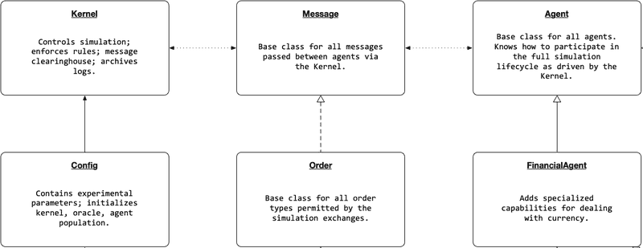

# ABIDES

ABIDES is a discrete-event market simulator with per-agent latency and computation delay, not an LLM benchmark.

*Cropped paper diagram (Figure 2, top two rows) of the ABIDES framework's classes: a Kernel that controls the simulation and acts as the clearinghouse for all messages passed between agents. Source: [Byrd, Hybinette and Balch, arXiv 1904.12066](https://arxiv.org/html/1904.12066v1).*

| | |
|---|---|
| Year | 2019 |
| Links | [arXiv 1904.12066](https://arxiv.org/abs/1904.12066) |
| Demo | None found (searched: arXiv abstract page, GitHub abides-sim/abides README, homepage field and wiki, jpmorganchase/abides-jpmc-public README and homepage field, web search for "ABIDES market simulator demo video") |
| Play mode | simulator (no LLM benchmark) |
| Clock | discrete-event, per-agent latency and computation delay |
| Does model latency matter? | Could |
| Basis | paper §1: "Variable electronic network latency and agent computation delays"; code `abides-core` latency model |

## Details

- Convertible: ABIDES is the natural base for a rigorous latency-sensitive task (put measured LLM latency in its computation-delay field).

## Demo

- None found. The [abides-sim/abides wiki](https://github.com/abides-sim/abides/wiki), opened in a headless browser, has only text tutorials ("Tutorial: Reference Market Simulation Configuration", "Sum Service" and others) with no video, GIF or viewer. The repo READMEs (abides-sim/abides, jpmorganchase/abides-jpmc-public) have no media and no homepage field, the arXiv abstract has no demo link, and a web search turned up only papers and code.

Searched 10 November 2026; no demo found.

Related: [HFTBench](hftbench.md)
