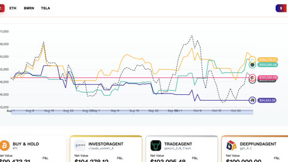

# Agent Market Arena

Agent Market Arena is a live-data trading arena that "trades at a fixed daily time".

*Screenshot of the AMA live dashboard as printed in the paper (Figure 5, cropped): daily net-value curves on BTC from Aug 1 to late Oct 2025 for InvestorAgent (Claude Sonnet 4), TradeAgent (Gemini 2.0 Flash) and DeepFundAgent (GPT-4.1) against buy-and-hold. Source: [Agent Market Arena paper, arXiv 2510.11695](https://arxiv.org/html/2510.11695).*

| | |
|---|---|
| Year | Oct 2025 |
| Links | [arXiv 2510.11695](https://arxiv.org/abs/2510.11695) |
| Demo | [AMA live dashboard](https://ama.thefin.ai/live) (linked from the paper): a daily-updated dashboard of agents' paper-trading decisions and returns on BTC, ETH, BMRN and TSLA, plus a Live Challenge and a Leaderboard. In Nov 2026 its Supabase backend did not resolve, so every view showed no data. No game view or replay; not human-playable. |
| Play mode | paused-live (live data, daily) |
| Clock | "trades at a fixed daily time" |
| Does model latency matter? | No |
| Basis | paper §3 |

## Details

- The live arenas are slow-cadence, noisy and unrepeatable; they are a poor fit for first environments.

## Demo

- [live-dashboard] [Agent Market Arena live dashboard](https://ama.thefin.ai/live) — Found via the paper's HTML version. I opened /live (the root redirects there) and clicked through Live Challenge, Leaderboard and the Updates popup. It is a React dashboard with "Live Arena", "Live Challenge", "Leaderboard" and "Join Arena!" tabs, BTC/ETH/BMRN/TSLA asset tabs and $/% toggles. Live Challenge says "The challenge has officially started on May 11, 2026". The Leaderboard filter defaults to 2025-08-01 to 2026-01-31. Updates lists a 2025-12-05 fee change ("Trading Fee: Updated from 0.05% to 0.06%", 0.1% slippage added). On the visit, every view showed "No data for BTC yet. Check Supabase runs or try another asset." or "No data found". The page's GET requests to the `trading_decisions` table at mnojhobblrgpthvithzs.supabase.co failed with ERR_NAME_NOT_RESOLVED. Play-mode evidence: the console logged "[AutoRefresh] Next refresh scheduled at: 11/11/2026, 6:00:00 PM", which shows a once-daily refresh of stored per-date decisions (fields include date, price, recommended_action, news_count and sentiment). This matches the daily paused-live label. The page makes no model calls of its own.

Visited 10 November 2026 in a headless browser.

Related: [Alpha Arena (Nof1)](alpha-arena.md); [LiveTradeBench](livetradebench.md)
