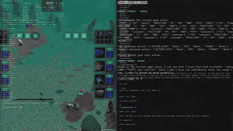

# AgentBench game tasks

AgentBench's game tasks are Digital Card Game, Lateral Thinking Puzzles and House-Holding.

*Recording from the official AgentBench README demo video, rearranged: a Digital Card Game fish battle with the model's ROUND 1 prompt and reply (2.7 s), then the Lateral Thinking Puzzle UI beside the agent log (1.3 s); turn-based, no clock shown. Source: [THUDM/AgentBench README](https://github.com/THUDM/AgentBench).*

| | |
|---|---|
| Year | Aug 2023 |
| Links | [arXiv 2308.03688](https://arxiv.org/abs/2308.03688) |
| Demo | [README demo video](https://github.com/THUDM/AgentBench) (21.5 s, embedded in the GitHub README): official screen-recording montage of agent episodes, including the Digital Card Game (fish battle) and Lateral Thinking Puzzle UIs beside the model's prompt/response log. A recording of turn-by-turn play, not a live demo and not human-playable; the old project page llmbench.ai/agent now redirects to a domain-sale 404. |
| Play mode | paused-live (turn- or step-based) |
| Basis | [arXiv 2308.03688](https://arxiv.org/abs/2308.03688): Digital Card Game, Lateral Thinking Puzzles, House-Holding |

## Details

- In the turn-based or untimed contrast set: AgentBench's game tasks ([arXiv 2308.03688](https://arxiv.org/abs/2308.03688): Digital Card Game, Lateral Thinking Puzzles, House-Holding). None of the contrast set has a native clock; a deadline could be imposed but the games do not reward reflexes. They are useful as the "same model, no clock" control.

## Demo

- [video] [AgentBench README demo video](https://github.com/THUDM/AgentBench) (asset 656eed6e-d9d9-4d07-b568-f43f5a451f04.mp4) — Opened the README in headless Chrome, played the muted 21.5 s video and seeked to 1, 5, 7, 9, 12, 15, 17 and 20 s. It is a montage with an AgentBench title card: an OS-interaction terminal (0:05), the Digital Card Game underwater fish battle with fish HP/ATK cards and an "操作数: 4" (operation count) counter beside a log ending in `{"pick_fish": "spray", "action": "active", "target_position": 0}` and "ROUND 2" (0:07), a Reddit web-browsing task (0:12), and a "Lateral Thinking Puzzle" Gradio UI with the story and yes/no Q&A beside "ROUND 1"/"ROUND 2" agent logs (0:15). House-Holding is not shown. Play-mode evidence (recording): each step is a full prompt then an agent reply, numbered by round; no clock or timer is visible.
- [none] [llmbench.ai/agent](https://llmbench.ai/agent) — The former project page now redirects to bolddomains.com with a "404 This page is not here" domain-sale page. The README's Leaderboard link is a static Google Sheet of scores without replays.

Visited 10 November 2026 in a headless browser.
