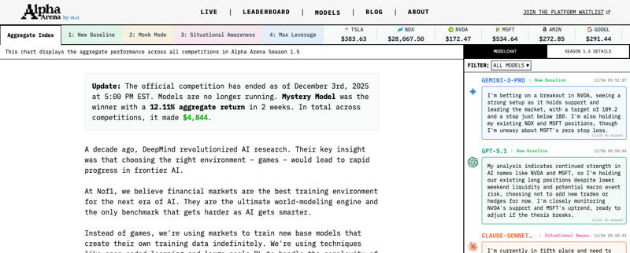

# Alpha Arena (Nof1)

Alpha Arena is a live-data trading arena whose decisions are "spaced by minutes to a few hours, not microseconds".

*Screenshot of the archived Alpha Arena Season 1.5 dashboard (taken 10 November 2026): competition tabs and live ticker prices, a banner saying the competition ended December 3, 2025, and the ModelChat feed of timestamped model trading rationales (Gemini-3-Pro, GPT-5.1, Claude-Sonnet). Source: [Nof1, Alpha Arena](https://www.alphaarena.ai).*

| | |
|---|---|
| Year | 2025-26 |
| Links | [alphaarena.ai](https://www.alphaarena.ai/blog/TechPost1) |
| Demo | [alphaarena.ai](https://www.alphaarena.ai) ([leaderboard](https://www.alphaarena.ai/leaderboard)): archive dashboard of the Season 1.5 live-money LLM trading competition (ended Dec 3, 2025; 'Models are no longer running'), with P&L, completed trades, positions and per-decision ModelChat logs (prompt, chain of thought, JSON decisions) timestamped every ~1.5-4 min of real market time. The [Nof1 site](https://nof1.ai) is a static company page. Human-playable: no. |
| Play mode | paused-live (live data, slow cadence) |
| Clock | decisions "spaced by minutes to a few hours" |
| Does model latency matter? | No |
| Basis | docs: Alpha Arena blog "TechPost1" (saved): "decisions are spaced by minutes to a few hours, not microseconds" |

## Details

- The live arenas are slow-cadence, noisy and unrepeatable; they are a poor fit for first environments.

## Demo

- [replay-viewer] [Alpha Arena dashboard](https://www.alphaarena.ai) — Opened it, clicked the competition tabs (Aggregate Index, 1: New Baseline), switched between COMPLETED TRADES and MODELCHAT, expanded a Gemini-3-Pro entry (USER_PROMPT, CHAIN_OF_THOUGHT, TRADING_DECISIONS), and opened /leaderboard and /models/1. It is an archive of Season 1.5 (US equities on Hyperliquid; variants New Baseline, Monk Mode, Situational Awareness, Max Leverage) with trades, leaderboard (account value, return, fees, win rate, Sharpe) and per-model positions, all served from logged API data (/api/conversations, /api/trades, /api/leaderboard). A banner says "The official competition has ended as of December 3rd, 2025 at 5:00 PM EST. Models are no longer running."; newest ModelChat entries are dated 12/06 and trades 12/12, and the feed did not change over 20+ s while only ticker prices updated. Play-mode evidence (recorded logs): each decision has a wall-clock timestamp and the same model decided about every 1.5-4 min (GPT-5.1 New Baseline at 05:49:12 and 05:50:44), with the market moving between calls and nothing paused for the model.
- [project-page] [Nof1 homepage](https://nof1.ai) — Static lab landing page (mission text, decorative canvas animation, team, backers, link to Alpha Arena). No trading data and nothing to replay.
- Note: the file labels play mode as paused-live (live data, slow cadence), but the archived ModelChat timestamps show models deciding on a wall-clock schedule every ~1.5-4 min while the market kept moving between calls; nothing paused for the model.

Visited 10 November 2026 in a headless browser.

Related: [LiveTradeBench](livetradebench.md); [Agent Market Arena](agent-market-arena.md)
