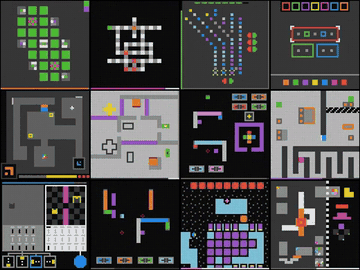

# ARC-AGI-3

ARC-AGI-3 is a set of turn-based grid games scored on action count against human action baselines.

*Recorded gameplay cropped to 12 tiles of the ARC Prize hero video's wall of ARC-AGI-3 games, each changing one action at a time with no clock on screen (the video does not say whether a human or an agent is playing). Source: [ARC Prize Foundation, ARC-AGI-3 project page](https://arcprize.org/arc-agi/3/).*

| | |
|---|---|
| Year | Jul 2025 |
| Links | [docs](https://docs.arcprize.org/methodology) |
| Demo | [play](https://arcprize.org/tasks/ls20) / [project page](https://arcprize.org/arc-agi/3/) / [sample replay](https://arcprize.org/replay/34a9614e-9b77-4f82-bda4-ff1320f2e15b) / [leaderboard](https://arcprize.org/leaderboard): 25 browser-playable turn-based grid games. The server advances one frame per action and has no clock; the bar on screen counts actions, not time. Each game page has a per-model table linking to recorded replays (NDJSON) with each step's reasoning, tokens, cost and thinking time (e.g. 48 s to 3 min per step, while the game waits). Human-playable: yes. |
| Play mode | paused-live, turn-based |
| Clock | none; scored on action count |
| Observation | grid frames |
| Action | few discrete actions |
| Players | 1 |
| Horizon | minutes |
| Human reference | human action baselines |
| Open source | toolkit open |
| Convertible to realtime-live | needs imposed deadline |
| Basis | docs `game-schema`: "ARC-AGI-3 games are turn-based environments"; code `agents/agent.py` choose_action -> take_action |

## Details

- In the turn-based or untimed contrast set: ARC-AGI-3 (docs: "ARC-AGI-3 games are turn-based environments"; scored on squared human-relative action efficiency). None of the contrast set has a native clock; a deadline could be imposed but the games do not reward reflexes. It is useful as the "same model, no clock" control and as a scoring template (human time over model time, squared).

## Demo

- [playable] [ARC-AGI-3 ls20 game](https://arcprize.org/tasks/ls20) — Played live in the browser (the 'Play [Humans]' link): clicked START, sat idle 8 s and 15 s while comparing screenshots and network traffic, then played with arrow keys; in one run cleared level 1 of 7 in 13 actions (API levels_completed 1/7, UI LEVEL 2/7). The console has a 64x64 grid, D-pad, SPACEBAR, CLICK, UNDO, RESET and HELP; each keypress POSTs /api/cmd/ACTION1..ACTION4 and the server returns the new frame, state (NOT_FINISHED), levels_completed/win_levels and available_actions. A 'Model Performance' table lists Humans 100% in 776 actions, google-barium-bb3 and gpt-6-1-sol provider-adapter runs at 99.99% in about 373-500 actions, claude-opus-5-high at 5.36%, each with a Replay link. Play-mode evidence (played live): no /api/cmd requests during 15 s idle; the yellow bar did not change while idle but shrank with each move, so it is an action budget, not a timer.
- [replay-viewer] [ARC-AGI-3 sample replay](https://arcprize.org/replay/34a9614e-9b77-4f82-bda4-ff1320f2e15b) — Let it auto-play, paused, stepped 5 decisions with Shift+Right, jumped to start and end, and read the reasoning log; also watched a model replay from the ls20 table ([barium-bb3 replay](https://arcprize.org/replay/89fd7da1-bcf5-4404-9f68-486d2eca77f4), google-barium-bb3-high-provider-adapter, 100%, 752 frames). The viewer has a scrubber with level markers (e.g. 41/124), play/pause/step/1x, 'Play Game', 'Import Replay', 'Download JSON', 'Download GIF', and a 'REASONING LOG' with action (e.g. CLICK (22, 40), MOVE UP), STEP n/N, reasoning text, OUTPUT TOKENS, COST and TIME per decision; the session summary shows gemini-3.1-pro-preview / benchmark_agent. Play-mode evidence (recorded replay): loaded from /api/recordings/ft09-0d8bbf25/<session_id> as NDJSON; per-step TIME shows 48.5 s at step 25 and 3m 1s at step 108 of the Gemini run (5.66 s per step for barium-bb3), with nothing moving in the game during those gaps.
- [project-page] [ARC-AGI-3 landing page](https://arcprize.org/arc-agi/3/) — Loaded it (three.arcprize.org redirects here). It has a hero video (arc-agi-3-hero.mp4) and links to 'Play [Humans]', 'Build [AI]' (docs.arcprize.org), the 25 public games, human leaderboards, the technical report, the ARC Prize 2026 track and a sample replay; a banner says ARC Prize 2026 has finished with results on December 4, 2026. It describes replays as a way to 'track decisions, actions, and reasoning in a structured timeline'.
- [leaderboard] [ARC Prize leaderboard](https://arcprize.org/leaderboard) — Loaded the verified ARC-AGI-3 cost-vs-score scatter (Opus 4.6 through Claude Opus 5, GPT-5.4 to GPT-6 families, Gemini 3.x, Grok) and the human leaderboard at arcprize.org/arc-agi/3/leaderboard, which ranks people by total actions to complete all 25 games and 183 levels (best 5502 actions). Aggregate scores only.

Visited 10 November 2026 in a headless browser.