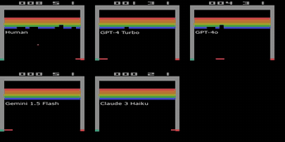

# Atari-GPT

Atari-GPT evaluates LLMs on seven Atari games with frame skip 8 and one model query per 8 frames.

*Recording of Breakout played by a human and four LLMs side by side; the panels were put together from step-wise runs where the game paused for each model, so the clip does not run at real-time speed. Source: [Atari-GPT project page (Waytowich et al.)](https://dev1nw.github.io/atari-gpt/videos.html).*

| | |
|---|---|
| Year | Aug 2024 |
| Authors / org | Waytowich, White, Sunbeam, Goecks (US Army Research Lab) |
| Links | [arXiv 2408.15950](https://arxiv.org/abs/2408.15950) |
| Demo | [project page](https://dev1nw.github.io/atari-gpt/) ([videos](https://dev1nw.github.io/atari-gpt/videos.html), [Google Sites videos](https://sites.google.com/view/atari-gpt/gameplay-performance-videos)): pre-recorded MP4 grids of 7 Atari games, with Human, GPT-4 Turbo, GPT-4o, Gemini 1.5 Flash and Claude 3 Haiku side by side, plus with/without in-context-learning versions. They are recordings of runs where the game paused for the model, not live play; the site says the 2-7 s inference is 'not yet fast enough for real time gameplay'. Human-playable: no. |
| Play mode | paused-live |
| Clock | STEP, frame skip 8 |
| Observation | pixels |
| Action | joystick actions |
| Players | 1 |
| Horizon | 1,000 steps |
| Human reference | standard human scores |
| Open source | MIT (repo nwayt001/atari-gpt) |
| Convertible to realtime-live | high |
| Basis | code: `run_experiments.py` `model_rollout` (blocking LLM call, then `env.step`, 1,000 steps) |

## Details

- Atari-GPT: Waytowich, White, Sunbeam, Goecks (US Army Research Lab), [arXiv 2408.15950](https://arxiv.org/abs/2408.15950). Seven games, frame skip 8, one model query per 8 frames, 2-7 s per call; authors say realtime was not possible. Human-normalised: GPT-4o 23.2%.
- Convertibility (Atari): high. Open source, microsecond step cost, 60 Hz native. Already run unpaused with RL: fixed action delays (Firoiu et al.) and Physical Atari. At 2 s latency a model misses 120 frames, so start with slow games (Freeway, Pong at reduced speed) or scale the clock and plot score against tick rate.

## Demo

- [video] [Atari-GPT project page](https://dev1nw.github.io/atari-gpt/) — Loaded the page and watched its one autoplaying, looping video (videos/GPT4o.mp4, 33.6 s), pausing for frames at 0.5 s, 2 s and 5 s. The 'Watch GPT-4o play Atari!' section is a grid of GPT-4o's recorded play on 7 games (Alien, Breakout, Frogger, Ms. Pacman, Pong, Seaquest, Space Invaders) with scores. Play-mode evidence (recording): a pre-rendered MP4 with no tick counter or latency overlay; network requests were only the HTML and the mp4. It is a sped-up recording of a run where the emulator waited for each model action, not live play.
- [video] [Atari-GPT videos page](https://dev1nw.github.io/atari-gpt/videos.html) — Listed its 7 videos (one per game, about 33.5 s each) and seeked Breakout and Pong to 1 s, 15 s and 30 s. Each video is a 5-panel side-by-side grid labelled Human, GPT-4 Turbo, GPT-4o, Gemini 1.5 Flash and Claude 3 Haiku; at 30 s in Breakout the scores were Human 34, GPT-4 Turbo 2, GPT-4o 9, Gemini 5, Claude 2. Play-mode evidence (recording): static MP4 files (videos/Breakout.mp4 and others) with no live calls; all panels advance at the same rate although each model takes seconds per decision, so the clips were assembled from paused, step-wise rollouts.
- [project-page] [Atari-GPT results page](https://dev1nw.github.io/atari-gpt/results.html) — Read the text and charts (normalized performance, per-environment, visual reasoning). GPT-4o is best at 23.2% human-normalized score. Play-mode evidence (text): the page says the 2-7 s inference time is 'a major hurdle for real-time applications' and that models are 'not yet fast enough for real time gameplay'.
- [video] [Google Sites gameplay videos](https://sites.google.com/view/atari-gpt/gameplay-performance-videos) — Loaded the older Google Sites page referenced by the paper and listed its embedded Google Drive videos. It has 14 videos, one 'w/o ICL' and one 'w/ ICL' per game for the same 7 games, each a multi-model grid like the GitHub Pages videos. Play-mode evidence (recording): recorded Drive videos only, nothing interactive or live.

Visited 10 November 2026 in a headless browser.

Related: [ALE / Atari](ale-atari.md)
