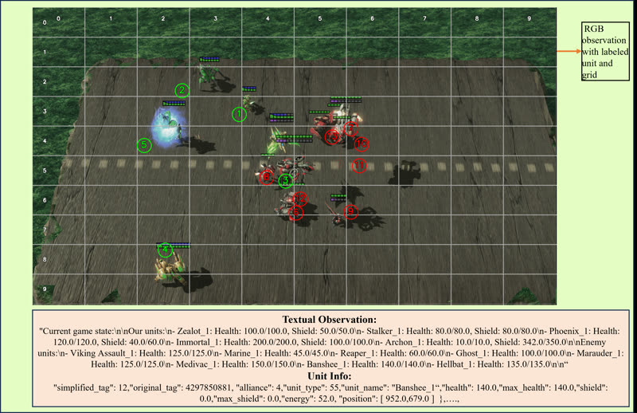

# AVA / AVACraft

AVA is SMAC-like StarCraft II micro at "2 Hz" for VLMs, paused-live from code.

*Paper figure (Figure 2), not a recording: the agent's multimodal observation, an annotated StarCraft II RGB frame with a 10x10 grid and numbered own (green) and enemy (red) units, plus the textual unit-state description. Source: [Ma et al., AVA, arXiv 2503.05383](https://arxiv.org/html/2503.05383v7).*

| | |
|---|---|
| Year | Mar 2025 |
| Links | [arXiv 2503.05383](https://arxiv.org/abs/2503.05383) |
| Demo | None found (searched: arXiv abstract and v7 HTML, GitHub repo camel-ai/VLM-Play-StarCraft2 README, homepage field and file tree, web search for AVA/AVACraft demo, YouTube and Bilibili videos). The paper says video demos are in its supplementary material, but none is posted publicly. |
| Play mode | paused-live |
| Clock | pysc2 `step_mul=8`, decide-then-step |
| Observation | RGB + text |
| Action | attack/move/ability |
| Players | 1 vs AI |
| Horizon | under 2 min |
| Human reference | none |
| Open source | open |
| Convertible to realtime-live | yes |
| Basis | code: `vlm_attention/run_env/multiprocess_run_env_with_ability.py` (`get_action` then `env.step`); `env/env_core.py` `SC2Env` without realtime |

## Details

- AVA ([arXiv 2503.05383](https://arxiv.org/abs/2503.05383)): SMAC-like micro at "2 Hz"; paused-live from code (`multiprocess_run_env_with_ability.py`: blocking `get_action`, then `env.step`; `SC2Env` built without realtime).
- Convertibility (StarCraft II family): SC2 has a verified `realtime=True`; SMAC-style micro battles are under two minutes with objective outcomes. Units keep executing orders, so degradation under a clock is gradual for macro play and sharp for micro.

## Demo

- None found. The arXiv abstract (comments: "Accepted by ACL 2026") links only the code repo [camel-ai/VLM-Play-StarCraft2](https://github.com/camel-ai/VLM-Play-StarCraft2). That repo has no homepage field, and its README has no GIFs, videos or demo links. Its only .SC2Replay files are PySC2 test data (`pysc2/lib/replay/test_data/replay_0*.SC2Replay`), not agent runs. The arXiv v7 HTML has no video or project-page URLs. Web searches for AVA/AVACraft demos, YouTube and Bilibili found only a different TextStarCraft II paper's videos. The paper says "video demos of our agent decision-making" are in its supplementary material, but none is hosted publicly.

Searched 10 November 2026; no demo found.

Related: [PySC2 / python-sc2](pysc2-python-sc2.md); [SMAC / SMACv2](smac.md); [TextStarCraft II](textstarcraft-ii.md); [LLM-PySC2](llm-pysc2.md); [RTSGameBench](rtsgamebench.md)
