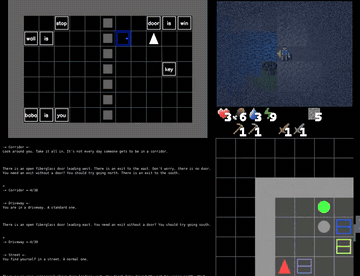

# BALROG

BALROG is a long-horizon text and text+image game benchmark stepped once per agent action.

*Recorded agent episodes from the authors' montage video, cropped to the BabaIsAI, Crafter, TextWorld and BabyAI panels and sped up 2x; the games are turn-based, so no clock is shown. Source: [BALROG authors, Hugging Face paper page video](https://huggingface.co/papers/2411.13543).*

| | |
|---|---|
| Year | Nov 2024 |
| Links | [arXiv 2411.13543](https://arxiv.org/abs/2411.13543) |
| Demo | [balrogai.com](https://balrogai.com): leaderboard where each model has a page with replication commands and a link to recorded per-step text trajectory logs (CSV/JSON on [GitHub](https://github.com/balrog-ai/experiments)), plus a short recorded montage video on the [HF paper page](https://huggingface.co/papers/2411.13543). All runs are offline and turn-based: the game waits for each action, and there is no live play. Human-playable: no. |
| Play mode | paused-live |
| Clock | STEP |
| Observation | text or text+image |
| Action | language actions |
| Players | 1 |
| Horizon | long |
| Human reference | none numeric |
| Open source | open |
| Convertible to realtime-live | weak (no native clock) |
| Basis | code: `balrog/evaluator.py` (`agent.act` then `env.step` per step) |

## Details

- In the turn-based or untimed contrast set: paused-live (turn- or step-based), from code (`balrog/evaluator.py`). None of the contrast set has a native clock; a deadline could be imposed but the games do not reward reflexes. They are useful as the "same model, no clock" control.

## Demo

- [leaderboard] [balrogai.com](https://balrogai.com) — Loaded the site, switched between the LLM and VLM tabs, clicked the top row and opened submit.html. It is a sortable DataTables leaderboard with columns % Progress, BabyAI, Crafter, TextWorld, BabaIsAI, MiniHack, NetHack and Date; on 2026-11-10 the top three were GPT-6-Astra-Max 68.3, Claude-Opus-5-Max 63.4 and GPT-5.6-Sol-Max 60.0. The submit page says entries are pull requests of evaluation logs ("summary and trajectory logs") to the BALROG/experiments repo. Play-mode evidence: static results table only; the page loads only static assets, makes no model calls, and has nothing to play.
- [replay-viewer] [per-model viewer page](https://balrogai.com/viewer.html?model=Gemini-3-Pro&leaderboard=LLM) — Opened the Gemini-3-Pro page, logged its network requests, and followed 'View Trajectories' to the [experiments repo](https://github.com/balrog-ai/experiments) (submissions/LLM/20260203_naive_gemini-3-pro/crafter/default/), where I fetched default_run_00.csv and default_run_00.json. The page shows a replication command (python3 -m eval agent.type=naive client.model_id=gemini-3-pro-preview ...) and a per-environment table (for example Crafter 57.27% over 10 episodes, NetHack 6.77% over 5 episodes); the trajectories are recorded log files (CSV columns Step, Action, Reasoning, Observation, Reward, Done with text observations such as "You see: grass 1 step to your west...") plus a JSON summary (num_steps 212, input_tokens 366223, seed, client config with timeout 60 and max_retries 10). Nothing is rendered visually and there is no step-through player. Play-mode evidence (recorded logs): rows are keyed by step index with no wall-clock timestamp or per-step latency, and the environments wait for each action, so these are offline turn-based runs.
- [video] [HF paper page video](https://huggingface.co/papers/2411.13543) — Played the author-posted MP4 in the first comment (Kf8vye8iNHp8m1YErD3RY.mp4, 56.9 s) and checked frames at 5%, 30%, 60% and 90%. It is a split-screen montage of recorded agent episodes: a BabaIsAI-style grid with a text log, Crafter or MiniHack tiles, and a growing NetHack map, with no captions, timing overlay or latency display. Play-mode evidence (recording): nothing on screen shows timing, and the benchmark is turn-based, so the environment waits for the model at every step.

Visited 10 November 2026 in a headless browser.