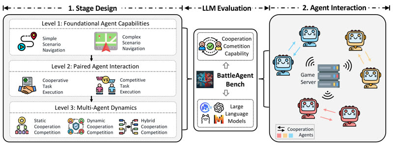

# BattleAgentBench

BattleAgentBench is "a turn-based interactive game, Battle City".

*Method diagram (figure, not footage) showing the three stage levels (navigation, paired cooperation/competition, multi-agent dynamics) and LLM agents connected to a Battle City game server. Source: [THUDM/BattleAgentBench README](https://github.com/THUDM/BattleAgentBench).*

| | |
|---|---|
| Links | [arXiv 2408.15971](https://arxiv.org/abs/2408.15971) |
| Demo | None found (searched: arXiv abstract page (no comments field, no code or demo links), [GitHub THUDM/BattleAgentBench](https://github.com/THUDM/BattleAgentBench) README and homepage field (static method diagram and one game screenshot only), web searches for project page, video and Hugging Face Space) |
| Play mode | paused-live (turn- or step-based) |
| Basis | [arXiv 2408.15971](https://arxiv.org/abs/2408.15971): "a turn-based interactive game, Battle City" |

## Details

- In the turn-based or untimed contrast set: BattleAgentBench ([arXiv 2408.15971](https://arxiv.org/abs/2408.15971): "a turn-based interactive game, Battle City"). None of the contrast set has a native clock; a deadline could be imposed but the games do not reward reflexes. They are useful as the "same model, no clock" control.

## Demo

- None found. The arXiv abstract page (2408.15971) has no comments field and lists no code, project or demo links. The [THUDM/BattleAgentBench](https://github.com/THUDM/BattleAgentBench) repo's homepage field points back to the repo itself. Its README has only two static images ("images/methodv3.png", a method diagram, and "images/game2.png", a game screenshot) plus instructions for running the Battle City server and LLM clients locally (`run_game.sh`, `run_batch.sh`). Web searches for a project page, video or Hugging Face Space found nothing; "BattleAgent" (agiresearch) is an unrelated project.

Searched 10 November 2026; no demo found.
