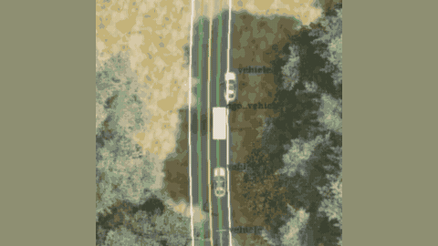

# Bench2Drive

Bench2Drive is a driving benchmark run in CARLA synchronous mode.

*A recording, played at normal speed and cropped around the car, of the Think2Drive RL expert (white box, "ego_vehicle") driving a two-lane road in the Vehicle Opens Door scenario while collecting training data (not an evaluated model). Source: [Bench2Drive project page](https://thinklab-sjtu.github.io/Bench2Drive/).*

| | |
|---|---|
| Year | 2024 |
| Links | [arXiv 2406.03877](https://arxiv.org/abs/2406.03877) |
| Demo | [project page](https://thinklab-sjtu.github.io/Bench2Drive/) and [YouTube video](https://www.youtube.com/watch?v=-osdzJJs2g0): recorded videos of the Think2Drive RL expert driving the CARLA scenarios used to collect the training data. These are recordings, not a live model run, a replay viewer or a human-playable demo, and no LLM agent appears. |
| Play mode | paused-live |
| Clock | CARLA synchronous mode |
| Basis | code: `leaderboard/leaderboard/leaderboard_evaluator.py` sets `synchronous_mode = True` |

## Demo

- [project page with videos] [Bench2Drive website](https://thinklab-sjtu.github.io/Bench2Drive/) (linked as "Website" from the [repo README](https://github.com/Thinklab-SJTU/Bench2Drive)): I rendered the page and played its four top-down MP4s under "Challenging Scenes Collected By World Model RL Expert Think2Drive", then seeked each one to about 5-6 s. The clips are vehicleopensdoor-top-down.mp4 (17.7 s, "The vehicle in front suddenly opens its door, and the ego vehicle responds urgently and changes lanes."), parkingexit-top-down.mp4 (8.9 s, "Starting from parking the car. (Parking Exit)"), enter-actor-flow-top-down.mp4 (21.3 s) and construction-two-way-top-down.mp4 (15 s). The page also embeds the YouTube video below and shows sensor, data-distribution and benchmark-table images. Play-mode evidence: all of these are static recorded files served from the GitHub Pages "sources/" folder. Nothing on the page calls a model live, and nothing is playable.
- [official video] [Bench2Drive Dataset Demonstration Video](https://www.youtube.com/watch?v=-osdzJJs2g0) (YouTube, 2:12, channel Xiaosong Jia, described as "the demonstration video for the official training set of Becn2Drive"): I played it and seeked to 1:00. That frame shows a top-down CARLA intersection with labelled vehicle boxes ("vehicle45717" and others), lane overlays and a "Limitations:" caption. Play-mode evidence: an edited recording of expert data collection, with no clock or step readout.
- Note: the demos show only the RL expert's data-collection driving. They show no evaluated policy (end-to-end driving model or LLM) running under the synchronous-mode evaluator, so they neither confirm nor contradict the paused-live label.

Visited 10 November 2026 in a headless browser.

Related: [CARLA](carla.md)
