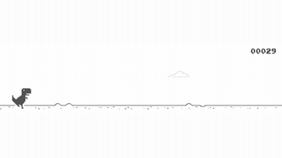

# Chrome Dino (gym-chrome-dino)

gym-chrome-dino sends key presses into a live browser game, so the Dino browser game is realtime-live.

*Real-time recording (6 s, not sped up) of the hosted T-Rex Runner page that gym-chrome-dino loads, played by a simple scripted jumper rather than a model; the score counter at top right ticks on the wall clock. Source: [elvisyjlin/t-rex-runner (gym-chrome-dino)](https://elvisyjlin.github.io/t-rex-runner/).*

| | |
|---|---|
| Year | Oct 2018 |
| Demo | [hosted T-Rex Runner](https://elvisyjlin.github.io/t-rex-runner/), the page that gym-chrome-dino's `DinoGame` loads ([elvisyjlin/gym-chrome-dino](https://github.com/elvisyjlin/gym-chrome-dino)). You can play it yourself in the browser. The game runs live on the wall clock, so obstacles keep coming whether or not you press a key. The site does not show a model playing. |
| Play mode | paused-live (Dino browser is realtime-live) |
| Clock | STEP at about 30 fps |
| Observation | numeric state or pixels |
| Action | 1-few buttons |
| Players | 1 |
| Horizon | seconds |
| Human reference | easy |
| Open source | MIT |
| Convertible to realtime-live | high |
| Basis | gym-chrome-dino `envs/chrome_dino_env.py` (key presses into a live browser `Runner`) |

## Details

- Listed with Flappy Bird, PLE, MinAtar and PyBoy in the RL-era table; its play-mode cell notes "Dino browser is RL" (realtime-live).

## Demo

- [human-playable] [elvisyjlin.github.io/t-rex-runner](https://elvisyjlin.github.io/t-rex-runner/): this is the forked game that gym-chrome-dino `game/dino_game.py` opens with `self.driver.get('https://elvisyjlin.github.io/t-rex-runner/')`. The page is titled "chrome easter egg: t-rex runner" and shows "Press Space to start" above one 600x150 canvas. I pressed Space and left the dino alone. The game kept running on the wall clock: `Runner.instance_.distanceRan` rose about 370 units per second, and `currentSpeed` climbed from 6.06 to 6.67 with the page's `config.ACCELERATION` 0.001. The idle dino hit the first cactus after about 5 s, showing "GAME OVER" and a score of 00042 (HI 00047). Next I ran a simple scripted jumper for about 11 s that sent key presses while the game ran, and it reached a score of 115 without crashing. The network log showed only static files (index.js, sprite PNGs, fonts) and no model or API calls. Play-mode evidence: the browser game is realtime-live, because it never waits for input. Nothing is recorded, and the page shows no LLM or RL agent.
- [static image] The repo README has a single screenshot (a JPG), with no video or GIF.

Visited 10 November 2026 in a headless browser.

Related: [Flappy Bird](flappy-bird.md); [PLE](ple.md); [MinAtar](minatar.md); [PyBoy](pyboy.md)
