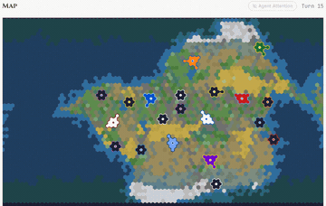

# CivBench

CivBench is a turn-based strategy benchmark played "over 300 turns".

*Screen recording of the site's animated territory-map replay of a recorded game (Claude Opus 4.6 as Babylon), running from about turn 20 to turn 220; the replay plays at its 10x setting and the GIF is a further 2x faster. Source: [civ6-mcp CivBench game archive](https://civ6-mcp.lwilko.com/games/babylon_stk_-1851106432_wandering-carmine-ballista-57).*

| | |
|---|---|
| Year | Sep 2026 |
| Links | [arXiv 2609.02459](https://arxiv.org/abs/2609.02459) |
| Demo | [civ6-mcp site](https://civ6-mcp.lwilko.com) (repo homepage of [lmwilki/civ6-mcp](https://github.com/lmwilki/civ6-mcp)): a leaderboard with replays. It has a CivBench ELO leaderboard from 23 games plus a game archive where each recorded game opens a turn-by-turn diary viewer and an animated map replay. These are recordings, not live play, and none is human-playable. |
| Play mode | paused-live, turn-based |
| Clock | none or generous per-move limits |
| Observation | text / board |
| Action | moves |
| Players | 1-2+ |
| Horizon | long |
| Human reference | varies |
| Open source | varies |
| Convertible to realtime-live | not meaningful |
| Basis | CivBench paper "over 300 turns" |

## Details

- In the turn-based or untimed contrast set: CivBench ([arXiv 2609.02459](https://arxiv.org/abs/2609.02459), "over 300 turns"). None of the contrast set has a native clock; a deadline could be imposed but the games do not reward reflexes. They are useful as the "same model, no clock" control.

## Demo

- [leaderboard] [CivBench leaderboard](https://civ6-mcp.lwilko.com/civbench). I rendered the page. It says "A benchmark for evaluating LLM agents in Civilization VI. Three scenarios at escalating difficulty test specific blind spots in agent perception", with scenario tabs "Ground Control", "Snowflake" and "Cry Havoc". The rankings cover "23 games played": Claude Opus 4.6 at ELO 1547 (2-6), Gemini 3.1 Pro at 1511 (1-5) and GPT-5.4 at 1457 (0-8). Model profiles split this into Economic, Military and Science.
- [replay-viewer] [Game archive](https://civ6-mcp.lwilko.com/games), for example [wandering-carmine-ballista-57](https://civ6-mcp.lwilko.com/games/babylon_stk_-1851106432_wandering-carmine-ballista-57) (Claude Opus 4.6 as Babylon, "VICTORY T326", "Science Victory"). I opened it and stepped through both tabs. The Diary tab has a turn slider ("Entry 325 / 325") with per-turn stats, an 8-civ leaderboard, diplomacy, victory progress, and the agent's TACTICAL / STRATEGIC / TOOLING / PLANNING / HYPOTHESIS reflections (for example "Turn 326: Production set, units skipped, no blockers... Attempting the critical T326→T327 transition that has hung in every"). Its timestamps are wall-clock, such as "Apr 3, 03:40". The page also offers "Turn Log" and "Eval Log" downloads. On the Map tab, pressing play animates a hex-map replay of territory at "10x"; after about 8 s it had reached "Turn 146". An "Agent Attention" overlay reports "713 spatial queries" and "22.7m query time". Play-mode evidence (recorded replay): the network panel showed only static Next.js page and image fetches, with no model calls. The replay is indexed by game turn and shows no clock, which matches the paused-live, turn-based label.

Visited 10 November 2026 in a headless browser.
