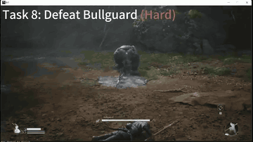

# CombatVLA

CombatVLA's benchmark is combat in Black Myth: Wukong, with the game paused during inference.

*Recording of CombatVLA fighting the Bullguard boss (Task 8, Hard) in Black Myth: Wukong; the authors' video has the game pauses during inference edited out, so it looks faster than it ran. Source: [CombatVLA project page](https://combatvla.github.io/).*

| | |
|---|---|
| Year | 2024-25 |
| Authors / org | Alibaba |
| Links | [arXiv 2503.09527](https://arxiv.org/abs/2503.09527) |
| Demo | [project page](https://combatvla.github.io/): two pre-recorded videos. One shows the model completing 13 Black Myth: Wukong combat tasks with the game pauses during inference edited out. The other is a side-by-side inference-speed comparison with VARP that keeps the pauses (about 1.8 s per call). The game waits for the model. Human-playable: no. Live demo: no. |
| Play mode | paused-live |
| Clock | game paused during inference |
| Observation | screenshots |
| Action | key/mouse |
| Players | 1 |
| Horizon | one fight |
| Human reference | 10 humans |
| Open source | released; paid game |
| Convertible to realtime-live | poor |
| Basis | paper 2503.09527 §4: "the agent pauses the game during model inference"; code `framework/runner/bmwk_runner.py` `pause_game()` |

## Details

- CombatVLA (Alibaba, ICCV 2025), [arXiv 2503.09527](https://arxiv.org/abs/2503.09527): states the game is paused during inference; 1.85 s per step.
- Convertibility: poor. Closed commercial Windows games, pausing through the game menu. NitroGen's clock interception (see [NitroGen universal simulator](nitrogen.md)) is the practical route to controlling time in such games.

## Demo

- [video] [CombatVLA project page](https://combatvla.github.io/) — Loaded the page and seeked through its two recorded videos (task1_13.mp4, 6:49, and comparison.mp4, 0:40); nothing is interactive and the network log shows only the two static mp4 files, so this was seen in recordings, not run live. The task video shows a Windows game window titled "b1" (Black Myth: Wukong) with captions such as "Task 1: Defeat WolfScout (Easy)", "Task 8: Defeat Bullguard (Hard)" and "Task 10: Defeat Guangzhi (Very Hard)"; the page says the videos also include Sekiro. The "Comparison on Inference Speed" video shows VARP and CombatVLA side by side, and by 35 s CombatVLA has finished while VARP is still fighting. Play-mode evidence: the game waits for the model; the paper (arXiv 2503.09527 v2, Sec 14) says the task video has "edited out the game pauses" and the comparison keeps them, "the pause duration representing the inference time" (about 1.8-1.85 s per call for CombatVLA vs about 90 s for VARP); no tick counter or latency overlay is visible in the frames.

Visited 10 November 2026 in a headless browser.

Related: [CombatVLA](../solutions/combatvla.md) (the model); [VARP](varp.md); [Cradle](cradle.md)
