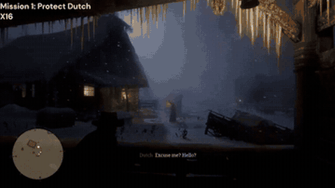

# Cradle

Cradle is a general computer-control agent framework that states it must pause games such as RDR2 and Stardew Valley while waiting for the model.

*Recording of Cradle playing the "Protect Dutch" mission in Red Dead Redemption II, sped up 16x by the authors (overlay "X16"), so the model's waiting time and game pauses are not visible. Source: [Cradle authors (BAAI), "Cradle Mastering Tasks in Chapter 1 of Red Dead Redemption II (at 16x speed)"](https://www.youtube.com/watch?v=fkkSJw1iJJ8).*

| | |
|---|---|
| Year | 2024 |
| Authors / org | Tan et al., BAAI and others |
| Links | [arXiv 2403.03186](https://arxiv.org/abs/2403.03186) |
| Demo | [Project page](https://baai-agents.github.io/Cradle/): official recorded videos of Cradle playing RDR2, Stardew Valley, Cities: Skylines and Dealer's Life 2 (plus five software apps), all titled "at 16x speed". Recordings only; no live run, replay viewer or human-playable page. |
| Play mode | paused-live in every environment (code); actions are generated code skills |
| Clock | game paused during calls |
| Observation | video clips at 2 fps |
| Action | keyboard/mouse via code |
| Players | 1 |
| Horizon | long |
| Human reference | anecdotal |
| Open source | code open; commercial games |
| Convertible to realtime-live | poor |
| Basis | code: `cradle/provider/execute/skill_execute.py` (`unpause_game` -> execute -> `pause_game` around every skill); paper §4 "we must pause those game environments while waiting for backbone model responses" |

## Details

- Cradle (Tan et al., BAAI and others), [arXiv 2403.03186](https://arxiv.org/abs/2403.03186): states it must pause RDR2 and Stardew Valley while waiting for the model; slow-paced management games run continuously. Actions are generated code functions. Later measured at about 62 s per decision.
- Convertibility: poor. Closed commercial Windows games, pausing through the game menu, human-judged success for Cradle. NitroGen's clock interception (see [NitroGen universal simulator](nitrogen.md)) is the practical route to controlling time in such games.

## Demo

- [project page with videos] [Cradle project page](https://baai-agents.github.io/Cradle/) — I rendered the page, played the 16 s intro montage (`video/whole_video.mp4`, a grid of game and software clips) and seeked two of the embedded YouTube videos. The "Game Videos" section embeds five videos: "RDR2: Main Storyline" (7:27), "RDR2: Open-ended World" (1:25), "Stardew Valley" (5:56), "Cities: Skylines" and "Dealer's Life 2". There is also a "Software Videos" section for Chrome, Outlook, CapCut, Meitu and Feishu. The YouTube titles all end "(at 16x speed)", for example "Cradle Mastering Tasks in Chapter 1 of Red Dead Redemption II (at 16x speed)". Frame overlays read "Mission 1: Outlaws from the West X8" near the start and "Mission 1: Search Barn X16" at 3:22, and the Stardew video reads "Task 1: Farm Clearup" at 1:00. Play-mode evidence: these are edited, sped-up recordings. They do not show a live clock, model latency or the game pauses, so they cannot confirm or refute the paused-live label.

Visited 10 November 2026 in a headless browser.

Related: [Cradle](../solutions/cradle.md) (the scaffold); [CombatVLA](combatvla.md); [VARP](varp.md); [Lumine evaluation settings](lumine.md)
