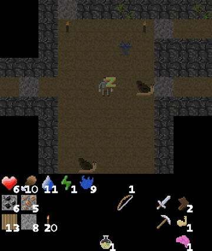

# Crafter / Craftax

Crafter and its JAX successor Craftax are fast, text-renderable open-world survival games that are not reflex-driven.

*A 5-second excerpt (from 0:40) of the pre-rendered Craftax gameplay GIF on the project page: a player sleeps, then explores a dungeon floor with creatures and a ladder, with health, food, water, energy and mana plus inventory shown below; the page does not say whether a human or an agent played it, and there is no clock. Source: [Craftax project page](https://craftaxenv.github.io/).*

| | |
|---|---|
| Year | 2021 / 2024 |
| Links | [Craftax](https://github.com/MichaelTMatthews/Craftax) |
| Demo | [Craftax site](https://craftaxenv.github.io/): a project page with pre-rendered gameplay GIFs (skills and an author-tile gallery) that do not say who played them. [Crafter page](https://danijar.com/project/crafter/): a recorded human-expert video plus YouTube talk and emergent-behavior RL videos. Neither shows an LLM, and both environments are step-locked. Human-playable in the browser: no (local pygame GUI only). |
| Play mode | paused-live |
| Clock | STEP |
| Observation | pixels, symbolic, glyph text |
| Action | 17+ discrete |
| Players | 1 |
| Horizon | long |
| Human reference | Crafter human 50.5% |
| Open source | MIT |
| Convertible to realtime-live | mechanical only |
| Basis | code: `crafter/env.py` `step`; Craftax `craftax_symbolic_env.py` `step_env` |

## Details

- **Crafter / Craftax**: fast and text-renderable (Craftax glyphs), but not reflex-driven; a wall-clock tick would convert thinking into hunger and damage.

## Demo

- [project-page] [Craftax project page](https://craftaxenv.github.io/) — Loaded the page, scrolled it, listed its media and logged network requests. It is a Distill-style page with looping Craftax GIFs (author tiles, craftax_long.gif, skill GIFs for Mining, Farming, Dungeon Crawling, Archery, Building, Magic), speed and achievement bar charts and static PLR/ACCEL level images; there is no video element, iframe, canvas or in-browser game. Play-mode evidence (pre-rendered GIFs): no caption says whether a human, RL agent or LLM produced the footage, and network requests were only static .gif and .png files. The page says one author took about 5 hours of human play to reach a perfect run; Craftax is a step-locked JAX environment that waits for each action.
- [video] [Crafter project page](https://danijar.com/project/crafter/) — Loaded the page, paused its autoplaying video (asset/crafter/video.mp4, 2:03) and checked frames at 5 s, 40 s and 90 s, and screenshotted the embedded YouTube talk (kcvafU2-CPc, 'Introducing Crafter'). The video is labelled 'Human Expert' (frame at 0:40 shows grass, a cow, an arrow and the inventory HUD); the page also links a human expert video, an emergent-behaviors RL video, baseline scores and a human experts dataset on archive.org. Play-mode evidence (recording): recorded human play and recorded RL agents, no LLM and nothing live; Crafter is turn-based and its human GUI (python -m crafter.run_gui) runs only locally.

Visited 10 November 2026 in a headless browser.