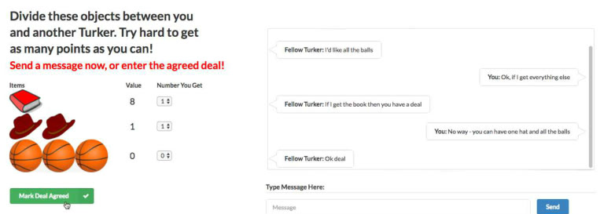

# Deal or No Deal

Deal or No Deal is a turn-based negotiation task in which "Agents then sequentially take turns", over 10 turns.

*Figure 1 from the paper (a screenshot, not a recording): the Mechanical Turk interface used to collect the dataset, with private item values on the left and a human-human negotiation chat ending in "Ok deal" on the right. Source: [Lewis et al. 2017, arXiv 1706.05125](https://arxiv.org/abs/1706.05125).*

| | |
|---|---|
| Year | Jun 2017 |
| Links | [arXiv 1706.05125](https://arxiv.org/abs/1706.05125) |
| Demo | [EMNLP 2017 talk video](https://aclanthology.org/D17-1259.mp4) (ACL Anthology): a recorded 25-minute conference talk whose slides show example human-vs-model negotiation transcripts. No playable page, live demo or replay viewer; the code repo (facebookresearch/end-to-end-negotiator, archived) has no media. |
| Play mode | paused-live, turn-based |
| Clock | 10 turns |
| Basis | paper §2: "Agents then sequentially take turns" |

## Details

- All the turn-based arenas convert trivially by adding a wall-clock deadline per message, as the UPenn paper does.

## Demo

- [official-video] [EMNLP 2017 talk, ACL Anthology D17-1259](https://aclanthology.org/D17-1259.mp4) — opened the MP4 linked as "Video" on https://aclanthology.org/D17-1259/ and seeked to several points (duration 1496.9 s); it is a conference talk recording, slides beside a camera view of the speaker. At about 13:43 an "Analysis" slide shows a human-vs-robot transcript ("I need the book and hats" ... "How about I give you the book and I keep the rest" / "Ok deal"); at about 7:29 a "Goal-based Training" slide. Play-mode evidence: static slide transcripts only, no clock or timing shown; consistent with the turn-based label.
- The GitHub repo [facebookresearch/end-to-end-negotiator](https://github.com/facebookresearch/end-to-end-negotiator) (archived, no homepage field) README has no demo, GIF or video; the dataset is on Hugging Face as `deal_or_no_dialog` (data only, no Space).

Visited 10 November 2026 in a headless browser.

Related: [Real-Time Deadlines (UPenn negotiation)](real-time-deadlines-negotiation.md)
