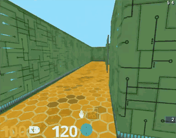

# DeepMind Lab

DeepMind Lab is a step-locked 3D platform, convertible but Linux-only with a Bazel build.

*Recording of a human player in the 'Nav Maze Level 1' maze, collecting apples while the top-right timer counts down (not an agent). Source: [Google DeepMind, "DeepMind Lab - Nav Maze Level 1" video](https://www.youtube.com/watch?v=M40rN7afngY).*

| | |
|---|---|
| Year | Dec 2016 |
| Links | [repo](https://github.com/google-deepmind/lab) |
| Demo | [video](https://www.youtube.com/watch?v=M40rN7afngY): 'Nav Maze Level 1', Google DeepMind, 2016. First-person 3D maze with score and timer HUD; the description says 'captured via human player', so no agent is shown. Human-playable: no (not in browser). |
| Play mode | paused-live |
| Clock | STEP, 60 fps config |
| Observation | RGBD |
| Action | 7-dim |
| Players | 1 |
| Horizon | minutes |
| Human reference | n/a |
| Open source | open, Linux, Bazel |
| Convertible to realtime-live | medium |
| Basis | docs `python_api.md`: step "Advance the environment a number num_steps frames"; fps is "An advisory metric" |

## Details

- **DeepMind Lab**: convertible but Linux-only with a Bazel build; ViZDoom covers the same ground.

## Demo

- [video] [DeepMind Lab - Nav Maze Level 1](https://www.youtube.com/watch?v=M40rN7afngY) — Watched frames at about 10, 28 and 50 s of the 1:02 Google DeepMind video (Dec 2016): a first-person 3D maze (green circuit-board walls, orange hex floor) with a score and timer HUD (100 / 102, top-right counter '3 6'). Play-mode evidence: the description states "In environment footage, captured via human player.", so this is a recording of human play, not an agent.

Visited 10 November 2026 in a headless browser.

Related: [ViZDoom](vizdoom.md)
