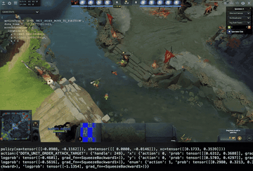

# Dota 2 bot API / dotaservice

The Dota 2 bot scripting API calls Lua `Think()` every frame, and dotaservice exposes a gRPC step interface.

*Recording of an RL policy (not an LLM) controlling a Dota 2 hero through dotaservice, with the in-game overlay showing the chosen unit order and a terminal strip printing the PyTorch policy outputs per step; the full 2.7 s README demo, resized and looped. Source: [TimZaman/dotaservice README demo.gif](https://github.com/TimZaman/dotaservice).*

| | |
|---|---|
| Year | Nov 2018 |
| Links | [dotaservice](https://github.com/TimZaman/dotaservice) |
| Demo | [dotaservice README demo.gif](https://github.com/TimZaman/dotaservice/raw/master/demo.gif) and two [DotaClient](https://github.com/TimZaman/dotaclient) YouTube recordings ([9 Mar 2019](https://www.youtube.com/watch?v=hxitG142gsY), [28 Jan 2019](https://www.youtube.com/watch?v=6vgStVonDdA)): recordings of an RL policy (not an LLM) playing Shadow Fiend 1v1 mid through dotaservice with action overlays; the Jan video shows the console logging "Script function 'Think' ... took ~28 ms" per frame. Recordings only; nothing human-playable or live. |
| Play mode | scripted (bot scripting API) + paused-live (dotaservice) |
| Clock | 30 fps |
| Observation | state vector |
| Action | unit orders |
| Players | 5v5 |
| Horizon | 30-45 min |
| Human reference | n/a |
| Open source | stale |
| Convertible to realtime-live | poor |
| Basis | docs: Valve wiki (archived capture) `Think()` "Called every frame"; code: dotaservice `lua/bot_generic.lua:94-99, 205-209` (Think busy-waits for the action file) |

## Details

- **Dota 2 bot scripting API**: Lua `Think()` called every frame; scripted natively. dotaservice exposes a gRPC step interface but is stale. 5v5, long, not human-easy: a motivating example, not a first environment.

## Demo

- [video] [dotaservice README demo.gif](https://github.com/TimZaman/dotaservice/raw/master/demo.gif) — Opened the repo README in headless Chrome and screenshotted the 600x405 animated GIF at three points. It shows a Dota 2 spectator view of a bot hero at mid with an in-game "GAME STATS" overlay printing the chosen order (`actionType = 'DOTA_UNIT_ORDER_MOVE_TO_POSITION'`, `dota_time = -17.5...`) and a terminal strip printing the PyTorch policy output (`policy(xa=tensor(...))`, `action:{'DOTA_UNIT_ORDER_ATTACK_TARGET': ...}`, logprob tensors). Play-mode evidence (recording): per-step policy action printed alongside the game, no timing readout.
- [video] [DotaClient "Dota 2 RL Bot. 8 Mar; learned to use fountain."](https://www.youtube.com/watch?v=hxitG142gsY) — Played the 2:27 video muted and seeked to 18, 73 and 125 s (later frames were stuck buffering). A 1v1 Shadow Fiend self-play game from the RL agent with the overlay showing `actionDelay = 5669`, `actionType = 'DOTA_UNIT_ORDER_ATTACK_TARGET'` and game clock 1:36. Play-mode evidence (recording): an `actionDelay` field is shown per action; no LLM involved.
- [video] [DotaClient "28 Jan self-play"](https://www.youtube.com/watch?v=6vgStVonDdA) — Skipped a pre-roll ad, played the 6:53 video and seeked to 43, 207 and 351 s. Frames show the Dota console filled with lines "Script function 'Think' on bot npc_dota_hero_nevermore took 28.754ms" (25-31 ms each), `host_timescale 5` typed in the console, game clock 0:21 and overlay `actionDelay = 1795`, `actionType = 'DOTA_UNIT_ORDER_NONE'`. Play-mode evidence (recording): the per-frame Think call blocks about 28 ms while waiting on the external agent, consistent with the file's paused-live label for dotaservice.

Visited 10 November 2026 in a headless browser.

Related: [OpenAI Five](../solutions/openai-five.md); [LOLPlay](lolplay.md)
