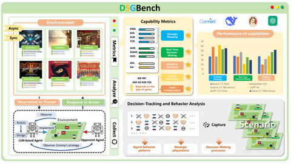

# DSGBench

DSGBench runs StarCraft II and Street Fighter III with an `asynch_mode` flag that switches between paused-live and realtime-live.

*Overview figure from the authors: the six games with the Async/Sync switch, the observation-to-prompt and response-to-action agent loop, capability metrics with per-model results, and decision-tracking analysis; a diagram, not footage. Source: [DSGBench project page](https://fateyetian.github.io/DSGBench/).*

| | |
|---|---|
| Year | Mar 2025 |
| Links | [arXiv 2503.06047](https://arxiv.org/abs/2503.06047) |
| Demo | None found (searched: arXiv abstract page, repo README of DeciBrain-Group/DSGBench (no homepage field), [project page](https://fateyetian.github.io/DSGBench/) (static figures only), [Game Wiki](https://decibrain-group.github.io/GameWiki/) (text only, "Under Construction"), web search for "DSGBench demo video"). |
| Play mode | paused-live (`asynch_mode` false) + realtime-live (`asynch_mode` true) |
| Clock | SC2: python-sc2 `realtime=asynch_mode`; SF3: async starts LLM threads while the game steps |
| Observation | text state |
| Action | macro actions / named moves |
| Players | 1-2 |
| Horizon | game-length |
| Human reference | none |
| Open source | open repo |
| Convertible to realtime-live | native flag |
| Basis | code: `games/starcraft2/agent_vs_computer_starcraft_env.py:244` `realtime=asy_mode`; `agent_manager/agents/streetfight3_agent/streetfight3_agent.py:103-127` (`PlanAndAct` threads when `asy_running`) |

## Demo

- [none] [Project page](https://fateyetian.github.io/DSGBench/) — rendered it; it holds only the abstract, three static figures (Overview.png, Code_Architecture.png, Results.png) and BibTeX; no video, GIF, iframe or replay viewer.
- [none] [Game Wiki](https://decibrain-group.github.io/GameWiki/) — rendered the home page and the StarCraft II, Street Fighter III and Experimental Result pages; text only, with the banner "GameWiki Under Construction"; no media or trajectory viewer.
- The repo README links only the paper, project page, wiki and code; the arXiv comments say "43 pages, 5 figures, conference"; a web search for a DSGBench demo video found nothing.

Searched 10 November 2026; no demo found.

Related: [PySC2 / python-sc2](pysc2-python-sc2.md); [LLM Colosseum](llm-colosseum.md); [DIAMBRA Arena](diambra-arena.md)
