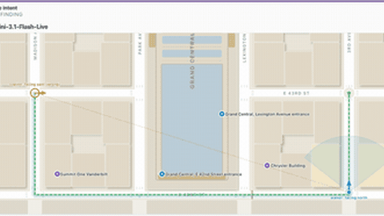

# DuplexWorld

DuplexWorld is a speech benchmark whose world "moves on its own clock" via a tick-based orchestrator.

*Screen recording of the project page's replay of a recorded Gemini-3.1-Flash-Live Pathfinding call near Grand Central, with the walker's position and field of view moving along the route while the copilot's belief lags (a replay of a past run, not a live call; audio not included). Source: [DuplexWorld voice samples](https://duplexworld.github.io/samples.html).*

| | |
|---|---|
| Year | 2026 |
| Links | [arXiv 2608.10716](https://arxiv.org/abs/2608.10716) |
| Demo | [project page](https://duplexworld.github.io/) with [voice samples](https://duplexworld.github.io/samples.html), a [tick-by-tick harness walkthrough](https://duplexworld.github.io/system.html) and an interactive [leaderboard](https://duplexworld.github.io/leaderboard.html): recorded speech-to-speech calls replayed with audio and an animated Pathfinding map (walker and copilot positions). These are recordings of past runs on the 200 ms tick clock, not live model calls; not human-playable. |
| Play mode | realtime-live (speech) |
| Clock | world "moves on its own clock" via a tick orchestrator; wall-clock timeout 1,200 s |
| Basis | paper §4: "a tick-based orchestrator"; "the world that moves on its own clock" |

## Demo

- [project page] https://duplexworld.github.io/ — opened the "Experience" page; it shows the title "Can a voice agent help you get through the day?", illustrations of the six worlds and a looping video (flight-small.mp4); links to the arXiv paper. The project page URL was found via a Centific blog post, not the arXiv page.
- [recorded replay with audio] https://duplexworld.github.io/samples.html — let the first sample ("Single intent", "PATHFINDING", "Gemini-3.1-Flash-Live") autoplay and seeked with the "+10s" button; an animated map near Grand Central shows "walker: facing east", later "walker: facing north", and "copilot: facing east (wrong)", with ideal-route and field-of-view overlays and controls "Pause", "−10s", "+10s", "Restart call". Further samples are Banking calls (bank_narr_ok.opus, bank_ident_ok.opus, bank_susp_ok.opus). The page loads only static trace files (geo_clean.json, geo_blocked_ok.json, geo_errand_ok.json, bank_*_ok.json, call_*_ok.json / call_*_bad.json) and no model API, so these are recordings of past runs.
- [harness walkthrough] https://duplexworld.github.io/system.html — an animated diagram of one call: "simulated time advances in 200 millisecond ticks, so a slow system and a fast one produce traces you can compare"; the caller is gpt-5.6-luna (words), claude-haiku-4.5 ("Two independent yes/no calls every 2 seconds while the agent is talking: interrupt, and backchannel") and ElevenLabs eleven_v3 (voice). It is a scripted animation, not a live run.
- [leaderboard] https://duplexworld.github.io/leaderboard.html — interactive charts and tables of five systems over "3,825 CONVERSATIONS", "387 h OF SPEECH"; top Pass@1 is Grok Voice Think Fast 1.0 at "0.490 ± 0.039". There are no per-run replays linked from the table.
- Note: the demo shows the speech agents were run on a simulated 200 ms tick clock ("simulated time advances in 200 millisecond ticks", system.html), which matters for the realtime-live label: the clock is simulated time, not wall-clock.

Visited 10 November 2026 in a headless browser.
