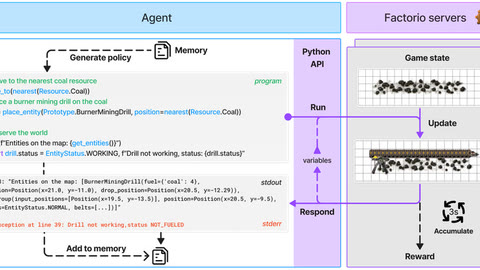

# Factorio Learning Environment

In the Factorio Learning Environment the agent writes Python programs in a REPL against the Factorio server.

*Diagram (cropped from the paper's Figure 2): the agent writes a Python program that runs against the Factorio server through the Python API, the game state updates, and stdout or an error such as "Drill not working, status NOT_FUELED" comes back and is added to memory. Source: [Hopkins et al., arXiv 2503.09617](https://arxiv.org/html/2503.09617).*

| | |
|---|---|
| Year | Mar 2025 |
| Authors / org | Hopkins, Bakler, Khan |
| Links | [arXiv 2503.09617](https://arxiv.org/abs/2503.09617) |
| Demo | [project page v0.3.0](https://jackhopkins.github.io/factorio-learning-environment/versions/0.3.0.html): recorded videos of agent-built factories, plus a step-by-step viewer of one trajectory (before/after GIFs with the agent's Python program for each step). [Leaderboard](https://jackhopkins.github.io/factorio-learning-environment/leaderboard) has scores only, no replays. All recordings; not human-playable, no live model calls. |
| Play mode | scripted (server paused between programs) |
| Clock | program execution |
| Observation | text stdout |
| Action | Python programs |
| Players | 1 |
| Horizon | long |
| Human reference | none |
| Open source | open |
| Convertible to realtime-live | out of scope |
| Basis | code: `fle/env/gym_env/environment.py:436` unpause before the program, `:519-521` pause after (`pause_after_action=True`) |

## Details

- Factorio Learning Environment (2025).
- Hopkins, Bakler, Khan. [arXiv 2503.09617](https://arxiv.org/abs/2503.09617). The agent writes Python programs in a REPL against the Factorio server. Out of scope by the team's rules, and Factorio has no reaction component.

## Demo

- [project-page-videos] [FLE v0.3.0 project page](https://jackhopkins.github.io/factorio-learning-environment/versions/0.3.0.html) (repo homepage field) — Opened the page, played the muted video grid and screenshotted frames. The grid holds six short MP4 clips (1.8 s to 19.4 s, e.g. `assets/0.3.0_vids/task_demos/iron-gear-wheel.mp4`, `battery.mp4`, `automated-science.mp4`) captioned "Smelt 16 Iron Plates per minute", "Make 16 Iron Gears per minute (end)", "Fabricate 16 Batteries per minute", "Manufacture 16 Red Science per minute", "Refine 16 Sulfur per minute", "Make 16 Plastic bars per minute", under the line "Claude builds factories in lab-play". The frames are top-down renders of factories being built (offshore pump, boiler, furnaces, belts). Play-mode evidence (recording): sped-up, edited clips with no tick counter or step readout.
- [trajectory-viewer] same page, "Example: Build an automatic iron gear wheel factory" — Clicked through the five tabs ("Power Setup", "Iron Mining", "Assembler Machine", "Logistics Attempt" (marked failed), "Logistics Complete"). Each tab shows "Input State" and "State After Action" GIFs (e.g. `iron_gear_wheel/15_17_engine_setup.gif`, `95_97_running.gif`) next to the full "Action Program" (e.g. `water_pos = nearest(Resource.Water)` ... `sleep(5)`). The "Logistics Attempt" text says the program "again produces an error because the agent did not also remove the chest". The page calls it an "Illustrative example". Play-mode evidence (recorded, step-indexed): one Python program per step, with the state shown before and after each program. This fits the program-per-step, paused-between-programs label.
- [leaderboard] [FLE leaderboard](https://jackhopkins.github.io/factorio-learning-environment/leaderboard) — Six models ranked by production score (Claude 3.5-Sonnet first at 293206, then Gemini-2-Flash, GPT4o, Llama-3.3-70b, Deepseek-v3, GPT4o-Mini; dated 2025-03-06/07). It has no replays or trajectories.
- [official-video] The project page's "Claude Code Plays Factorio" section links a Twitch channel ([twitch.tv/playsfactorio](http://twitch.tv/playsfactorio)) where Claude Code drives FLE. The page's YouTube links ("100 SPM Base YouTube Showcase" to "10K SPM Megabase YouTube Tour") look like reference tours of human-built bases, not agent play. I did not watch the stream or the videos; a Twitch stream would need its own visit to tell whether it is live or replayed.

Visited 10 November 2026 in a headless browser.
