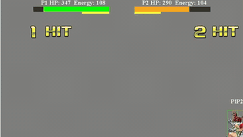

# FightingICE / DareFightingICE

FightingICE is a 60 fps fighting game from the IEEE CoG competition with observations delayed by 15 frames to simulate human reaction, and a sound-only track.

*Recording, at normal speed and cropped to the game window, of the LLM agents Iconic (P1) and BakaCirno (P2) in a 2026 DareFightingICE LLM AI Competition sample fight, with the round timer (top centre) counting down from about 51 s. Source: [ICE Lab, 2026 DareFightingICE LLM AI Competition results video](https://www.youtube.com/watch?v=LV24hG35gbI).*

| | |
|---|---|
| Year | 2013 / 2022 |
| Authors / org | Ritsumeikan ICE Lab; IEEE CoG competition |
| Links | [arXiv 2203.01556](https://arxiv.org/abs/2203.01556), [Repo](https://github.com/TeamFightingICE/FightingICE) |
| Demo | [Competition site](https://www.ice.ci.ritsumei.ac.jp/~ftgaic/) and [results page](https://www.ice.ci.ritsumei.ac.jp/~ftgaic/index-R.html) with official YouTube videos, including the [2026 DareFightingICE LLM AI Competition results video](https://www.youtube.com/watch?v=LV24hG35gbI): recorded clips of LLM agents (Iconic vs BakaCirno) fighting with the in-game round timer counting down at about real-time speed. Recordings only; no browser-playable build or replay viewer (the game is a Java download). |
| Play mode | realtime-live (default) + paused-live (`--input-sync`) |
| Clock | 60 fps, 16.67 ms per frame, 15-frame observation delay |
| Observation | frame data, pixels, audio (sound-only track) |
| Action | fighting moves |
| Players | 2 (vs bot) |
| Horizon | 60 s round |
| Human reference | blindfolded humans beat weak AI |
| Open source | repo open, no licence file |
| Convertible to realtime-live | n/a |
| Basis | code: `src/manager/DisplayManager.java` `frameSync.sync(GameSetting.FPS)`, `src/aiinterface/AIController.java` `DELAY = 15`, `ThreadController.java` input-sync wait; rules page: "AILoader will consider the AI's last input as a new input" |

## Details

- Ritsumeikan ICE Lab; IEEE CoG competition. [Repo](https://github.com/TeamFightingICE/FightingICE); [competition paper](https://arxiv.org/abs/2203.01556).
- 60 fps with 16.67 ms per frame, and observations delayed by 15 frames to simulate human reaction (rules page, saved; code `AIController.java` `DELAY = 15`). Rounds are 60 s. A sound-only track gives the agent only audio (48 kHz stereo, with FFT and Mel features). Blindfolded humans beat a weak MCTS AI in the sound-design protocol. On a missed frame the AI's previous input is reused (rules page: "AILoader will consider the AI's last input as a new input"). The repo has no licence file.
- Shortlist rank 8 (DareFightingICE versus a fixed bot): keep in reserve for an audio-channel task with a built-in 15-frame reaction delay.

## Demo

- [video] [Result Presentation Video: 2026 DareFightingICE LLM AI Competition](https://www.youtube.com/watch?v=LV24hG35gbI) (embedded on the [results page](https://www.ice.ci.ritsumei.ac.jp/~ftgaic/index-R.html)) — Watched the 244 s video in headless Chrome, capturing frames at 48, 98, 134, 149, 159, 187, 199 and 239 s. Slides describe "Prompting or fine-tuning a Large Language Model (LLM) to play the DareFightingICE game", with a Standard League (round-robin wins) and a Speed Running League ("AIs try to beat our opponent AIs (MctsAi and sample LLM AI) as quickly as possible"), and a "Results (F1-Score)" table (Iconic 154.33 first, BakaCirno 115 second, Mambagpt 105.33 third). It then plays "Sample Fight Iconic (P1) vs BakaCirno (P2) - Rushdown" and "- Zoning" recordings. Play-mode evidence (recording): the in-game timer read 59.483 at video 133.8 s, 46.033 at 148.9 s and 37.233 at 158.9 s, so the round clock ran at about 0.9x the video's speed. That is consistent with the game running in real time while the LLM agents act. No per-call latency readout is shown.
- [video] [MctsAi ZEN vs MctsAi GARNET](https://www.youtube.com/watch?v=Uzbr79l_Om8) (embedded on the [competition home page](https://www.ice.ci.ritsumei.ac.jp/~ftgaic/)) — Watched the roughly 45 s video and captured a frame at 28 s. It is a Bandicam screen recording of two MCTS sample AIs fighting, with HP/energy bars, "ROUND:1" and a "1 HIT" combo counter. It shows no LLM. The home page also embeds "Introduction to FightingICE and the Fighting Game AI Competition" (https://www.youtube.com/watch?v=40ABh5yKJVE), which I did not watch.
- [files] [2026 LLM AI Competition files](https://www.ice.ci.ritsumei.ac.jp/~ftgaic/Downloadfiles/2026AI.zip) — A 49 MB archive linked from the results page ("download all relavent files"). I checked its size but did not download or open it, so I don't know if it holds replay logs. No web replay viewer exists.

Visited 10 November 2026 in a headless browser.

## Fit

realtime yes; verifiable yes; versus a fixed bot is effectively single player; human-easy; short. A rare open environment with an audio observation channel and a built-in reaction delay.
