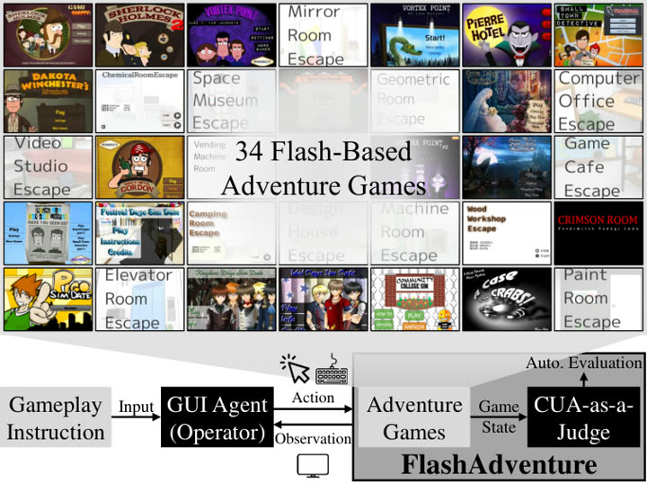

# FlashAdventure

FlashAdventure is a set of Flash adventure games chosen to avoid strict time limits, untimed by design.

*Paper figure (Figure 1): title screens of the 34 Flash adventure games above a diagram of a GUI agent acting on a game by mouse and keyboard, with CUA-as-a-Judge scoring the game state. Source: [Ahn et al., FlashAdventure (arXiv 2509.01052)](https://arxiv.org/html/2509.01052).*

| | |
|---|---|
| Year | Sep 2025 |
| Links | [arXiv 2509.01052](https://arxiv.org/abs/2509.01052) |
| Demo | [project page](https://ahnjaewoo.github.io/flashadventure) with a 14 s [YouTube teaser](https://www.youtube.com/watch?v=ff4aKGzyW1Q): a static paper page plus a montage of the 34 Flash games. It has no agent replays, live runs or trajectory viewer, and the games are untimed and wait for the agent; human-playable: no. |
| Play mode | paused-live (untimed by design) |
| Clock | STEP |
| Observation | screenshots |
| Action | mouse/keyboard |
| Players | 1 |
| Horizon | about 26 min human |
| Human reference | 97% humans |
| Open source | project page |
| Convertible to realtime-live | not relevant |
| Basis | paper §3.1: games chosen by "avoiding strict time limits and rapid-action requirements"; code agents count actions, no timer |

## Details

- In the turn-based or untimed contrast set: paused-live, from the paper (§3.1, untimed by design). None of the contrast set has a native clock; a deadline could be imposed but the games do not reward reflexes. They are useful as the "same model, no clock" control.

## Demo

- [project-page] [FlashAdventure project page](https://ahnjaewoo.github.io/flashadventure) — Loaded and scrolled the static EMNLP 2025 paper page and played its embedded YouTube teaser from inside the page (frames at about 3, 7 and 13 s). The page has the abstract, 34 game thumbnails across 5 subgenres, figures for the observation-behavior gap, CUA-as-a-Judge and COAST, a judge validation table (94% accuracy vs human judging) and results (best agents 5.88% success, humans 97.06% with unlimited steps); there is no agent trajectory, replay viewer or playable game. Play-mode evidence: nothing shows a model playing, live or recorded; network requests were only static images, jQuery and YouTube. The page describes untimed point-and-click games where agents run up to 1000 steps via pyautogui or computer use and the game waits between actions.
- [video] [FlashAdventure teaser](https://www.youtube.com/watch?v=ff4aKGzyW1Q) — Played the 14.9 s muted teaser "FlashAdventure Benchmark / Can GPT Play Games Like a Human?" in the project-page iframe (the bare embed gives Error 153). It is an edited montage: a Knight/King dialogue scene with a mouse cursor, then grids of game screens zooming out to the FlashAdventure logo. Play-mode evidence (recording): no model captions, action logs, timers or latency readouts, and no indication whether the footage is agent or human play.

Visited 10 November 2026 in a headless browser.