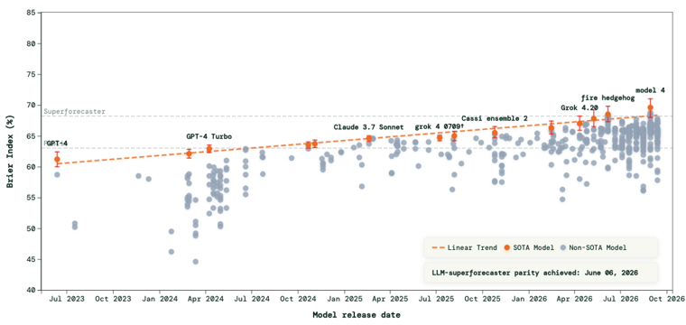

# ForecastBench

ForecastBench is a forecasting benchmark whose questions resolve days to months later.

*Screenshot of the ForecastBench /explore chart: each model's Brier Index (higher is better) against its release date, with state-of-the-art models in orange, a linear trend, and the superforecaster and public reference lines. Source: [ForecastBench, Forecasting Research Institute](https://www.forecastbench.org/explore/).*

| | |
|---|---|
| Year | 2024-26 |
| Links | [arXiv 2409.19839](https://arxiv.org/abs/2409.19839) |
| Demo | [ForecastBench](https://www.forecastbench.org/): static Tournament and Baseline leaderboards and an /explore chart (Brier Index vs model release date), updated nightly; datasets on GitHub and Hugging Face. No traces, replays or live runs. Human-playable: no. |
| Play mode | paused-live (forecast before resolution) |
| Clock | questions resolve days to months later |
| Does model latency matter? | No |
| Basis | papers: ForecastBench §3 questions and resolution values |

## Details

- The live arenas are slow-cadence, noisy and unrepeatable; they are a poor fit for first environments.

## Demo

- [leaderboard] [ForecastBench site](https://www.forecastbench.org/) — Loaded the homepage and the /explore/ and /datasets/ pages and read them. The Tournament leaderboard (tool use allowed, 439 entries) lists 'fire hedgehog' at 68.5 with the Superforecaster median at 68.2; the Baseline leaderboard (130 entries) lists the Superforecaster median 67.1, Public median 62.1 and o3-scratchpad 61.1, both "last updated 2026-11-10"; /explore plots Brier Index against model release date with a linear SOTA trend and states "LLM-superforecaster parity achieved: June 06, 2026"; datasets are on GitHub and mirrored to Hugging Face (forecastingresearch/forecastbench-datasets), with question sets released every two weeks. Play-mode evidence: static leaderboards and charts only, with no traces, replays or live runs; forecasts are submitted offline per question set, so there is no clock or latency measure.

Visited 10 November 2026 in a headless browser.

Related: [Prophet Arena](prophet-arena.md)
