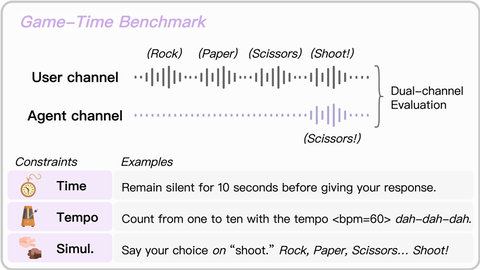

# Game-Time

Game-Time is a speech benchmark of timing tasks (wait N seconds before answering, finish within a duration, keep a tempo, speak on a cue) with dual-channel evaluation.

*Paper diagram (Figure 1) of the benchmark: the agent must say its choice on the user's "Shoot!" in a separate audio channel, with example Time, Tempo and Simul. constraints below. Source: [Game-Time, arXiv 2509.26388](https://arxiv.org/abs/2509.26388).*

| | |
|---|---|
| Year | Sep 2025 |
| Links | [arXiv 2509.26388](https://arxiv.org/abs/2509.26388) |
| Demo | [project page](https://ga642381.github.io/Game-Time): interactive waveform player of recorded two-channel (user top / model bottom) .wav samples. You choose task (Basic/Advanced, e.g. G-Simul.-Cue Rock-Paper-Scissors) and model (Moshi, Unmute, GPT-Realtime, SSML-LLM oracle); the oracle speaks over 'Shoot!' while Moshi speaks early. Human-playable: no. |
| Play mode | realtime-live (speech) |
| Clock | dual-channel audio time |
| Basis | paper §3.4 "Dual-channel Evaluation"; the SSML-LLM topline is "non-streaming and non-causal" |

## Details

- Game-Time's tasks (wait N seconds before answering, finish within a duration, keep a tempo, speak on a cue) port directly to a keypress channel; nearly all models fail the timed tasks.

## Demo

- [replay-viewer] [Game-Time project page](https://ga642381.github.io/Game-Time) — Played the Overview player, then in 'Audio Demos' kept Advanced / G-Simul.-Cue (Rock-Paper-Scissors 'shoot' cue) and switched the model between SSML-LLM, Moshi and GPT-Realtime, playing each. The custom player shows the user channel (blue, top) and model channel (pink, bottom) with a moving playhead and time readout (e.g. 0:04 / 0:07); SSML-LLM says 'Scissors!' over the user's 'Shoot!' at about 0:06, while Moshi speaks early around 0:02-0:03. Play-mode evidence (recording): each choice loads a fixed .wav (e.g. assets/audios/Moshi/7-a-Game-RockPaperScissors-SimulSpeakCue-03.wav), no microphone and no live model call; the recordings are full-duplex, so the user's countdown keeps going whether or not the model has answered and timing errors are audible. The Unmute option was not separately captured.

Visited 10 November 2026 in a headless browser.

Related: [Thinking Machines TimeSpeak / CueSpeak](thinking-machines-timespeak-cuespeak.md); [Full-Duplex-Bench](full-duplex-bench.md)
