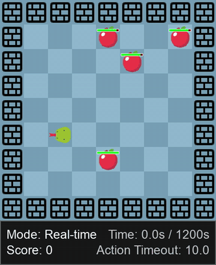

# GameVerse

GameVerse is a 15-game benchmark, paused by default, in which Snake and Plants vs. Zombies have Stop / Slow / Normal settings and Normal is realtime.

*Recording of a VLM agent playing Snake in Real-time mode, with the in-game clock (Time x/1200s, Action Timeout 10.0) running while the model thinks; the authors' clip is sped up (about 106 s of game time in 6 s). Source: [GameVerse project page](https://gameverse-bench.github.io/).*

| | |
|---|---|
| Year | Mar 2026 |
| Authors / org | Tsinghua |
| Links | [arXiv 2603.06656](https://arxiv.org/abs/2603.06656) |
| Demo | [project page](https://gameverse-bench.github.io/): recorded, sped-up gameplay videos of VLM agents (and a human player) for all 15 games, before/after-reflection comparisons and a static leaderboard. The Snake clip shows a real-time game clock (Time x/1200s, Action Timeout 10.0) that keeps running while the model thinks. [code](https://github.com/THUSI-Lab/GameVerse) to run locally. Human-playable: no; no live model or replay viewer. |
| Play mode | paused-live + realtime-live (Snake, PvZ) |
| Clock | Stop / Slow / Normal |
| Observation | screenshots |
| Action | semantic or GUI |
| Players | 1 |
| Horizon | mixed |
| Human reference | rookie and expert tiers |
| Open source | repo open (LICENSE.txt) |
| Convertible to realtime-live | partial |
| Basis | paper App.: Stop "the environment is fully paused during inference", Slow "a 5-second pause", Normal "without any artificial delays"; code `snake/config.yaml` `game_mode: discrete` / `realtime` |

## Details

- **GameVerse** (Mar 2026, Tsinghua), [arXiv 2603.06656](https://arxiv.org/abs/2603.06656): 15 games, paused by default; Snake and Plants vs. Zombies have Stop / Slow / Normal settings, where Normal is realtime. Reports that reasoning models drop sharply at Normal. Human rookie and expert tiers (37 participants).

## Demo

- [project-page] [GameVerse project page](https://gameverse-bench.github.io/) — Read the page, clicked "Play All Games" and pulled frames from several of its 36 self-hosted MP4s (Snake game_10, PvZ game_11, Forza Horizon 5 game_12, Mini Metro game_13, pvz_before, and the Gemini-2.5-Pro and human clips). It has a 5x3 grid of recorded gameplay per game, Models vs. Human side-by-side clips (Qwen3-VL-32B, Gemini-2.5-Pro, a human) on 5 games, before/after Video-based Reflection clips, and a static leaderboard; nothing is interactive. Play-mode evidence (recordings, accelerated): the page says videos show "gameplay trajectories captured in real-time"; the Snake recording (11.5 s) overlays "Mode: Real-time", "Time: X s / 1200s" and "Action Timeout: 10.0", and the in-game clock reads 8.9 s at 0:00.5, 45.6 s at 0:03 and 178.3 s at 0:11 before "GAME OVER! SCORE: 5" (about 15x speed-up). The PvZ clips are screen recordings of the Steam game. No Stop/Slow/Normal labels appear on the page.
- [project-page] [GameVerse repo](https://github.com/THUSI-Lab/GameVerse) — Read the README, docs/setup_snake.md, docs/setup_pvz.md and the Snake config.yaml; you run it yourself with scripts/play_game.py, and PvZ requires the Steam game. Play-mode evidence (code): Snake game_mode "realtime" or "discrete", action_timeout 20.0 ("If no action received, move with current direction"), max_duration 1200 s; PvZ takes a screenshot every 0.5 s while the game runs, after the framework clicks "Back to Game" once.

Visited 10 November 2026 in a headless browser.