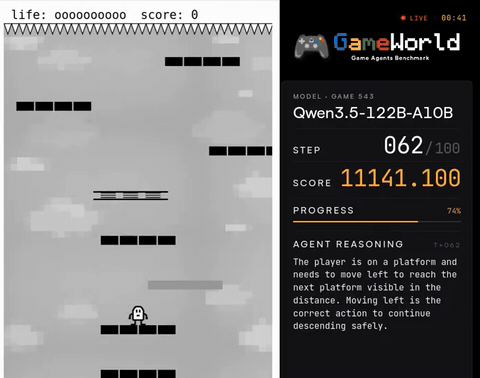

# GameWorld / GameWorld-RT

GameWorld is a benchmark of 34 browser games and 170 tasks whose main mode pauses the game during inference, with GameWorld-RT keeping the game running on the wall clock.

*A recording from the authors' archived live stream: Qwen3.5-122B-A10B plays NS-Shaft. Over 8 s the step counter goes from 063 to 066 while the LIVE countdown drops from 00:40 to 00:33 at wall-clock speed. The stream does not say whether this was the paused or the RT track. Source: [Clip from the GameWorld authors' official YouTube live stream (youtube.com/@gameworld-bench)](https://www.youtube.com/watch?v=vcOLE5vcKro).*

| | |
|---|---|
| Year | Apr 2026 |
| Authors / org | Ouyang, Hu, Lin, Ng, Shou (NUS, Oxford) |
| Links | [arXiv 2604.07429](https://arxiv.org/abs/2604.07429), project [gameworld-bench.github.io](https://gameworld-bench.github.io); code [gameworld-project/gameworld](https://github.com/gameworld-project/gameworld) |
| Demo | [project page](https://gameworld-project.github.io/) with a static [trajectory casebook](https://gameworld-project.github.io/static/figures/gameworld/cases/case_study_casebook/case_study_casebook.html) of recorded step-by-step THINK/CONTROL/EVAL cards (Minecraft, Mario CUA vs Generalist, Flappy Bird), plus a [YouTube "24/7 live" channel](https://www.youtube.com/@gameworld-bench/live) with 2 archived streams (Apr 2026) of Qwen3.5-122B playing the games in rotation. The streams show step n/100, score, reasoning and a wall-clock countdown, but don't say whether the paused or RT track was running; human-playable: no. |
| Play mode | paused-live (main) + realtime-live (RT) |
| Clock | sandbox pause / WALL |
| Observation | screenshots |
| Action | raw mouse/keyboard or semantic |
| Players | 1 |
| Horizon | short tasks |
| Human reference | novice 55.3, expert 77.1 SR |
| Open source | repo open (gameworld-project/gameworld) |
| Convertible to realtime-live | has RT switch |
| Basis | code: `runtime/runtime_config.py:20` `pause_during_inference: bool = True` (RT = False); paper §1 "A browser-based sandbox pauses game execution during model inference" |

## Details

- GameWorld-RT (Apr 2026).
- Ouyang, Hu, Lin, Ng, Shou (NUS, Oxford). [arXiv 2604.07429](https://arxiv.org/abs/2604.07429); project [gameworld-bench.github.io](https://gameworld-bench.github.io). Code: [gameworld-project/gameworld](https://github.com/gameworld-project/gameworld) (read). The pause is a runtime flag, `pause_during_inference: bool = True` in `runtime/runtime_config.py`; GameWorld-RT sets it off.
- Tasks: 34 browser games in five genres (runner, arcade, platformer, puzzle, simulation), 170 tasks. Two interfaces: raw computer-use, or semantic actions through a deterministic parser.
- Play modes: the main benchmark is paused-live (the browser sandbox pauses the game during inference). GameWorld-RT keeps the game running (wall clock). RT was run only for two Qwen3-VL models.
- Scoring: state-verified through a JavaScript bridge exposing 233 game-state fields; success rate and normalised progress. Human reference under a 100-action budget: novice 55.3 SR / 64.1 PG, expert 77.1 / 82.6.
- Results: paused best is Gemini-3-Flash-Preview 21.2 SR / 41.9 PG at 5.5-12.8 s per step. RT: Qwen3-VL-235B 17.1 SR at 6.2 s/step; Qwen3-VL-30B 15.6 SR at 2.4 s/step.
- Shortlist rank 5 (GameWorld-RT browser games): state-verified scoring with novice and expert human baselines, short tasks, RT mode already exists but has been run on two models only. Code is open ([gameworld-project/gameworld](https://github.com/gameworld-project/gameworld)).

## Demo

- [project-page] [GameWorld project page](https://gameworld-project.github.io/) — Loaded the page (gameworld-bench.github.io redirects here), read the FAQ and seeked the 20 s promo montage (GameworldPromoShort.mp4). It lists 34 games and 170 tasks with leaderboards for Generalist and Computer-Use agents (top Gemini-3-Flash-Preview 41.9% PG; Seed-1.8 39.8% PG; human novice 64.1, expert 82.6). Play-mode evidence: only text; the FAQ says "GameWorld-RT is the real-time variant where the environment keeps running during inference. It complements the default paused benchmark". No playable game and no live model calls.
- [replay-viewer] [GameWorld trajectory casebook](https://gameworld-project.github.io/static/figures/gameworld/cases/case_study_casebook/case_study_casebook.html) — Opened the casebook the Cases iframe loads and went through its three cases: Minecraft dirt collection (steps 1-100, 90% progress, FAILED), Mario CUA vs Generalist side by side (steps 66-69), and Flappy Bird "Real-Time Reaction and Timing Control" (steps 46-50, alternating wait(0.2)/flap). Each card shows a frame, THINK text, CONTROL (e.g. flap() -> press_key(key=Space, duration=0.2)) and EVAL state diffs; it is a static 1.6 MB HTML storyboard. Play-mode evidence (recording): cards are indexed by step with no wall-clock latency and do not say whether the game was paused during inference.
- [video] [GameWorld YouTube live channel](https://www.youtube.com/@gameworld-bench/live) — Opened the channel; it was not live and has 2 archived streams titled "AI Game Agents at Play | GameWorld 24/7 Live Stream" (vcOLE5vcKro, Apr 16 2026, 1:01:43; bCIgWkE0QVw, Apr 14 2026, 11:54:56); captured frames 2.6 s apart from 40:00 of the first. The overlay shows MODEL (Qwen3.5-122B-A10B), GAME number (e.g. "GAME 543"), STEP n/100, SCORE, progress, AGENT REASONING, key-press widgets, a task card (e.g. "NS-Shaft: Survive for at least 15 seconds...") and a red "LIVE" countdown. Play-mode evidence (recorded stream of live model play): in 18 s the step counter went 060 -> 064 -> 068 (about 2-2.5 s per step) while the countdown fell 00:47 -> 00:37 -> 00:29 at wall-clock rate; the overlay does not say whether the paused or RT track was running.

Visited 10 November 2026 in a headless browser.

## Fit

realtime yes (RT); verifiable yes; single yes; human-easy yes with measured humans; short yes. One of the best candidate pools, and RT mode is under-explored.
