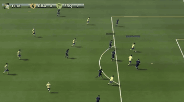

# Google Research Football

Google Research Football is an archived football simulator at 100 ms per step with short single-player academy scenarios.

*Recording of 11v11 gameplay in the environment, with the scoreboard game clock at top left; taken from the edited official trailer, so it includes a cut between scenes. Source: [Google Research, official GRF trailer](https://www.youtube.com/watch?v=F8DcgFDT9sc).*

| | |
|---|---|
| Year | 2019 |
| Links | [repo](https://github.com/google-research/football) |
| Demo | [research-football.dev](https://research-football.dev) (the game server named in the repo description) does not resolve. The [Kaggle 2020 competition leaderboard](https://www.kaggle.com/competitions/google-football/leaderboard) lists recorded RL-bot episodes (0.5 s per-step timeout), but its replay viewer currently fails ('Unable to render', visualizer 404). The [official trailer](https://www.youtube.com/watch?v=F8DcgFDT9sc) is an edited recording of the environment. No hosted LLM demo; human-playable: only with a local install. |
| Play mode | paused-live |
| Clock | STEP, 100 ms per step |
| Observation | pixels, minimap, vector |
| Action | 19 discrete |
| Players | 1 controlled |
| Horizon | academy tasks under 40 s |
| Human reference | easy |
| Open source | archived |
| Convertible to realtime-live | high |
| Basis | code: `gfootball/env/football_env_core.py` `step`; README "a single action per 100 ms reported to the environment" |

## Details

- **Google Research Football** ([repo](https://github.com/google-research/football), archived): 100 ms per step; academy scenarios (empty goal, run to score) are single-player, under 40 s and easy. Sticky directions help as a default action.

## Demo

- [dead-or-unreachable] [research-football.dev](https://research-football.dev) — Opened it over https and http and ran dig. It fails with net::ERR_NAME_NOT_RESOLVED and dig returns no records, although the archived repo (archived Aug 19, 2026) still names it as the new game server. No play-mode evidence; the page did not load.
- [replay-viewer] [Kaggle Google Football leaderboard](https://www.kaggle.com/competitions/google-football/leaderboard) — Opened the 2020 competition leaderboard, clicked the watch-games icon for the winner WeKick, which opened Game History for episode 7012487 (WeKick vs SaltyFish), waited about 30 s, and downloaded replay.json (21.5 MB). The player pane shows "Unable to render this environment. Please contact support@kaggle.com" because the football visualizer (episode-visualizers/football/index.json) returns 404, so no frames could be watched. Play-mode evidence (recorded replay file): the config has actTimeout 0.5, episodeSteps 3002, scenario 11_vs_11_kaggle and save_video true; agents had a 0.5 s per-step deadline, a turn timeout rather than a clock that runs while they think, and the agents are 2020 RL/rule bots, not LLMs.
- [video] [official GRF trailer](https://www.youtube.com/watch?v=F8DcgFDT9sc) — The blog embed failed with Error 153, so I opened the watch page and checked frames at 5, 20, 40 and 60 s of the 2:12 video. It shows 3D 11v11 gameplay with a scoreboard and game clock (12:25 and 06:52, RBA 0 FRQ 0) and a minimap, with captions "A novel Reinforcement Learning environment" and "Multi-player: play against your agent!". Play-mode evidence (recording): edited footage with RL or built-in AI players; no LLM and no latency or thinking time shown; human play is advertised but only after a local install.
- [project-page] [GRF GitHub repo](https://github.com/google-research/football) — Read the top of the archived repo's README. It links a Colab notebook (headless training without rendering), the paper, the blog post and the Kaggle competition; human play ('Playing the game') needs a local install, and there is no hosted browser demo. Play-mode evidence: by default the env steps synchronously, so the game waits for the agent at each step.

Visited 10 November 2026 in a headless browser.