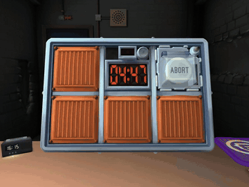

# GPTNT

GPTNT is Keep Talking and Nobody Explodes with two agents under a live countdown.

*Recording from the async self-play replay (Claude Sonnet 4.6), sped up 6x: the defuser view turns the bomb to inspect its modules while the bomb timer keeps counting down. Source: [GPTNT project site](https://gptnt.github.io).*

| | |
|---|---|
| Year | 2026 |
| Links | [arXiv 2606.28514](https://arxiv.org/abs/2606.28514), code [repo](https://github.com/GPTNT/gptnt) |
| Demo | [site](https://gptnt.github.io) ([docs](https://gptnt.github.io/docs)): replay viewer of recorded Claude Sonnet 4.6 self-play games. It plays the defuser-view video in sync with a step log of reasoning, actions and messages, with wall-clock stamps. The async run shows the bomb timer running down while the models think (detonated at about 4:32), and there is also a sync (clock-frozen) run. There is also a leaderboard with async vs sync columns. Human-playable: no (needs your own copy of KTANE). |
| Play mode | realtime-live |
| Clock | live countdown |
| Observation | game UI + chat |
| Action | UI + messages |
| Players | 2 |
| Horizon | minutes |
| Human reference | humans succeed |
| Open source | repo open (LICENSE) |
| Convertible to realtime-live | n/a |
| Basis | paper Fig.: "In asynchronous mode ... generation time per request counts against the bomb clock"; §1 "act asynchronously and communicate in real time" |
| Play mode (negotiation table) | realtime-live (async) + paused-live (sync) |
| Clock (negotiation table) | bomb countdown |
| Basis (negotiation table) | paper §4.1 (see [GPTNT](gptnt.md)) |

## Details

- **GPTNT** (Jun 2026, TMLR), [arXiv 2606.28514](https://arxiv.org/abs/2606.28514): Keep Talking and Nobody Explodes with two agents under a live countdown; no tested model defuses a bomb in real time. Two modes (paper §4.1): "In asynchronous mode ... generation time per request counts against the bomb clock" (realtime-live) and "In synchronous mode ... the game is paused during generation" (paused-live). Code: [repo](https://github.com/GPTNT/gptnt) linked from the project page. Pairwise, so later-stage.
- Later, for pairwise work (from the shortlist): GPTNT.

## Demo

- [replay-viewer] [GPTNT site](https://gptnt.github.io) — Pressed Play in the Replay section, stepped forward 15 steps, clicked the timeline and switched the ASYNC/SYNC tabs. The hero autoplays runs/claude46-async/bomb.mp4 ("ASYNC SELF-PLAY · THE CLOCK NEVER STOPS") with a Defuser/Observer/Expert transcript; the replay syncs a defuser-view video to a step log of reasoning, actions (click(x,y), flip(), do_nothing()) and messages, each with a wall-clock offset. The ASYNC run (Claude Sonnet 4.6 vs itself, 5:00 bomb) ends "Detonated" at about 4:32 after 98 steps; the SYNC run shows "Defused", 139 steps, 3:27; a leaderboard compares 16 models in REAL-TIME async vs TURN-TAKING sync columns. Play-mode evidence (recording): only prerecorded MP4s and bundled JS data are fetched, no API calls; in the async replay the bomb timer drops (04:56 -> 04:27 -> 04:11 -> 03:53) as steps pass, steps carry wall-clock stamps (#2 0:03s ... #94 4:20s), and the model emits do_nothing() "Still waiting" steps. The FAQ says async means "every token a model generates burns game time" while sync "freezes the clock during generation". Caveat: the SYNC replay loads runs/mock/bomb.mp4 and shows "Defused" although the site says no model defused a bomb, so it may be placeholder data.
- [project-page] [GPTNT docs](https://gptnt.github.io/docs) — Read the landing page: install, run and submit documentation (v2.2.0) for running your own model; you need your own copy of KTANE. No in-browser demo and no play-mode evidence.
- Note: the file's main Play mode row says realtime-live only (the negotiation-table row lists both async and sync), but the site also shows a SYNC replay in which the clock is frozen during generation (its video is runs/mock/bomb.mp4, possibly placeholder data).

Visited 10 November 2026 in a headless browser.

Related: [Real-Time Deadlines (UPenn negotiation)](real-time-deadlines-negotiation.md)
