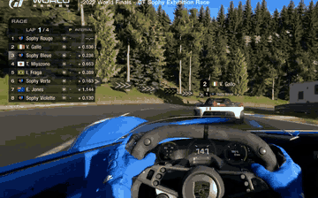

# Gran Turismo Sophy interface

The Gran Turismo Sophy interface ran only in real time on PS4 hardware with 10 Hz control.

*Recording of the 2022 World Finals exhibition race, in-car view from the agent "Sophy Bleue" as it chases human driver Valerio Gallo, with the live lap-1 standings and intervals; real-time footage, cropped. Source: [GRAN TURISMO TV on YouTube](https://www.youtube.com/watch?v=RbkvlcwP1FM).*

| | |
|---|---|
| Year | Feb 2022 |
| Links | [paper page](https://ai.sony/publications/Outracing-champion-Gran-Turismo-drivers-with-deep-reinforcement-learning) |
| Demo | [GT Sophy Race Together](https://www.gran-turismo.com/us/gran-turismo-sophy/race-together/) ([site](https://www.gran-turismo.com/us/gran-turismo-sophy/)): recorded broadcasts of live 2021 races against top human drivers, with GT Sport physics running in real time; the site itself gives no latency figure (10 Hz control per the paper). Nothing playable; human-playable: no. |
| Play mode | realtime-live |
| Clock | PS4 real time, 10 Hz control |
| Observation | state |
| Action | steer/throttle |
| Players | 1-4 |
| Horizon | laps |
| Human reference | champions |
| Open source | not public |
| Convertible to realtime-live | reference only |
| Basis | paper (Nature 2022 author PDF): "GT Sophy interacted with the game at 10 Hz"; "communicates asynchronously with the game by means of TCP. Although GT ran only in real time" |

## Details

- **Gran Turismo Sophy**: realtime only on PS4 hardware, 10 Hz control (paper: "GT Sophy interacted with the game at 10 Hz"; "Although GT ran only in real time"); interface not public.

## Demo

- [project-page] [Gran Turismo Sophy site](https://www.gran-turismo.com/us/gran-turismo-sophy/) — Loaded the landing, Race Together and Technology pages and opened the Race Day #1 broadcast "[English] Gran Turismo Sophy RACE TOGETHER 2021 #1" (1:36:14), seeking to 120 s and 600 s. Race Days were 2 Jul 2021 and 21 Oct 2021, with three races (Dragon Trail Seaside N500, Lago Maggiore Gr.3, Sarthe Gr.X); YouTube IDs 4Gfm317R7l4, RbkvlcwP1FM, _RCvq_63nD8, dxmIAy9ShZg, nZbA_CDoWrk, oGbe4Zx-jDA, vIShQ2yD5K4; the Technology page describes DART on more than 1,000 cloud PS4 consoles. Play-mode evidence (recording): broadcasts of live races where GT Sport physics runs in real time beside human drivers; the site gives no reaction-time figure (the Nature paper and Sony AI write-ups, via search, give a 10 Hz control cap, about 23-30 ms inference latency, and superhuman results with 100-250 ms added delay). Nothing playable on the site.

Visited 10 November 2026 in a headless browser.

Related: [GT Sophy](../solutions/gt-sophy.md)
