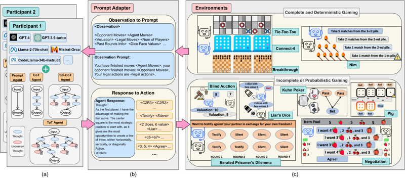

# GTBench

GTBench is a set of board and card games with a baseline that "randomly selects action at each turn".

*Figure 1 from the paper (a diagram, not a recording): LLM participants and reasoning agents (Prompt, CoT, SC-CoT, ToT) exchange observations and actions through a prompt adapter with ten turn-based games, from Tic-Tac-Toe and Connect-4 to Kuhn Poker, Liar's Dice and Negotiation. Source: [Duan et al., GTBench, arXiv 2402.12348](https://arxiv.org/abs/2402.12348).*

| | |
|---|---|
| Links | [arXiv 2402.12348](https://arxiv.org/abs/2402.12348) |
| Demo | [HF Space leaderboard](https://huggingface.co/spaces/GTBench/GTBench): a static Gradio table of scores for each game, LLM, agent and opponent across 10 turn-based OpenSpiel games. It has no replays, game viewer or live play; human-playable: no. |
| Play mode | paused-live (turn- or step-based) |
| Basis | [arXiv 2402.12348](https://arxiv.org/abs/2402.12348): "randomly selects action at each turn" baseline, board and card games |

## Details

- In the turn-based or untimed contrast set: GTBench ([arXiv 2402.12348](https://arxiv.org/abs/2402.12348): "randomly selects action at each turn" baseline, board and card games). None of the contrast set has a native clock; a deadline could be imposed but the games do not reward reflexes. They are useful as the "same model, no clock" control.

## Demo

- [leaderboard] [GTBench HF Space](https://huggingface.co/spaces/GTBench/GTBench) — Opened the running Gradio Space, toggled the column, model, agent and opponent checkboxes, and read the About tab. It is a static NRA-score table (models GPT-4, GPT-3.5-turbo, Llama-2-70b-chat, Codellama-34b-instruct, Mistral-7b-Orca; agents Prompt, CoT, SC-CoT, ToT; opponents GPT-3.5-turbo-1106 and GPT-4) with one column for each of 10 OpenSpiel games (Tic-Tac-Toe, Connect Four, Breakthrough, Liar's Dice, Blind Auction, Negotiation, Kuhn Poker, Nim, Pig, Iterated Prisoner's Dilemma); there is no board, replay, trajectory viewer or play interface (0 canvas, 0 video elements). Play-mode evidence: none on the page, only aggregate scores with no timing; the games are turn-based, so the environment waits for each LLM move.

Visited 10 November 2026 in a headless browser.