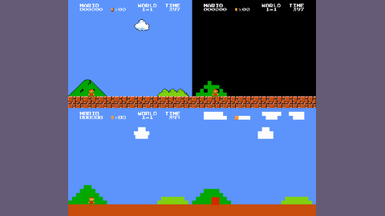

# gym-super-mario-bros

gym-super-mario-bros is a step-locked NES Super Mario Bros. environment on nes-py.

*Static screenshots (not a recording) of the start of World 1-1 in the four SuperMarioBros ROM modes: standard v0 (top left), downsample v1 (top right), pixel v2 (bottom left) and rectangle v3 (bottom right), arranged into a grid. Source: [gym-super-mario-bros README, tag 7.4.0](https://github.com/Kautenja/gym-super-mario-bros/blob/7.4.0/README.md).*

| | |
|---|---|
| Year | Apr 2018 |
| Links | [repo](https://github.com/Kautenja/gym-super-mario-bros) |
| Demo | None found (searched: repo README and homepage field (empty), repo file tree, README at tag [7.4.0](https://github.com/Kautenja/gym-super-mario-bros/blob/7.4.0/README.md) and old PyPI descriptions, web search for "gym-super-mario-bros demo video"). The old README has only a 200x200 walking-Mario sprite GIF and six static 256x224 stage screenshots, no gameplay video or replay. |
| Play mode | paused-live |
| Clock | STEP |
| Observation | pixels |
| Action | NES buttons |
| Players | 1 |
| Horizon | about 1 min/level |
| Human reference | easy |
| Open source | MIT + ROM |
| Convertible to realtime-live | high |
| Basis | code: nes-py `nes_env.py` `step` "Run one frame of the NES" |

## Details

- Orak uses gym-super-mario-bros and states it requires pausing.

## Demo

- None found. The current README (9.x) has only badges and text, the repo has no media files, and the homepage field is empty. The README at tag [7.4.0](https://github.com/Kautenja/gym-super-mario-bros/blob/7.4.0/README.md), opened in a headless browser, embeds a 200x200 GIF with the alt text "Mario". Screenshots of its frames show only a walking Mario sprite on a white background. The same README also has six static 256x224 screenshots of game stages. Neither shows an agent playing or a replay. A web search for a demo video found only PyPI listings. The README's command-line interface (keyboard or random play) is local only, not a hosted demo.

Searched 10 November 2026; no demo found.

Related: [Orak](orak.md); [LMGame-Bench](lmgame-bench.md); [stable-retro / Gym Retro](stable-retro.md)
