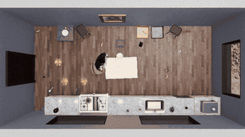

# HAZARD with the Time Conversion Mechanism

HAZARD is a fire, flood and wind rescue benchmark in ThreeDWorld at 30 FPS, run paused in the original and realtime under RRARA's Time Conversion Mechanism.

*Top-down recording of a HAZARD agent rescuing objects in a fire scenario while the fire spreads, sped up 6x (about 30 s of footage). Source: [HAZARD project page, UMass](https://embodied-agi.cs.umass.edu/hazard/).*

| | |
|---|---|
| Year | 2024 / 2025 |
| Authors / org | HAZARD: Zhou, Chen et al.; RRARA: Zheng, Mao, Zhang, Cai (University of Sydney) |
| Links | [arXiv 2506.07223](https://arxiv.org/abs/2506.07223), HAZARD [arXiv 2401.12975](https://arxiv.org/abs/2401.12975) |
| Demo | [project page](https://embodied-agi.cs.umass.edu/hazard/) (the listed [vis-www.cs.umass.edu/hazard/](https://vis-www.cs.umass.edu/hazard/) URL did not resolve; older [Google Site](https://sites.google.com/view/hazard-challenge)): pre-recorded videos of fire/flood/wind scenes evolving and top-down agent rescue runs, plus a 10-sample-per-scenario dataset preview selector that just swaps MP4s. No live model, no timing overlay, leaderboard closed; human-playable: no. |
| Play mode | paused-live (original HAZARD) / realtime-live with TCM |
| Clock | INJECT at 30 FPS |
| Observation | 3D scene, text |
| Action | navigation/pick actions |
| Players | 1 |
| Horizon | minutes |
| Human reference | none |
| Open source | HAZARD open; TCM no code |
| Convertible to realtime-live | TCM is the conversion |
| Basis | original: code `src/HAZARD/challenge.py` (agent chooses, then env steps, `while frame_count < max_steps`); TCM: paper 2506.07223 §3 "After each decision, we advance the simulator by frames" |

## Details

- HAZARD with the Time Conversion Mechanism (2024 / 2025-26).
- HAZARD: Zhou, Chen et al., ICLR 2024, [arXiv 2401.12975](https://arxiv.org/abs/2401.12975): fire, flood and wind rescue in ThreeDWorld at 30 FPS. The original does not charge LLM thinking time: in `src/HAZARD/challenge.py` the agent chooses an action and only then is the environment stepped (`while self.env.controller.frame_count < self.max_steps`), so the simulator waits for the LLM (paused-live). The RRARA paper says the same of such benchmarks: "Many simulators effectively freeze the environment during model inference".
- RRARA: Zheng, Mao, Zhang, Cai (University of Sydney), [arXiv 2506.07223](https://arxiv.org/abs/2506.07223). Adds the Time Conversion Mechanism: frames advanced = ceil(inference seconds x FPS), with the agent standing still while the hazard spreads. Under it, GPT-3.5 (2.5 s) scores 0.25 value rate and Claude-3.7-sonnet (13 s) 0.07.
- Reuse: the conversion is a few lines and applies to any frame-based simulator.

## Demo

- [video] [HAZARD project page (UMass mirror)](https://embodied-agi.cs.umass.edu/hazard/) — Scrolled the page and seeked all 11 videos (teaser 34.6 s, 60 s scenario previews, six agent-example .mov clips of 32-62 s), and clicked Fire > sample 3 and Flood > sample 7 in the Dataset Preview while logging network requests. The agent examples are top-down ThreeDWorld recordings captioned only "Rescue in fire/flood/wind scenario" with target lists such as "Targets: bag, pocketbook, purse, hairbrush"; the preview just swaps static MP4s (video/fire/3.mp4, video/flood/7.mp4, 60.04 s); the leaderboard is "Currently Closed". Play-mode evidence (recordings): only video fetches, no model calls, and no tick counter, latency or reasoning overlay; the captions do not name the agent type, so nothing shows whether the simulation kept running while the model thought.
- [video] [HAZARD Google Site](https://sites.google.com/view/hazard-challenge) — Loaded the older project page: embedded Fire, Flood and Wind environment clips and "Fire/Flood/Wind (with agent)" clips ("The red spots denote the trace of agent."), plus scene images and target lists. Play-mode evidence: recorded videos only, with no live inference or timing information.
- [dead-or-unreachable] [vis-www.cs.umass.edu/hazard](https://vis-www.cs.umass.edu/hazard/) — Tried in Playwright (net::ERR_NAME_NOT_RESOLVED) and curl (empty response). The arXiv abstract still links here; the content is mirrored at embodied-agi.cs.umass.edu/hazard.

Visited 10 November 2026 in a headless browser.

Related: [RRARA](../solutions/rrara.md) (the method from the same paper)
