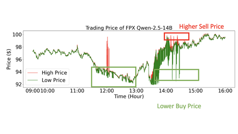

# HFTBench

HFTBench is a latency-sensitive trading backtest from "Win Fast or Lose Slow" in which measured inference time moves the fill price.

*Figure from the authors' project page: one HFTBench trading day (09:00-16:00) of high and low prices for FPX Qwen-2.5-14B, with boxes marking where the agent got lower buy and higher sell prices; a static plot, not a recording. Source: [competitive-agent.com](https://www.competitive-agent.com/).*

| | |
|---|---|
| Year | May 2025 |
| Links | [arXiv 2505.19481](https://arxiv.org/abs/2505.19481) |
| Demo | [project page](https://www.competitive-agent.com/): animated HFTBench cumulative-yield charts (FPX vs FP16), a yield-bar GIF and an offline latency-tradeoff dial that only moves along precomputed curves; no recording or replay of a trading run. [code](https://github.com/HaoKang-Timmy/LatencySensitiveBench) README has an HFTBench heading but no demo. Human-playable: no. |
| Play mode | realtime-live (in a backtest) |
| Clock | measured inference time moves the fill price |
| Does model latency matter? | Yes |
| Basis | code: `HFTBench/Environment/TradingEnv.py` `_apply_linear_decay` (price decays toward the daily average over `decay_window` 1.5 s of measured delay), `HFTBench/Agent/agent.py` `decide_trades` times inference with `time.time()` |

## Details

- HFTBench details: per-second historical NVDA and AMZN data, inference triggered on a spread threshold, daily yield from $10,000. A 14B model with FPX at 713 ms yields +26.5%; 7B models are negative. Code read (`HFTBench/Environment/TradingEnv.py`, `HFTBench/Agent/agent.py`): the released simulation runs one agent at a time (a TODO notes multi-agent trading is not implemented). The agent's inference is timed with `time.time()`, and the trade is filled at the observed second with the buy and sell prices moved linearly toward the day's average price in proportion to that delay, reaching the average at 1.5 s (`decay_window`). So measured wall-clock latency directly worsens the fill price, as an injected penalty; the rank-based exchange described in the paper is not what the public code does.

## Demo

- [video] [competitive-agent.com project page](https://www.competitive-agent.com/) — Loaded the page and screenshotted the HFTBench section: a Chart.js animated cumulative-yield chart (FPX vs FP16), a GIF of yield bars, a results table of daily yield, and a draggable "Latency-Quality Trade-off" speed dial. The dial only moves points along precomputed win-rate/yield curves and calls no model. Play-mode evidence: none for HFTBench; there is no replay or recording of a trading run, only charts.
- [project-page] [LatencySensitiveBench repo](https://github.com/HaoKang-Timmy/LatencySensitiveBench) — Read the README. Its Visualization section embeds one more recorded StreetFighter clip (video1_8vsfpx.mp4) and has an HFTBench heading; run instructions use DIAMBRA Arena (`run_api.py --agent1 Qwen/Qwen3-4B --agent2 Qwen/Qwen3-8B`), which needs a DIAMBRA account and the game ROM. Play-mode evidence: only a recorded video plus instructions for running locally; nothing hosted to play or run live.

Visited 10 November 2026 in a headless browser.

Related: [Win Fast or Lose Slow: StreetFighter](streetfighter-win-fast-or-lose-slow.md) (same paper); [FPX](../solutions/fpx.md); [ABIDES](abides.md)
