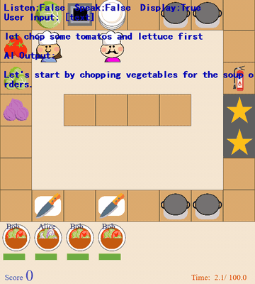

# HLA Overcooked

HLA plays Overcooked with a human partner and chat at about 3 Hz, with a scripted executor acting while the LLMs run.

*Recorded replay from the human study (Player-421, map Quick) at real speed: the human (pink beard) types "let chop some tomatos and lettuce first", HLA (blue chef) replies in the AI Output line and chops a tomato while the timer runs from about 2 to 8 s of 100. Source: [HLA project page](https://sites.google.com/view/overcooked-hla/).*

| | |
|---|---|
| Year | 2023 |
| Authors / org | Liu, Yu, Gao, Xie, Liao, Wu, Wang (Tsinghua) |
| Links | [arXiv 2312.15224](https://arxiv.org/abs/2312.15224) |
| Demo | [project page](https://sites.google.com/view/overcooked-hla/): a static Google Site of recorded GIF replays comparing HLA with its ablations (scripted-command tests captioned with wall-clock completion times such as 'Success in 19.7s', plus replays of 4 human-study players who chat or speak). The recordings show the game clock running while the model acts in real time (the slow-LLM ablation lets soups burn). Human-playable: no. |
| Play mode | realtime-live |
| Clock | WALL, about 3 Hz |
| Observation | text + chat |
| Action | macro + scripted executor |
| Players | 2 (human) |
| Horizon | 100 s |
| Human reference | humans as partners |
| Open source | no code found |
| Convertible to realtime-live | n/a |
| Basis | paper §1: Overcooked where "players collaborate at a rate of approximately 3Hz"; executor acts while the LLMs run (§4); no pause described; no code released |

## Details

- Realtime Overcooked: HLA (2023), AAMAS 2024.
- HLA: Liu, Yu, Gao, Xie, Liao, Wu, Wang (Tsinghua), AAMAS 2024. [arXiv 2312.15224](https://arxiv.org/abs/2312.15224). Overcooked with a human partner and chat at about 3 Hz, 100 s games, 60 volunteers.
- Realtime-live. For HLA there is no code; the paper describes a game played "at a rate of approximately 3Hz" with a scripted executor acting while the LLMs run, and no pause. The LLM never issues atomic actions: a scripted executor does.

## Demo

- [replay-viewer] [HLA project page](https://sites.google.com/view/overcooked-hla/) — Scrolled the whole Google Site and checked its media (44 animated GIFs and 4 PNGs, no video), and compared frames of the section 6.1 GIFs at 0, 4 and 8 s. Sections 4-5 compare NEA, SMOA, FMOA and HLA on scripted commands such as "3 chopped tomatoes please" and "Chop 2 Onions" then "Chop it again", captioned with wall-clock results like "Success in 42.9s", "Success in 19.7s" or "Failed"; section 6 replays four human-study players (Player-128 silent, 322 speaking, 221 and 421 texting) on maps Ring, Bottleneck, Partition and Quick, with a HUD ("Listen:False Speak:False Display:True") and an "AI Output:" chat line. Play-mode evidence (recordings): the page contrasts HLA, which "act[s] most swiftly", with SMOA (slow LLM only), which "takes much longer time" and lets soups burn, and the human partner keeps moving independently, so the game did not wait for the model. Nothing runs live or is playable; the page links code at github.com/HosnLS/Hierarchical-Language-Agent.
- Note: the file's Basis says no code was released, but the project page links a code repository (github.com/HosnLS/Hierarchical-Language-Agent; not visited).

Visited 10 November 2026 in a headless browser.

## Fit

realtime yes; verifiable yes; two-player by design; human-easy; short.

Related: [HLA](../solutions/hla.md) (the scaffold); [DPT-Agent Overcooked](dpt-agent-overcooked.md); [Overcooked-AI](overcooked-ai.md)
