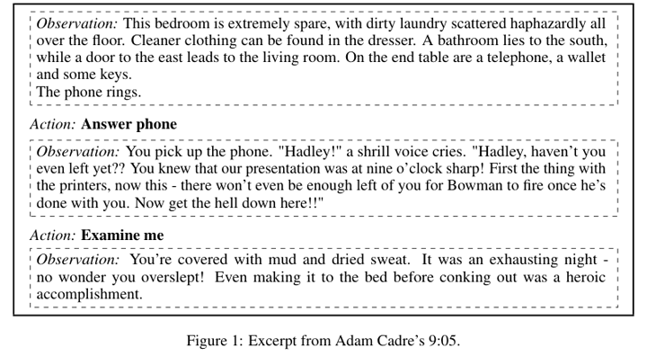

# Jericho

Jericho is a turn-based interactive-fiction environment stepped by `step(action)`.

*Figure from the Jericho paper showing an excerpt from the game 9:05, where text observations alternate with typed actions such as "Answer phone" and "Examine me". Source: [Hausknecht et al., Interactive Fiction Games: A Colossal Adventure (arXiv 1909.05398), Figure 1](https://arxiv.org/abs/1909.05398).*

| | |
|---|---|
| Year | Oct 2018 |
| Demo | None found (searched: GitHub repo microsoft/jericho README and homepage field (empty), docs at jericho-py.readthedocs.io, arXiv 1909.05398 abstract page, web search for "Jericho interactive fiction demo video"). |
| Play mode | paused-live, turn-based |
| Clock | none |
| Observation | text |
| Action | text |
| Players | 1 |
| Horizon | long |
| Human reference | n/a |
| Open source | open |
| Convertible to realtime-live | not meaningful |
| Basis | Jericho `jericho/jericho.py:623` `step(action)` |

## Demo

- None found. The repo README links only documentation, the paper and baseline agent repos; the GitHub homepage field is empty; the arXiv abstract has no project link; web search returned no project page, video, Hugging Face Space or replay viewer for the Microsoft Jericho framework.

Searched 10 November 2026; no demo found.

Related: [TextWorld](textworld.md); [NetHack LE](nethack-le.md); [Timely-RL](../solutions/timely-rl.md) (uses Jericho with assigned interaction delays)
