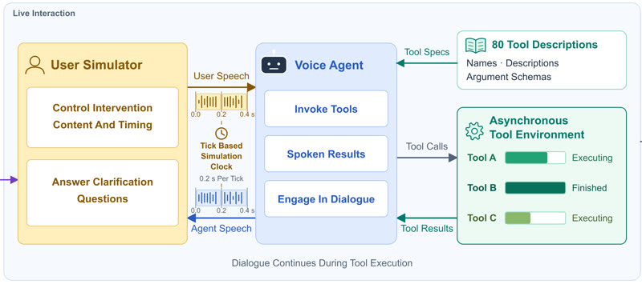

# Joi-Bench-Task

Joi-Bench-Task is a speech benchmark in which users intervene while the agent speaks or runs tools.

*Diagram (cropped from the paper's Figure 1) of the live interaction loop: a user simulator and a voice agent exchange speech on a tick-based simulation clock (0.2 s per tick) while asynchronous tools keep executing. Source: [He et al., arXiv 2611.12118](https://arxiv.org/abs/2611.12118).*

| | |
|---|---|
| Year | Nov 2026 |
| Links | [arXiv 2611.12118](https://arxiv.org/abs/2611.12118) |
| Demo | None found (searched: arXiv abstract page and comments, outbound links in the arXiv HTML paper, web searches for "Joi-Bench-Task" and "Joi-Bench" demo / GitHub / Hugging Face) |
| Play mode | realtime-live (speech) |
| Clock | user interventions while the agent speaks or runs tools |
| Basis | paper §1: users "refine requests, redirect ongoing work ... while the agent is speaking" |

## Demo

- None found. The arXiv abstract page for "Joi-Bench-Task: Benchmarking Task Coordination in Full-duplex Voice Agents through Interactive Simulation" (He et al.) has no comments field and no project page, code or demo link. The arXiv HTML paper links out only to the tau-bench voice leaderboard (taubench.com), which belongs to a different benchmark. Web searches for "Joi-Bench-Task" and "Joi-Bench" with demo, GitHub or Hugging Face found nothing about this benchmark.

Searched 10 November 2026; no demo found.
