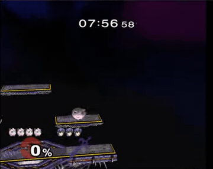

# libmelee / Slippi

libmelee drives Super Smash Bros. Melee in Dolphin at 60 Hz, reusing the last input so a slow bot holds stale inputs.

*Screen recording (real time, cropped to the Dolphin window) of the scripted puff.py Jigglypuff bot from the libmelee quickstart playing a match on Battlefield, with the in-game timer counting down. Source: [AltF4, Libmelee Programming Quickstart (YouTube, 2020)](https://www.youtube.com/watch?v=1R723AS1P-0).*

| | |
|---|---|
| Year | Dec 2016 |
| Links | [repo](https://github.com/altf4/libmelee) |
| Demo | [video](https://www.youtube.com/watch?v=1R723AS1P-0): AltF4 coding quickstart, 2020. A scripted Jigglypuff bot reads gamestate each frame through console.step() (60 fps, the game does not wait). Tutorial only; no ML and no gameplay in sampled frames. Human-playable: no. |
| Play mode | realtime-live (default) + paused-live (`blocking_input=True`) |
| Clock | 60 Hz Dolphin, last input reused |
| Observation | structured game state |
| Action | controller |
| Players | 2 (vs CPU) |
| Horizon | 1 stock 30-60 s |
| Human reference | pros |
| Open source | LGPL + ISO |
| Convertible to realtime-live | n/a |
| Basis | code: `melee/console.py` `blocking_input=False` "Should dolphin block waiting for bot input"; README: Dolphin "will just use whatever you pressed last frame" |

## Details

- **libmelee** ([repo](https://github.com/altf4/libmelee), now maintained at vladfi1/libmelee): Dolphin at 60 Hz reuses the last input, so a slow bot holds stale inputs. Structured state, no pixels. Firoiu et al. ([arXiv 1810.07286](https://arxiv.org/abs/1810.07286)) impose 12-15 frames of delay as human-like reaction. Needs a Melee ISO.

## Demo

- [video] [Libmelee Programming Quickstart](https://www.youtube.com/watch?v=1R723AS1P-0) — Watched frames at 1:12, 4:50, 9:05, 10:20 and 11:40 of AltF4's tutorial (Oct 2020, 12:07). Frames show the libmelee readthedocs Quick Example (Console/Controller setup, a 'while True: gamestate = console.step()' loop) and puff.py, a scripted Jigglypuff bot that presses B when gamestate.distance < 4 and otherwise tilts toward the opponent. Play-mode evidence: coding tutorial only; console.step() blocks until the next Dolphin frame (60 fps), so the bot must react within one frame and the game never waits, but no sampled frame showed gameplay and no ML or LLM is involved.

Visited 10 November 2026 in a headless browser.

Related: [Phillip / slippi-ai](../solutions/phillip-slippi-ai.md)
