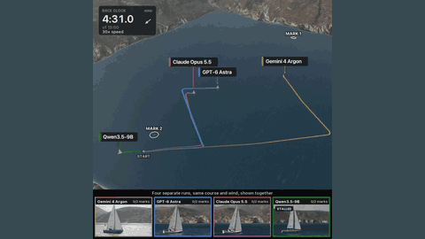

# LLM sailing race (r/ClaudeAI sailing sim)

A hobby 3D sailing simulator, written with Claude Code, in which language models race a sailboat round a two-mark course by setting helm and sails every 5 s of simulated time from 23 numbers, with the simulation paused while each model thinks.

*Race clock 4:30 to 7:27 (shown at 30 times speed) of the launch video: four separate runs (Gemini 4 Argon, GPT-6 Astra, Claude Opus 5.5, Qwen3.5-9B) on the same course and wind, overlaid as coloured tracks over a 3D coast, with each boat's camera below; a recording of completed runs, not live play. Source: [u/abhi3188, "I built a sailing sim with Claude Code and made the frontier models race each other in it", r/ClaudeAI, 6 November 2026](https://www.reddit.com/r/ClaudeAI/comments/1xpij9t/i_built_a_sailing_sim_with_claude_code_and_made/).*

| | |
|---|---|
| Year | Nov 2026 |
| Authors / org | Reddit user u/abhi3188 (personal project; no affiliation stated) |
| Links | [Reddit post](https://www.reddit.com/r/ClaudeAI/comments/1xpij9t/i_built_a_sailing_sim_with_claude_code_and_made/) (6 November 2026) with a 38 s video; follow-up videos in the author's comments: [three open models against GPT-6 Astra](https://www.reddit.com/r/ClaudeAI/comments/1xpij9t/comment/19s8tt5jbdf0i/) and [four Claude models](https://www.reddit.com/r/ClaudeAI/comments/1xpij9t/comment/19s9bcxzf4m68/); no repo, game page or write-up |
| Demo | race videos only (recordings of finished runs, four runs overlaid). Not playable: no public build. Human-playable: no. |
| Play mode | paused-live |
| Clock | STEP: one decision per 5 s of simulated time, simulation paused during each model call; 15 min simulated time limit |
| Observation | text: 23 raw numbers (heading, speed, wind, next-mark position and others) |
| Action | helm and sail settings (continuous or discrete not stated) |
| Players | 1 per run (runs overlaid in the video, no interaction between boats) |
| Horizon | 15 min of simulated time, so at most about 180 decisions |
| Human reference | none |
| Open source | no (author: "i havent even pushed to github yet") |
| Convertible to realtime-live | yes in principle (a continuous physics simulation; run it on the wall clock and apply the latest helm and sail setting), but only by the author while the code is private |
| Basis | post text: "every 5 secs each model gets the full state of the world (23 raw numbers ...) and sets its helm and sails ... The sim pauses while it thinks, so slow models aren't punished"; no code to check |

## Details

- LLM sailing race (posted 6 November 2026 on r/ClaudeAI by u/abhi3188). The author says Claude Code wrote "basically all of it (the boat physics, wind, the 3D water and coast, and the setup that lets AI models sail it)" while the author directed and checked the results.
- What it tests: whether a language model, given only raw numbers and no sailing tips ("No sailing tips"), can sail a boat upwind to a mark and back. The course in all three videos is "Upwind to mark 1, then back to mark 2, in 15 minutes".
- How a run works (from the post): every 5 s of simulated time each model receives "the full state of the world (23 raw numbers like heading, speed, wind, where the next mark is etc)" and sets its helm and sails. The simulation pauses while the model thinks. Each model races alone; the video overlays four separate runs "same course and wind, shown together". In comments the author added that wind speed and direction change during a run, reasoning effort was set to maximum for every model, and a mark counts once the boat is within 10 m of it (the author called this rounding rule too loose: "should update that").
- Scoring: marks rounded (0, 1 or 2) and finishing time within the 15-minute limit; the end cards also give distance short of the next mark for unfinished runs. The post also compares cost per run.
- Results, launch video (first test, two runs per model, one shown each): Gemini 4 Argon finished in 783.1 s, first to finish; GPT-6 Astra finished in 899.4 s, 0.6 s inside the limit; Claude Opus 5.5 ran out of time 26 m short of mark 1; Qwen3.5-9B ran aground at 590 s after drifting backwards onto the beach. The end card says only GPT-6 Astra finished in both test runs. The post says Argon cost $0.78 per run against $3.58 for Astra.
- Results, follow-up videos (one run per model): GPT-6 Astra finished in 894.1 s, while Kimi K3, DeepSeek V4 Pro and GLM-5.3 all ran out of time 262 m, 782 m and 796 m short of mark 1 (the author says Kimi cost about twice Astra). Among Claude models, Fable 5.1 rounded mark 1 and ran out of time 411 m short of mark 2; Opus 5.5, Sonnet 5.5 and Haiku 5.5 ended 26 m, 161 m and 832 m short of mark 1. The author also says Jev "could not get out of the starting gate".
- Caveats: one or two runs per model on a single course, no published observation schema, action format, prompt or code, and no human baseline. The tracks in the video show boats pausing; one commenter wrote that the author had said elsewhere that inference time is not shown in the video and that those pauses were time when the boat should have been sailing. That statement by the author was not found in the 177 comments readable through the post's public RSS feed, and it is unclear what the "STALLED" badges on the boat cameras mean (a stalled sail or a paused model). The post text, which says the simulation pauses while the model thinks, is taken as the basis.
- Not the same project as the local Sailrunner game (huikang-games, deployed at gstar-2026-team-project.github.io/huikang-games/sailrunner/): Sailrunner is a human-played daily buoy race with a leaderboard and replays, and its game code has no language-model harness. The Reddit project is a different author's 3D simulator.

## Demo

- [recording] [Launch video on the Reddit post](https://www.reddit.com/r/ClaudeAI/comments/1xpij9t/i_built_a_sailing_sim_with_claude_code_and_made/) — The Reddit page showed a "Prove your humanity" challenge in the headless browser, so the post and comments were read through Reddit's public RSS feed and the three videos were fetched directly from v.redd.it without signing in. The 38 s, 1080x1080 launch video shows a 3D coastline from above with a start line and two marks, four coloured tracks (one per model) labelled with model names, a race clock "of 15:00" played at 30 times speed (12 times slow motion near the marks), a wind arrow, and a strip of four boat cameras with marks rounded and status badges (STALLED, AGROUND, FINISHED). It ends on a results card. The two follow-up videos (37 s and 44 s, 720x720) have the same layout. Play-mode evidence: the videos are replays of finished runs on the simulated clock and show nothing about model latency; the paused-live label rests on the post text.
- No playable game, game page or repository was found (a GitHub search for a matching repository found none, and the author said on 6 November 2026 that the code was not yet on GitHub).

Visited 10 November 2026 in a headless browser.

## Fit

realtime no as run (the simulation pauses for each decision), though the physics would run on a wall clock; verifiable yes (marks rounded and finishing time are computed by the simulator); single yes (each run is one boat alone); human-easy probably (steering a dinghy round two marks is a casual game skill, but no human baseline); short yes (15 minutes of simulated time, about 180 decisions). Worth copying: a continuous-control task where the decision interval (5 s) is long compared with the physics, so the same simulator could be run paused, on a token clock or on the wall clock, and the result (marks, time, distance short) is a clean score. Not usable as is because the code is private.

Related: [Real-Time Reasoning Gym](realtime-gym.md); [tmrl / rtgym (TrackMania)](tmrl-rtgym.md); [Gran Turismo Sophy interface](gran-turismo-sophy.md); [LLM Colosseum](llm-colosseum.md); [Will GPT-4 Run DOOM](will-gpt-4-run-doom.md)
