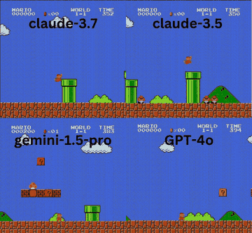

# LMGame-Bench

LMGame-Bench evaluates models on Super Mario Bros., Tetris, Sokoban, Candy Crush, 2048 and Ace Attorney, paused-live.

*Recording of claude-3.7, claude-3.5, gemini-1.5-pro and GPT-4o playing Super Mario Bros. side by side (the authors' edited 2x2 comparison of early GamingAgent runs, with each panel's NES TIME counter running), 5 s excerpt. Source: [lmgame.org](https://lmgame.org/).*

| | |
|---|---|
| Year | May 2025 |
| Authors / org | Hu et al. (UCSD, MBZUAI, Berkeley) |
| Links | [arXiv 2505.15146](https://arxiv.org/abs/2505.15146), [GamingAgent repo](https://github.com/lmgame-org/GamingAgent) (MIT) |
| Demo | [site](https://lmgame.org/) + [HF leaderboard](https://huggingface.co/spaces/lmgame/lmgame_bench) (the game_arena_bench URL redirects here): a static leaderboard plus GIF/YouTube galleries of recorded model runs. These are 2x2 comparison edits; the harness videos are aligned by 'Step N' (the game waits for each action), and the older Mario clips show the NES timer running. Human-playable: no; there are no live runs or replay viewer, and 'Try Now' links to the GitHub repo. |
| Play mode | paused-live |
| Clock | STEP (code read) |
| Observation | screenshots (+ text harness) |
| Action | game inputs |
| Players | 1 |
| Horizon | short to medium |
| Human reference | none |
| Open source | MIT |
| Convertible to realtime-live | yes for Mario, Tetris |
| Basis | code: `lmgame-bench/single_agent_runner.py` (`agent.get_action` then `game_env.step`); `superMarioBrosEnv.py` repeats the action for its frame count |

## Details

- LMGame-Bench: Hu et al. (UCSD, MBZUAI, Berkeley), ICLR 2026, [arXiv 2505.15146](https://arxiv.org/abs/2505.15146); [GamingAgent repo](https://github.com/lmgame-org/GamingAgent) (MIT). Super Mario Bros., Tetris, Sokoban, Candy Crush, 2048, Ace Attorney. Paused-live, confirmed in code: `lmgame-bench/single_agent_runner.py` loops `agent.get_action(...)` then `game_env.step(...)`, and the emulator advances only inside `step`. In the Mario environment (`gamingagent/envs/retro_01_super_mario_bros/superMarioBrosEnv.py`) the model's action string carries a frame count and `step` repeats the button press for that many emulator frames; inference time is logged (`time_taken_s`) but not charged. With harness, o3 scores Mario 3445, Tetris 42. No human scores.
- Convertibility: good for Mario and Tetris (NES at 60 fps; Tetris has gravity pressure). The puzzle games have nothing to convert. The harness's perception module (an o3 call per frame) would itself break under a clock.

## Demo

- [project-page] [lmgame.org](https://lmgame.org/) — Loaded the site, visited Blog and About Us, and downloaded two carousel GIFs (mario_demo, 5374 frames; tetris-demo, 5438 frames) to inspect frames. A landing page ('AI vs. AI and Human vs. AI') with a carousel of six GIFs (Tetris, 2048, Ace Attorney, Candy Crush (o3-mini), Mario, Sokoban); 'Try Now' links to github.com/lmgame-org/GamingAgent; About says 'Lmgame hosts live computer games for AI evaluations'. Nothing is playable in the browser, with no live runs or replay viewer; network requests were only static GIFs and analytics. Play-mode evidence (recording): the Mario GIF is an edited 2x2 grid (claude-3.7, claude-3.5, gemini-1.5-pro, GPT-4o) with 'GAME OVER' overlays and NES TIME counters that differ per panel and count down (e.g. claude-3.7 at 289), so the timer kept running while recording; the Tetris GIF is a screen capture of a macOS 'Python Tetris' window.
- [leaderboard] [lmgame HF leaderboard](https://huggingface.co/spaces/lmgame/game_arena_bench) — The URL redirects to huggingface.co/spaces/lmgame/lmgame_bench (Running); opened the Gradio app directly and went through the Model Leaderboard, Agent Leaderboard and Gallery tabs. Per-game scores for SMB, Sokoban, 2048, Candy Crush, Tetris and Ace Attorney: 24 models (o3 first at 66.17) and 5 models in the GamingAgent-harness leaderboard (o3 at 87.69), plus a Colab notebook link. The Gallery has news items from Feb to Jun 2025 with 11 embedded YouTube videos. Play-mode evidence: static scores and recorded videos; nothing runs live and viewers cannot play.
- [video] [lmgame 'mario' YouTube video](https://www.youtube.com/watch?v=nixMIJZYAgg) — Watched three gallery videos on YouTube watch pages (embeds showed Error 153), taking frames at about 10% and 40%: 'mario' (90 s), 'Claude-sonnet-4 & Claude-opus-4 Highlights' (53 s; 4CV-fB5EVJs) and 'R1 Tetris Highlight Performance' (26 s; m6i9L6-pgu4). They are edited 2x2 model comparison grids; the 2025 harness videos show a side panel with Game, Model, 'Harness: True' and GAME STATUS (Step N, Action, Current Reward, Total Reward). Play-mode evidence (recording): all four Tetris panels show the same 'Step: 52' and the Claude-4 grid shows 'Step: 48' or 'Step: 189' with actions like 'hard_drop', a step-indexed loop where the game waits for each action, aligned by step in the edit. The older Mario video shows NES TIME counters ticking down at different values per panel (365, 363, 396, 363 at about 9 s), which fits early GamingAgent Mario runs where the in-game clock kept running; the ICLR 2026 slides say the benchmarked Mario setup pauses the game until the model responds.
- Note: the file labels play mode as paused-live, but the homepage Mario GIF and the older 'mario' YouTube video show the NES TIME counters counting down at different values per panel during recorded runs, so the in-game clock kept running in those (early GamingAgent) runs; the newer harness videos are step-aligned, consistent with paused-live.

Visited 10 November 2026 in a headless browser.

Related: [gym-super-mario-bros](gym-super-mario-bros.md); [stable-retro / Gym Retro](stable-retro.md)
