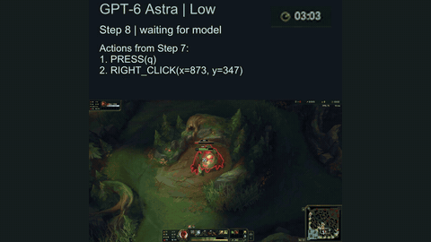

# LOLPlay

LOLPlay is a set of 36 champion-specific tasks in the native League of Legends client, played realtime-live on the wall clock.

*A recording of GPT-6 Astra (low effort) playing Lee Sin in League of Legends on LOLPlay Task002, with the wall clock running: its status goes from "waiting for model" to "executing action batch" (Q skillshot on a jungle camp, level up) to the next step while the in-game timer moves from 03:04 to 03:09. Rearranged from the left pane of the side-by-side video (status panel and timer enlarged and moved above the game view). Source: [Clip from the LOLPlay project page (answers111.github.io/LOL-Play-homepage), Zhaojian Yu et al.](https://answers111.github.io/LOL-Play-homepage/).*

| | |
|---|---|
| Year | Nov 2026 |
| Authors / org | Zhaojian Yu |
| Links | [arXiv 2611.03685](https://arxiv.org/abs/2611.03685), code [answers111/LOLPlay](https://github.com/answers111/LOLPlay) (read; no licence file) |
| Demo | [project page](https://answers111.github.io/LOL-Play-homepage/) with a [side-by-side recorded video](https://answers111.github.io/LOL-Play-homepage/assets/videos/task002-comparison.mp4): GPT-6 Astra vs DeepSeek-v4.1-Flash on one 10-minute task, with step counters, action logs and 'waiting for model' status overlays. The game keeps running during inference (the in-game AFK warning appears while the model is thinking). The page also has a leaderboard with per-request latency and a catalog of the 36 tasks. No interactive replay viewer; human-playable: no. |
| Play mode | realtime-live |
| Clock | WALL |
| Observation | screenshots 1080p |
| Action | mouse/keyboard |
| Players | 1 (+bots) |
| Horizon | 5-20 min |
| Human reference | 2 players, 36/36 |
| Open source | repo open (licence file not present) |
| Convertible to realtime-live | n/a |
| Basis | paper §3: "The environment keeps running while the agent generates its response and executes the actions"; repo README: "Gameplay continues during model reasoning and action execution" |

## Details

- Zhaojian Yu. [arXiv 2611.03685](https://arxiv.org/abs/2611.03685); code [answers111/LOLPlay](https://github.com/answers111/LOLPlay) (read; no licence file). The repo README states "Gameplay continues during model reasoning and action execution".
- Tasks: 36 champion-specific tasks with 82 subgoal checks in the native League of Legends client (farming, development, sustain, combat, cooperation, map objectives), 5-20 minute budgets, at most 100 model responses.
- Play mode: realtime-live, wall clock. The paper states the environment keeps running while the agent generates and executes.
- Observation: 1920x1080 screenshots only. Action: mouse/keyboard, several actions per response. Scoring through Riot's Live Client Data API, which the agent cannot see.
- Human reference: two experienced players completed 36/36 (stated in the full text as a feasibility check, not a population estimate; the abstract does not mention it).
- Results: best task success 25.0% (GPT-6 Astra, low and medium effort), 16.7% at high effort; pooled 40 of 324 runs pass. Mean latency 6.5 s. Higher effort never improved task success.

## Demo

- [project-page] [LOLPlay homepage](https://answers111.github.io/LOL-Play-homepage/) — Loaded the static page and played its one recorded side-by-side MP4 (task002-comparison.mp4, 10:13): GPT-6 Astra (low effort) vs DeepSeek-v4.1-Flash (low effort) on Task002 (Lee Sin, first elemental dragon within 10 minutes), with step counter, agent status and action-log overlays; the page also has a leaderboard (best 25.0%, mean request latency 2.8-16.7 s) and a catalog of the 36 tasks with 82 subgoal checks. Nothing to play and no trajectory stepping; network requests show only static files. Play-mode evidence (recording): at 1:31, 5:37 and 9:54 GPT-6 Astra's screen shows the in-game "AFK Warning" while its status reads "waiting for model" (steps 3, 15, 29), while DeepSeek is at step 23 or 76, so the game clock kept running during inference. The page says "Gameplay continues during model reasoning and action execution" and that these illustrative runs are separate from the benchmark results; the Task035 case study cites a 144.641-second request during which a kill and a death were logged.

Visited 10 November 2026 in a headless browser.

## Fit

the closest published thing to "LLM plays DOTA". Realtime yes; verifiable yes; single yes; human-easy only for players who know the game; horizon too long for cheap training. Running bots on the LoL client may conflict with Riot's terms (not assessed).

Related: [Dota 2 bot API / dotaservice](dota-2-bot-api.md)
