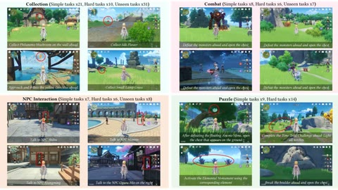

# Lumine evaluation settings

Lumine is evaluated in two regimes: long main-storyline missions run realtime-live, and a 141-task benchmark run paused-live for every agent.

*Figure from the paper showing example in-game screenshots and instructions for the paused-live 141-task Genshin Impact benchmark across its four categories (Collection, Combat, NPC Interaction, Puzzle), with simple, hard and unseen task counts. Source: [Lumine paper, Figure 8 (arXiv 2511.08892)](https://arxiv.org/html/2511.08892).*

| | |
|---|---|
| Year | Nov 2025 |
| Links | [arXiv 2511.08892](https://arxiv.org/abs/2511.08892) |
| Demo | [Lumine](https://www.lumine-ai.org/): project page with short recorded task clips and full-length YouTube playthroughs (Genshin Mondstadt 5h, Liyue 7h, Star Rail 7h at 4x, Wuthering Waves 1h46m); one combat clip shows the in-game timer running. All recorded video, with no live model or replay viewer; human-playable: no. |
| Play mode | realtime-live (main-storyline missions) + paused-live (141-task benchmark, every agent) |
| Open source | Not an open environment |

## Details

- **Lumine** (2025), [arXiv 2511.08892](https://arxiv.org/abs/2511.08892): two regimes. The long main-storyline missions are realtime-live ("All the experiments are run in a real-time setting"). The 141-task benchmark is paused-live for every agent, Lumine included: "Since API responses can take as long as 30 seconds to return, we pause the game during inference following the setup in Cradle" (evaluation setting, which applies to "all agents"). Not an open environment. Covered in [Lumine](../solutions/lumine.md) on the solutions side.

## Demo

- [project-page] [Lumine project page](https://www.lumine-ai.org/) — Scrolled the ByteDance Seed page, logged 24 looping MP4 clips (7-87 s, 1280x720) from cloud.video.taobao.com and 6 YouTube iframes, seeked 8 clips to their midpoint and resolved the YouTube titles via oEmbed (the YouTube videos were not played). It describes a VLM agent seeing pixels at 5 Hz and outputting 30 Hz keyboard-mouse actions with adaptive reasoning; full playthroughs on YouTube: Genshin Mondstadt Act I (56 min), Act II and III (4h43m), Liyue Act I (7h16m, "edited version"), Honkai: Star Rail Herta Space Station (7h18m, "4x speed") and Wuthering Waves (1h46m); short clips cover combat, boss fights (Electro Hypostasis, Stormterror), puzzles, NPC talk, GUI use and complex instructions. Play-mode evidence (recording): the page says the agent acts "in real time" and one combat clip shows the in-game timer running (00:33 in a domain challenge), consistent with unpaused play; no latency readout, and the paper's paused 141-task benchmark is not shown.

Visited 10 November 2026 in a headless browser.

Related: [Lumine](../solutions/lumine.md); [Cradle](cradle.md); [SIMA evaluation environments](sima.md)
