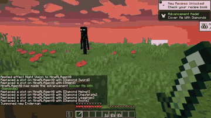

# MCU / MineStudio

MCU is a Minecraft evaluation suite that runs on MineStudio's vendored copy of the MineRL simulator, with 20 Hz synchronous stepping.

*Recorded episode of an agent doing the MCU "Combat Enderman" task in the MineStudio simulator, closing in on a summoned Enderman (4 s excerpt, real speed). Source: [MCU project page, CraftJarvis](https://craftjarvis.github.io/MCU/).*

| | |
|---|---|
| Year | 2016-22 |
| Demo | [MCU project page](https://craftjarvis.github.io/MCU/): a project page with 18 recorded MP4 clips of agents doing MCU tasks (16 example tasks plus a simple/hard "sleep in bed" pair). Some clips overlay the task prompt and the per-step keyboard/mouse action readout. These are offline recordings; no clip shows a model playing live against a running clock, and nothing on the page can be played. |
| Play mode | paused-live (MineRL, MineDojo, MCU/MineStudio) + realtime-live (native Malmo) |
| Clock | STEP at 20 Hz |
| Observation | pixels (+ some state) |
| Action | mouse/keyboard |
| Players | 1 |
| Horizon | minutes to hours |
| Human reference | n/a |
| Open source | MIT; Malmo archived |
| Convertible to realtime-live | medium |
| Basis | MineStudio `minestudio/simulator/minerl/env/_multiagent.py` |

## Details

- **MineRL / MineDojo / MCU**: 20 Hz synchronous stepping (code: MineRL `_multiagent.py` sync token and `TICK_LENGTH = 0.05`; MCU runs on MineStudio's vendored copy); a wall-clock wrapper works only if the simulator sustains 20 Hz. Heavy and long-horizon.
- Game-TARS's Minecraft (MCU) runs use a synchronous simulator (MineStudio), so they are paused-live.

## Demo

- [project page with videos] [MCU: An Evaluation Framework for Open-Ended Game Agents](https://craftjarvis.github.io/MCU/) (linked from the [CraftJarvis/MCU](https://github.com/CraftJarvis/MCU) README). I rendered the page, played the first three clips, and paused two clips to look at single frames. Under "Example tasks" there are 16 MP4 clips, all 640x360, from videos/build_nether_portal.mp4 (37.1 s) to videos/prepare_birthday_gift_for_your_neighbor.mp4 (155.7 s), with tasks such as "Mine Diamond", "Combat Enderman" and "Craft Clock". Two more clips, "Simple: Outdoor Bed" and "Hard: Indoor Bed", come with the text "moving the bed from outdoors to a furnished room caused GROOT to misidentify the bed or leave the area". The frame at 0:12 of sleep_in_bed_hard.mp4 shows "TASK: sleep in bed during night, place a…" and a per-step action readout ("attack: 0, back: 0, forward: 0, … hotbar.1: 0 …"). Play-mode evidence (recorded): these are static video files. The page says "trajectories are recorded as videos and analyzed by a VLM (GPT-4o)" after the episode ends, so it gives no sign of wall-clock pressure on the agent. This fits the paused-live label.
- The [MineStudio docs](https://craftjarvis.github.io/MineStudio/) (the repo's homepage field) have only a banner image and badges, with no videos or interactive viewer.

Visited 10 November 2026 in a headless browser.

Related: [MineRL](minerl.md); [Game-TARS game suite](game-tars.md); [Game-TARS](../solutions/game-tars.md)
