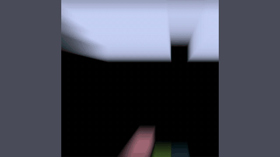

# MinAtar

MinAtar is a miniature Atari suite with tiny, text-serialisable state.

*Recording of a trained DQN agent (not an LLM) playing MinAtar Breakout on its 10x10 grid: the teal paddle at the bottom returns the ball (pink and green cells: the ball and its trail) into the brick rows; no clock is shown. Source: [Kenny Young, MinAtar breakout (YouTube)](https://www.youtube.com/watch?v=cFk4efZNNVI).*

| | |
|---|---|
| Year | Mar 2019 |
| Demo | [repo README GIFs](https://github.com/kenjyoung/MinAtar) and official YouTube videos (e.g. [MinAtar breakout](https://www.youtube.com/watch?v=cFk4efZNNVI)): looping GIFs of all five games and screen recordings of a trained DQN agent (not an LLM) playing. Recordings only; human play needs the local `examples/human_play.py` GUI. |
| Play mode | paused-live (Dino browser is realtime-live) |
| Clock | STEP at about 30 fps |
| Observation | numeric state or pixels |
| Action | 1-few buttons |
| Players | 1 |
| Horizon | seconds |
| Human reference | easy |
| Open source | MIT |
| Convertible to realtime-live | high |
| Basis | MinAtar README step loop |

## Details

- **Flappy Bird**, **PLE**, **MinAtar**, **PyBoy**: tiny, text-serialisable state, one or two buttons. Ideal for latency-versus-score curves.
- Anokhin et al., Handling Delay in Real-Time RL (2025), [arXiv 2503.23478](https://arxiv.org/abs/2503.23478): per-layer delay; MinAtar and MuJoCo (framing paper).

## Demo

- [GIFs] [kenjyoung/MinAtar README](https://github.com/kenjyoung/MinAtar) — Opened the repo page and scrolled to the README media; five looping 600x600 GIFs titled "Seaquest", "Breakout", "Asterix", "Freeway", "Space Invaders" (img/seaquest.gif, img/breakout.gif, etc.) show the 10x10 coloured-cell games in motion, plus animated result plots (img/sensitivity_curves.gif, img/learning_curves.gif). Play-mode evidence (recording): the GIFs are pre-rendered and show no agent, clock or step counter.
- [official-video] [MinAtar breakout (YouTube)](https://www.youtube.com/watch?v=cFk4efZNNVI) — Played muted and seeked to 0:20 of 1:26 (1280x720); the description reads "Trained DQN agent on the miniaturized version of breakout from the MinAtar platform." The frame shows the brick block, the ball with its trail cell and the paddle. The README links one such video per game ("a video of a trained DQN agent playing"): [Asterix](https://www.youtube.com/watch?v=Eg1XsLlxwRk), [Freeway](https://www.youtube.com/watch?v=gbj4jiTcryw), [Seaquest](https://www.youtube.com/watch?v=W9k38b5QPxA), [Space Invaders](https://www.youtube.com/watch?v=W-9Ru-RDEoI). Play-mode evidence (recording): an offline RL agent, not an LLM, with no wall-clock or latency readout. No web-playable version or replay viewer exists; the README's GUI (`examples/human_play.py`, `examples/agent_play.py`) runs locally only.
- Note: the GitHub repo page shows a "GPL-3.0 license" (the README also ends with GPL text), while this file's Open source row says MIT.

Visited 10 November 2026 in a headless browser.

Related: [Flappy Bird](flappy-bird.md); [PLE](ple.md); [Chrome Dino](chrome-dino.md); [PyBoy](pyboy.md); [ALE / Atari](ale-atari.md)
