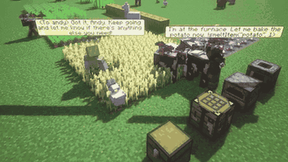

# MINDcraft

MINDcraft issues high-level commands on a live Minecraft server.

*Recording of two LLM bots in a MineCollab cooking task: one says "I'm at the furnace. Let me bake the potato now. !smeltItem("potato", 1)" while the other replies in chat as the world keeps moving. Source: [MineCollab project page, "Cooking Footage and Communication Showcase" video](https://www.youtube.com/watch?v=FbNJ3cR_RWY).*

| | |
|---|---|
| Year | Aug 2023 |
| Links | [arXiv 2504.17950](https://arxiv.org/abs/2504.17950) |
| Demo | [project page](https://mindcraft-minecollab.github.io/): static leaderboard plus 11 recorded YouTube clips (timelapses and showcases of LLM bots building, cooking and crafting with chat and !command bubbles, including failure cases); no replay viewer or hosted live demo. You can run it yourself on a live Minecraft server via [github](https://github.com/kolbytn/mindcraft); human-playable in browser: no. |
| Play mode | scripted (Voyager, Odyssey: server paused during LLM calls) / realtime-live (MINDcraft) |
| Clock | server 20 TPS |
| Observation | structured state |
| Action | JS skills / commands |
| Players | 1+ |
| Horizon | long |
| Human reference | none |
| Open source | open |
| Convertible to realtime-live | restrict to low-level controls |
| Basis | MINDcraft `src/agent/tasks/tasks.js:378-387` wall-clock timeout, no server pause |

## Details

- Minecraft code agents: Voyager, Odyssey, MINDcraft.
- MINDcraft ([arXiv 2504.17950](https://arxiv.org/abs/2504.17950)) issues high-level commands on a live server.
- Convertibility: the server already runs at 20 TPS and at least one harness runs unpaused (Parallelized Planning-Acting, [arXiv 2503.03505](https://arxiv.org/abs/2503.03505)). To make latency bite, restrict actions to low-level controls and score survival time or kills in a short arena. The high-level API otherwise hides all sensorimotor difficulty.

## Demo

- [project-page] [MineCollab project page](https://mindcraft-minecollab.github.io/) — Read the page, clicked the static sortable leaderboard (Claude-3.5-Sonnet 0.49, GPT-4o 0.29, LLaMa-70B 0.24, LLaMa-8B-SFT 0.23, LLaMa-8B 0.01, split by Cooking/Crafting/Construction), and played 5 of its 11 YouTube embeds muted with frames at 15/50/85%. The clips are recorded and edited: a 26 s 3x3 montage, construction timelapses ('AI collab / pyramid timelapse' 40 s, 'church decent' 33 s, a communication showcase, a church-build failure), cooking clips ('AI collab / Cooking' 129 s) and crafting clips (a bookshelf success, and 'useless talk' 26 s where the agents go looking for spiders); frames show bots 'andy' and 'randy'/'mandy' with LLM chat bubbles containing commands such as !smeltItem("potato", 1), !startConversation("randy", ...), !goToPlayer, !searchForBlock("furnace", 64) and !craftRecipe. Play-mode evidence (recordings): the bots keep moving and the world keeps going between chat messages on a live Minecraft server, but the timelapse editing and the lack of timestamps or latency readouts mean response time cannot be measured; network requests were only YouTube and Google Fonts, and nothing is playable in the browser.
- [project-page] [MINDcraft blog post](https://sites.uci.edu/kolbynottingham/2024/10/30/mindcraft/) — Read the post by Kolby Nottingham and Max Robinson. It explains that MINDcraft is a Node.js tool on Mineflayer whose handleMessage loop is triggered by chat, prompts the LLM, runs any returned command and prompts again, with query commands (!inventory, !nearbyBlocks), action commands and a newAction code-writing mode. Play-mode evidence (text only): event-driven loop on a live server that does not wait for the LLM, with Mineflayer carrying out low-level actions asynchronously. No demo on the page.
- [video] [mindcraft tutorial video](https://www.youtube.com/watch?v=gRotoL8P8D8) — Read the metadata and checked frames at 15/50/85% of "How to Play Minecraft with AI (mindcraft tutorial)" by Emergent Garden (941 s). It is an install tutorial for the [mindcraft repo](https://github.com/kolbytn/mindcraft), not a hosted demo. Play-mode evidence (recording): humans chat with the bot on a live, self-hosted Minecraft server.

Visited 10 November 2026 in a headless browser.

Related: [Voyager](voyager.md); [Odyssey](odyssey.md); [Mineflayer](mineflayer.md); [Parallelized Planning-Acting](../solutions/parallelized-planning-acting.md)
