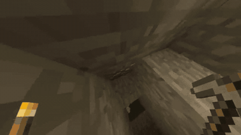

# MineRL

MineRL is a Minecraft environment with 20 Hz synchronous stepping.

*A 4.5 s clip from the official MineRL Competition 2019 trailer: a recording of first-person Minecraft play, mining down a tunnel with a pickaxe and torch toward an ore block; the trailer does not say whether a human or an agent is playing, and no timer is shown. Source: [Microsoft Research, MineRL Competition 2019](https://www.youtube.com/watch?v=ggo1WAldyq0).*

| | |
|---|---|
| Year | 2016-22 |
| Links | [MineRL](https://github.com/minerllabs/minerl) |
| Demo | [MineRL Competition 2019 video](https://www.microsoft.com/en-us/research/video/minerl-competition-2019/) (YouTube [ggo1WAldyq0](https://www.youtube.com/watch?v=ggo1WAldyq0)): official 66 s Microsoft Research trailer with first-person Minecraft mining footage and captions; a recording, not a model playing live. The docs ([minerl.readthedocs.io](https://minerl.readthedocs.io/en/latest/), Cloudflare-blocked in headless Chrome) embed short gameplay GIF clips. Not human-playable in the browser. |
| Play mode | paused-live (MineRL, MineDojo, MCU/MineStudio) + realtime-live (native Malmo) |
| Clock | STEP at 20 Hz |
| Observation | pixels (+ some state) |
| Action | mouse/keyboard |
| Players | 1 |
| Horizon | minutes to hours |
| Human reference | n/a |
| Open source | MIT; Malmo archived |
| Convertible to realtime-live | medium |
| Basis | code: MineRL `minerl/env/_multiagent.py` (token "# synchronous", `TICK_LENGTH = 0.05`) |

## Details

- **MineRL / MineDojo / MCU**: 20 Hz synchronous stepping (code: MineRL `_multiagent.py` sync token and `TICK_LENGTH = 0.05`; MCU runs on MineStudio's vendored copy); a wall-clock wrapper works only if the simulator sustains 20 Hz. Heavy and long-horizon.

## Demo

- [video] [MineRL Competition 2019 (Microsoft Research)](https://www.microsoft.com/en-us/research/video/minerl-competition-2019/) — Opened the page (dated June 13, 2019, Noboru Sean Kuno); the embedded youtube-nocookie player (ggo1WAldyq0) gave "Error 153" headless, so watched it at [youtube.com/watch?v=ggo1WAldyq0](https://www.youtube.com/watch?v=ggo1WAldyq0), duration 65.9 s, seeking to 10, 40 and 65.9 s. It is a promotional trailer over first-person Minecraft footage (tunnelling with a pickaxe, torch in hand) with captions "This challenge opens up a new frontier of Machine Learning research.", "Your agent must obtain a diamond in Minecraft using only four days of training time." and "It's up to you to be a fast teacher." Play-mode evidence (recording): no step counter, tick rate or agent/human label is shown, so it says nothing about the 20 Hz synchronous stepping.
- [project-page] [MineRL docs](https://minerl.readthedocs.io/en/latest/) (the repo homepage http://minerl.io/docs/ redirects here) — Could not view it: headless Chrome stayed on a Cloudflare "Performing security verification" page. Read the same front page source on [GitHub (docs/source/index.rst)](https://github.com/minerllabs/minerl/blob/dev/docs/source/index.rst) instead; it embeds GIF clips survival1-4, survival6 and orion1 (`assets/*.mp4.gif`), and the repo's docs assets also hold per-environment clips (navigate1-4.mp4.gif, BASALT clips such as caves1_0-05.gif, house_long_7-00.gif) and minerl_viewer.gif. Play-mode evidence (recording): short silent gameplay GIFs (not viewed frame by frame; index.rst does not say whether they are human or agent play); no timing readout.

Visited 10 November 2026 in a headless browser.

Related: [MineDojo](minedojo.md); [Malmo](malmo.md); [MCU / MineStudio](mcu-minestudio.md); [VPT](../solutions/vpt.md); [DreamerV3 / Dreamer 4](../solutions/dreamer.md); [STEVE-1](../solutions/steve-1.md); [GROOT](../solutions/groot.md); [ROCKET](../solutions/rocket.md); [JARVIS-VLA](../solutions/jarvis-vla.md)
