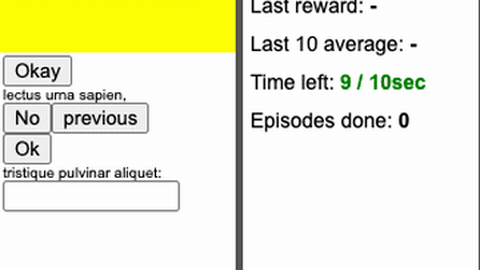

# MiniWoB++

MiniWoB++ is a suite of more than 100 short web tasks whose episode timer is wall clock with a 10 s default and a time-decayed reward, so it is realtime-live out of the box.

*Real-time screen capture of the official click-button browser demo played by a simple scripted clicker (not a model) across three episodes, with the "Time left: N / 10sec" countdown and the time-decayed rewards (0.81, 0.87, 0.76) in the side panel. Source: [Farama MiniWoB++ demo](https://miniwob.farama.org/demos/miniwob/click-button.html).*

| | |
|---|---|
| Year | Feb 2018 |
| Authors / org | World of Bits (Shi et al., 2017); MiniWoB++ (Liu et al., 2018); Farama |
| Links | [docs](https://miniwob.farama.org/content/reward/), [source](https://github.com/Farama-Foundation/miniwob-plusplus) |
| Demo | [docs](https://miniwob.farama.org/) / [task demos](https://miniwob.farama.org/demos/miniwob/click-button.html): every task can be played in the browser by a human, with a real-time countdown (10 s for most tasks, 15 s for simon-says). A correct click at about 2.5 s scored 0.74 (raw 1) and an idle timeout scored -1. No model is shown playing and there is no replay viewer (the Turk demonstrations are JSON files in a separate repo). Human-playable: yes. |
| Play mode | realtime-live natively (usually neutralised to paused-live) |
| Clock | 10 s wall timer, reward x (1 - t/10 s) |
| Observation | DOM + screenshot |
| Action | click/type/drag |
| Players | 1 |
| Horizon | 10 s |
| Human reference | yes (World of Bits) |
| Open source | MIT |
| Convertible to realtime-live | none needed |
| Basis | code: `miniwob/html/core/core.js` (`setTimeout(EPISODE_MAX_TIME)`, reward x `max(0, 1 - dt/EPISODE_MAX_TIME)`); `miniwob/reward.py` `get_raw_reward` "without time penalty" |
| Play mode (realtime computer use table) | realtime-live |
| Clock (realtime computer use table) | 10 s wall timer |
| Basis (realtime computer use table) | see RL-era table |

## Details

- World of Bits (Shi et al., 2017); MiniWoB++ (Liu et al., 2018); Farama. [Reward doc](https://miniwob.farama.org/content/reward/), [source](https://github.com/Farama-Foundation/miniwob-plusplus).
- Verified in `core.js`: the episode timer is wall clock with a 10 s default; positive reward is multiplied by max(0, 1 - elapsed/10 s); timeout gives -1. So it is realtime-live out of the box. Most LLM papers switch this off with reward processors (raw or binary reward) or longer timers, which makes their results paused-live in effect.
- Observation: instruction, structured DOM, screenshot. Action: click, drag, type. More than 100 tasks that humans finish in 1-3 s. Five tasks have no "no-delay" version and are inherently dynamic: chase-circle, moving-items, simon-says, button-delay, hover-shape.
- Shortlist rank 2 (MiniWoB++ with the original time-decayed reward): realtime out of the box, 10 s episodes, graded speed score, humans at 1-3 s, DOM text and screenshot channels. Include the five dynamic tasks that paused evaluations drop (chase-circle, moving-items, simon-says, button-delay, hover-shape). Cheapest to stand up and cheap enough to train on.

## Demo

- [playable] [MiniWoB++ click-button demo](https://miniwob.farama.org/demos/miniwob/click-button.html) — Played live in the browser from the Farama docs (each task page embeds /demos/miniwob/<task>.html). On click-button, clicked the correct button about 2.5 s in ('Click on the "okay" button.'), which logged 'reward: 0.7402 (raw: 1)'; in the next episode stayed idle until timeout, which logged 'reward: -1 (raw: -1)'. Also played chase-circle (10 s timer, reward 0.6669) and simon-says (15 s timer, 'reward: 1 (raw: 1)', no time decay). A side panel shows 'Last reward', 'Last 10 average', 'Time left: N / 10sec' and 'Episodes done'; no network requests during play. Play-mode evidence (played live): the countdown ran one second at a time on wall clock while idle and ended the episode at 0 s; the docs say 'any positive reward is scaled by the remaining time on the timer'. No model plays on the page; the recorded Mechanical Turk demonstrations are JSON files in a separate repo with a local viewer.html, not hosted.
- [playable] [BrowserGym HF Space (third-party)](https://burtenshaw-browsergym-env-95313e2.hf.space/web) — Found by web search and opened; did not run actions. It is a third-party OpenEnv/BrowserGym wrapper with a 'HumanAgent Interface' (Action Str text box, Step / Reset Environment / Get State buttons). Play-mode evidence: steps are user-driven (type an action, press Step), no timer is shown and no model plays live. Not an official MiniWoB++ demo.

Visited 10 November 2026 in a headless browser.

## Fit

5 of 5, and the cheapest realtime benchmark to stand up. Breakage: Selenium round-trip latency counts against the agent, and DOM serialisation is large.

Related: [OpenAI Universe](openai-universe.md) (shipped Mini World of Bits); [Realtime-Bench](realtime-bench.md)
