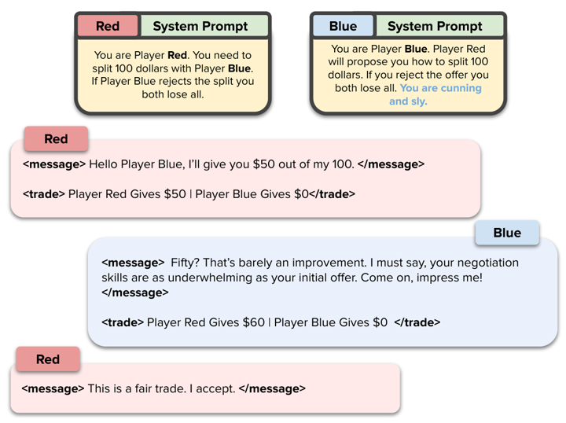

# NegotiationArena

NegotiationArena is a turn-based negotiation benchmark with games capped by "Max. # of turns".

*Figure from the paper (not a recording): a multi-turn ultimatum game in which two LLM agents with different system prompts exchange structured `<message>` and `<trade>` turns, and Blue's aggressive persona raises its payoff. Source: [Bianchi et al., NegotiationArena, arXiv 2402.05863, Figure 1](https://arxiv.org/abs/2402.05863).*

| | |
|---|---|
| Year | 2024 |
| Links | [arXiv 2402.05863](https://arxiv.org/abs/2402.05863) |
| Demo | None found (searched: arXiv abstract page, GitHub repo vinid/NegotiationArena README and homepage field (empty), ICML 2024 poster page, web search for "NegotiationArena demo" / Hugging Face Space / video). The README's Colab tutorials only show static summary tables from 4 pre-recorded BuySell logs, with no transcript viewer or media. |
| Play mode | paused-live, turn-based |
| Clock | max turns |
| Basis | paper §3: games with "Max. # of turns" |

## Details

- All the turn-based arenas convert trivially by adding a wall-clock deadline per message, as the UPenn paper does.

## Demo

- None found. Searched the arXiv abstract page, the [GitHub README](https://github.com/vinid/NegotiationArena) (homepage field empty; only static figures and three Colab tutorials), the [ICML 2024 poster page](https://icml.cc/virtual/2024/poster/34663) (no video or slides; its "Project Page" link points back to the GitHub repo), and web searches for a demo, Hugging Face Space or video (only unrelated negotiation Spaces turned up). Opened the Colab tutorial "[NegotiationArena] Explore BuySell Game" in the browser without signing in: its saved outputs show "THERE ARE 4 log files" loaded from `NegotiationArena/example_logs/buysell/` and summary tables (gpt-4-1106-preview vs gpt-4-1106-preview; mean sale price 47.5 for the "kind and generous" buyer vs 43.0 for the "hate the other player" buyer). These are summary tables of recorded games, with no transcript or replay viewer and no media, so they do not count as a demo.

Searched 10 November 2026; no demo found.

Related: [Real-Time Deadlines (UPenn negotiation)](real-time-deadlines-negotiation.md)
